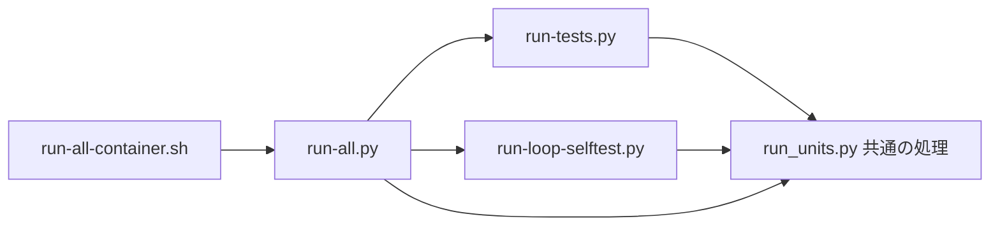

# テストの流し方(詳しい説明と時間の記録)

結論: 全回帰テスト(回帰テストをすべて流すこと)は `python3 -B scripts/run-all.py` の 1 つのコマンドで流す。
- 要点は [AGENTS.md](../AGENTS.md) の「検証」の節にある。この文書は、詳しい説明・決まり・時間の記録を持つ。
- 以前は、6 つのコマンドを別々に同時に始めていた。unittest は CPU の数の半分、loop-selftest は 4 分の 1 の枠(同時に動かすプロセスの数)を別々に持ち、先に終わった側の枠を、ほかが使えなかった。



## Rust の開発と検査(段階 0a)

Rust の検査は、既存の全回帰テストとは別に流す。段階 0a([Issue #442](https://github.com/Yuki-Maeda-valour/workflow/issues/442))で開発用の土台を作り、段階 0b([Issue #443](https://github.com/Yuki-Maeda-valour/workflow/issues/443))から入口と実行ファイル 3 本を同梱する。CI(変更を送るたびに自動で検査する仕組み)も、このソースの検査を続ける。
利用者向けの試し方と必要環境は [runtime-requirements.md](../plugins/dev-workflow/skills/do-task/references/runtime-requirements.md#rust-版を試す条件段階-1b) にある。
段階 1a([Issue #448](https://github.com/Yuki-Maeda-valour/workflow/issues/448))で検査した `resolve-task-dir` を、段階 1b([Issue #450](https://github.com/Yuki-Maeda-valour/workflow/issues/450))で配布する。共通入口・既存の呼び出し元・導入後の検査は、下の「段階 1b の配布と導入の検査」にある。

### Rust 1.99.1 の導入と外部の出力先

- `rustup`(Rust の版を入れて管理する道具)が無ければ、[Rust 公式の導入手順](https://rust-lang.org/tools/install/)で開発者が導入する。利用者への自動導入は加えない。
- [AGENTS.md の Rust の検査](../AGENTS.md#rust-の検査段階-0a)に、`rustup toolchain install 1.99.1` と、必要な `rustfmt`・`clippy` を入れるコマンドを置く。`native/rust-toolchain.toml` が使う版を選ぶため、全体の既定の版は変えなくてよい。
- Rust のビルドと依存の管理には Cargo を使う。依存の版を固定する `native/Cargo.lock` を共有し、ビルド・clippy(よくある誤りの検査)・テストに `--locked` を付ける。
- `CARGO_TARGET_DIR` は、リポジトリの外の空のフォルダにする。`mktemp -d` で作る例は `AGENTS.md` にある。`TMPDIR` を変えている場合も、作られる場所がリポジトリの外か確かめる。
- `native/target/` は無視する設定だが、通常の出力先には使わない。既存テストがコピーしたり走査したりする対象へ、ビルドの生成物を混ぜないため。
- `native/` の新しいソースは、Git の追跡対象に加えてからビルドする。入力の計算は Git の一覧を使う。Git が無い・一覧が取れない・空の場合はビルドを止める。
- `native/ci/build.py` は `CARGO_TARGET_DIR` を使い、未設定なら `RUNNER_TEMP/native-ci` を使う。どちらも指定が無ければ止める。リポジトリ内の出力先も拒否する。
- `RUSTFLAGS` などでビルド設定を上書きしない。最適化と絶対パスの置き換えは `native/Cargo.toml`・`native/.cargo/`、CI の設定は `native/ci/` に置く。

### 必須の検査と実行ファイルの指定

- コマンドの一覧は [AGENTS.md の Rust の検査](../AGENTS.md#rust-の検査段階-0a)にある。書式・clippy・Rust テスト、CI の定義と補助、配布物と比較の補助のテストをすべて流す。
- `native/ci/build.py test` は `native/ci/scripts/test_native_ci.py` を流す。Rust のビルドをせず、CI の補助を検査する。
- `scripts/test_native_distribution.py` と `scripts/test_support_native.py` は、既存の `scripts/run-all.py` にも自動で集められる。形式や比較の補助の検査にはテスト用の作り物を使う。
- 段階 0b では配布物を必須にし、`scripts/test_native_launch.py` で実際の配布物も起動する。これらの検査に Cargo は不要だが、配布物 3 本の欠落は失敗にする。
- 今回のソースから作った実行ファイルの検査は、`DEV_WORKFLOW_TEST_NATIVE_BINARY` にその実体を指定し、`native/ci/check_probe.py` と `native/ci/check_resolve_task_dir.py` で流す。配布した版の起動確認とは分ける。
  - 未設定・空文字・不在・実行不能は失敗にする。検査を飛ばさず、配布済みの実行ファイルへも切り替えない。
  - `check_probe.py` は `--version`・`--help`・`probe --json`・`probe --self-sha256` の出力と終了コードを確かめる。不正な引数の拒否、実行 CPU、自己の SHA256(内容の違いを確かめるための値)、作業フォルダの無変更も確かめる。
  - `check_resolve_task_dir.py` は、下の「タスク保存先の比較(段階 1a)」の条件で旧版と比べる。
  - `source_input_hash.py` で現在のソース入力を独立に計算し、`probe --json` の `source_input_sha256` と比べる。
- `run-all.py` は Cargo と `native/ci/` の検査を実行しない。`run-all-container.sh` も Cargo や外部ビルドの環境変数を渡さない。Mac で Linux 専用の全回帰テストを流さない。

### 共通の終了値と入出力の検査(C0a)

[Issue #453](https://github.com/Yuki-Maeda-valour/workflow/issues/453)の検査は、開発用ソースに追加した入出力の契約を確かめる。
配布物、C0bのファイル保護・上限、C0cの子プロセス監督の検査を完了したとは扱わない。

- `cargo test --locked` は、C0a時点で通常のRustテスト44件と、実プロセスを使う検査1件を実行する。4種類のCIでも同じコマンドを必須にする。
- `native/crates/core/src/output.rs` は、全256種類の終了値、無出力、非UTF-8とNUL、部分書込み、0バイト書込み、書込みと `flush` の失敗を検査する。
  - 途中の出力失敗を無視しても終了1になることを確かめる。後続出力の禁止と、診断の出力先・字面・回数も確認する。
  - 固定長バッファの範囲、短読、EOF、入力エラーを確認する。`Interrupted` も再試行せず返し、コマンドが専用の終了値を選べることを確かめる。
- `native/crates/cli/src/main.rs` は、登録表を通した引数と入出力の受け渡しを検査する。既存コマンドの引数・出力・終了値・無変更の検査も維持する。
- `native/crates/core/tests/command_io.rs` は、`harness = false` で登録した同じテスト実行物を子として起動する。外部サービスや孫プロセスは起動しない。
  - 子は標準出力・標準エラーを明示的な `BufWriter` で包む。改行のない途中出力を両方受け取るまで、親は入力を送らない。子が終了していないことも確認する。
  - 親は非UTF-8とNULを含む入力を送り、最終出力の生バイトと終了237を厳密に比較する。シグナル終了は合格にしない。
  - 途中出力の受信と子の終了待ちには、共通の20秒の期限を設ける。各出力の後半は最大128バイトまで読み、余分な出力を受理しない。
  - 失敗・時間切れでも直接の子へ `kill` と `wait` を行い、読取りスレッドを回収する。このテスト用の後片付けを製品の子プロセス監督とは扱わない。
- 今回作った実行ファイルで `check_probe.py` と `check_resolve_task_dir.py` を実行する。Linuxでの既存714件の比較と、下のMacで省略を許す条件を維持する。
  - `scripts/support_native.py` は変更しない。#448の承認済みの差を別コマンドへ広げず、通常の比較条件と比較補助のテストを維持する。
- PR前の全回帰テストは、管理担当が他の編集・検証を止めて単独で流す。最新mainを含む最終SHAと結果をPR本文へ記録する。
- その公開SHAに対するLinux・Macの必須CIの成功を確認してからマージする。手元のRust検査をPR用CIの成功と扱わない。
- C0aのMac実機と最低OSでの動作は未確認。MacのCI実行環境と、利用者の実機・最低OSでの実測は分けて記録する。

### 処理量と保持実体の検査(C0b)

[Issue #456](https://github.com/Yuki-Maeda-valour/workflow/issues/456)で、開発用の上限・保持実体・再検査を追加した。
配布は段階 1b・プラグイン v4.53.0 のまま。C0cの検査は下の節に記す。YAML解析、機密指定、状態走査は未着手である。
契約と後続の責務は [design.md](design.md#処理量と時間の上限保持実体の検査c0b)、公開APIは [native/README.md](../native/README.md#処理量と時間の上限保持実体の検査c0b)にある。

- `cargo test --locked` は、C0b時点で通常のRustテスト64件を実行する。C0aの44件を残し、予算4件・読取り10件・保持実体6件を加えた。
- 通常のテストに加え、`harness = false` の `command_io` と `held_file` を実行する。後者は次の経路を必須にする。

```text
cargo test --locked
  -> held_file
     -> python3 -B check_c0b.py --fixture 今回の held_file 実行物
        -> test_c0b.py の自己テスト19件
        -> 旧PythonとRustの53組 + 新APIの1件 = 54ケース
```

- 実行する `python3` は3.10系、利用者はroot以外を必須とする。CIのPythonは3.10.11。別の版・root・比較器の不在・起動失敗・検査失敗を合格にしない。
- 入口を単独で確認する場合も、今回ビルドした `held_file` の実行物を `--fixture` に渡す。製品CLIや配布した実行ファイルでは代用しない。
- `held_file` は180秒以内に比較器の終了を待ち、失敗時も直接の子を停止・回収する。比較器は既存の `support_native.run_command` を使い、比較ごとに10秒、Rustの接続1回に5秒の上限を付ける。製品用の子プロセス監督は追加していない。
- この経路は既存 `build.py` の `cargo test --locked` に含まれる。Linux2種・Mac2種の4環境で必須となる。CI定義と `build.py` を変更せず、既存の検査経路へ加えた。

#### 固定期待値と旧版の比較

- `native/ci/check_c0b.py` は、実際の `loop-state.py` の `Budget`・`open_dir_path`・`read_at` を呼ぶ。旧版とRustを同じ初期入力の独立コピーで動かす。
- 両方を、それぞれ固定期待値と比較してから互いに比べる。同じ誤りを返しても合格にならない。明示的な名前の再検査1件は新APIだけの検査として分ける。
- 接続の出力は、固定6キーのJSON1件と改行1個に限定する。キーは `case`・`outcome`・`body_hex`・`error`・`usage`・`deadline_unchanged`。本文の生バイト、失敗種別、OSのエラー番号、項目数とバイト数、期限の不変を確認する。
- 旧版の `Stop` は決めた文言・発生段階だけを対応させる。IOの例外型とOSのエラー番号も限定する。未知の例外、余分な出力、終了失敗、時間切れを正常な拒否に置き換えない。
- `scripts/support_native.py` は変更せず、既存の比較とファイル内容・種類・権限の記録を再利用する。C0bの失敗種別の比較は専用比較器に閉じ、#448の承認済みの差を広げない。
- 空・非UTF-8・複数ブロックの本文、上限の前後と等値、期限切れ、借用した予算の累積、親と末尾のリンク、権限、不在、FIFO・socketを検査する。
  - 総量の残りが1バイトでも65536バイトを要求するケースと、1 MiBを超えてloopの上限内に収まるケースを含む。
  - 開く前の差替え、読取り中の縮小・伸長・同長上書き・権限変更、親差替え後の旧本文、祖先の子だけが変わる条件を含む。
- 通常の一時ルートは準備時に物理的な絶対パスへ確定する。検査対象として作る意図的なリンクは解決せず渡す。
  - 途中変更は属性を控えた後や開いた後の境界に固定し、待ち時間で競合の位置を決めない。
  - 時刻のケースは先に `mtime` を固定する。保持実体の属性を控えた後に本文を書き換え、`mtime` だけを戻す。`ctime` の変化を最大2秒で確かめる。`ctime` 自体を任意値へ戻す検査ではない。
  - socketは作業場所を変えず、入力の下の短い相対名で作る。長い一時ルートでもOSのsocketパス長制限に当たらず、通常ファイルの拒否まで検査できる。
- 各コピーの処理直前・直後に、`dev`・`ino`・`mode`・`size`・`mtime_ns`・`ctime_ns` を追加で比べる。通常読取りで変わる `atime` は対象外である。
  - 特殊ファイル・権限制限の準備後から、後片付けで復元する前までを観察する。意図した変更はケースごとにパスと属性を限定し、ほかの属性を消して合格にしない。
  - 内容が同じでも、更新時刻だけの変更と、同じ権限・内容・更新時刻の別実体への置換を拒否する。移動した旧実体の識別情報も確認する。
- `native/ci/test_c0b.py` の自己テスト19件は、誤った本文・消費量・失敗種別・段階・JSON形式・終了失敗などを拒否する。長いsocketパス、時刻だけの変更、別実体への置換、権限復元前の変更検出も含む。
- Rustの単体検査では、短読・割込み・途中IOエラー、整数の桁あふれ、初回拒否後の再使用禁止も確かめる。接続の前後では開いた識別子の数と内容が戻ることを確認する。
- Macで実在する非UTF-8名の作成が `EILSEQ` または `EINVAL` で拒否された場合だけ、そのケースを理由付きで未実施と記録する。それ以外の拒否条件や比較を緩めない。

C0bのMac実機と最低OSでの動作は未確認である。別OS向けの型検査、CI、利用者の実機確認は分けて記録する。
公開前の全回帰テストとPR用必須CIは、最終の公開SHAで別途確認する。上の検査経路の説明や手元での合格は、その成功やマージ済みを示すものではない。

### 単一子の実行と回収の検査(C0c)

[Issue #458](https://github.com/Yuki-Maeda-valour/workflow/issues/458)の専用比較は、新APIの保証と旧版の一致を分けて確かめる。
契約は [design.md](design.md#単一子の実行と回収c0c)、公開APIは [native/README.md](../native/README.md#単一子の実行と回収c0c)にある。

```text
cargo test --locked
  -> child_process (harness = false)
     -> python3 -B check_c0c.py --fixture 今回の child_process 実行物
        -> test_c0c.py の自己検査33件
        -> 新APIの固定期待 + 適用できる旧run_gitとの比較
```

- `native/crates/core/Cargo.toml` の `child_process` は、この経路を必ず実行する。Python3.10系・非rootを要求する。検査の不在・失敗・外側timeoutを省略して合格にしない。
- 単独の再確認は `native/` で `cargo test --locked -p dev-workflow-core --test child_process` を使う。製品CLIや配布した実行物では代用しない。
- `native/ci/build.py` の `cargo test --locked` に含まれるため、Linux2種・Mac2種のCIで必須となる。CI定義や既存のprobe・保存先比較を置き換えていない。
- 2026-11-09のLinux実装検証では、通常のRustテスト80件、C0c専用305ケースと比較器25件が成功した。C0aの入出力、C0bの54ケースと比較器19件、保存先比較714件も維持した。
  - C0cのPR用必須CIは、この実装検証時点では未実行である。4環境へ検査を必須化したことと、実際の成功は分ける。Mac実機・最低OSでの動作は未確認である。

#### 返却直後の回収確認

- 検査用の接続は、各 `run_child` 返却直後に標準入出力で通知・応答を行う。外側の検査は接続が生存中に実PIDの不在を測る。応答が届くまで、接続は次の実行や終了へ進まない。
- 同じ予算を2回使う `borrow-twice` は両回を確認する。終了状態だけから不在を作らず、接続終了後のOSによる回収を製品の回収成功に混ぜない。
- 途中flushの検査は、C0aの `CommandIo` から `ready` を受けた後に入力の続行を許す。子と接続が生存中であることを確認し、最後の生bytesと終了237も比較する。
- パイプを保持する孫と、パイプを閉じて生きる孫を分ける。製品返却時に直接子は不在、孫は生存していることを確かめる。孫は検査の `support_proc` で別に停止・回収する。
- 外側の実行は `support_native.run_command` を使う。通常ケースは15秒、途中flushの外側は12秒、Cargoの接続全体は360秒を上限にする。この検査用監督を製品APIへ持ち込まない。

#### 固定期待・旧版比較・誤合格の拒否

- 全256種類の数値終了、SIGTERM/SIGKILLとの区別、空・NUL・非UTF-8・複数パイプ容量の入出力を比較する。stdin詰まり、EPIPE両方針、出力別上限の直前・等値・超過、予算の事前消費と連続使用も含む。
- 消費量と途中出力の固定値は、短い1回の書き込みか受信確認で順序を決める。実pipeの途中送信長はOS依存のため、固定入力長未満・早期閉鎖・方針別結果を検査する。内部検査では短い書き込み2回後のEPIPEで送信量2を厳密に確かめる。
- Rustの内部検査はsetup/poll/read/write/wait/killの故障、再試行、取消、consumer拒否、最初の原因と回収失敗の保持を確かめる。cleanup期限後の例外は初回確認・必要なKILL・直後確認だけとし、待機やEINTR/EAGAINで期限を越えた後の追加OS操作0も確認する。
- 非再試行のwait失敗後の追加OS操作0、回収済みの子へ信号を送らないこと、未回収 `Child` のPID・親パイプ閉鎖・呼出元の明示waitを確認する。
- 旧版比較8ケースは、実際の `loop-state.py::run_git` を変更せず呼ぶ。双方を固定期待と比べた後で互いに比較する。旧loopの総量超過は加算前に拒否する。新APIだけの取消・回収型などを旧版互換とは記録しない。
- 長い物理一時パス、空白・日本語のcwdを通常入力として使う。短いパスへ回避しない。非UTF-8の実在cwdと実行物も旧版・Rust・固定期待へ一致させる。
  - `git` 固定の旧関数には、同じ実行物を指すリンクを使う。検査用実行物が `-C` を適用し、両者の作業フォルダを同じにする。Popenの観測用差替えは、引数を変えず実Popenを呼び、終了状態だけを記録する。
  - Macで実在名の事前作成が `EILSEQ` になった場合だけ、当該ケースを理由付きで未実施にする。作成できた入力の差は許可しない。本文の非UTF-8は省略しない。
- 入力の種類・権限・内容・リンク先と `dev`/`ino`/`size`/`mtime`/`ctime` を実行前後で比べる。通常読取りで変わる `atime` だけを対象外にする。
- 最終観測は終了0・stderr空・JSON1件に限定する。全階層の余分・欠落・重複キー、整数へのbool混入、誤ったstatus・bytes・原因・errno・消費量・入力量・回収状態を拒否する。
- 自己検査33件は、両版同じ想定外失敗・両版timeout・入力変更・旧版だけの起動失敗と誤bytesを拒否する。未回収、返却後の自然終了、連続実行1回目の未回収も成功へ変えない。
  - #469で8件を足した。
  - 子のPID(プロセスの番号)の記録が無いまま返却されたとき、`FileNotFoundError` ではなく、理由(記録のファイルの名前・計画を送る直前から返却の通知までのミリ秒・`execution_ms`)を含む `ValueError` で落ちることを確かめる。記録が無いこと以外の読み取りの失敗は、そのまま上へ出ることも確かめる。
  - 子が記録を書くまでの時間の値の欠落と余分も拒否する。
  - 子(`--child`)と接続の中継(`--fixture-driver`。計画を検査用の実行物へ渡し、返却の通知に答えるPythonのプロセス)の経路が、重いモジュールを読むことを拒否する。
  - 期限の4ケースの値が2000ミリ秒でないこと、回収の期限との差が1000ミリ秒未満であることを拒否する。`C0c 記録までの時間:` の要約の行の字面も固定する。

公開前の全回帰テストは管理担当が他の編集・レビュー・検証を止めて流す。最新mainを含む最終SHAと結果をPRへ記録する。
同じSHAの `pull_request` イベントでLinux・Macの必須CIがすべて成功したことを確認する。手元の検査や `push` イベントの成功で代用しない。

#### 期限のケースと全体の上限(#469)

- [Issue #469](https://github.com/Yuki-Maeda-valour/workflow/issues/469)で、期限の4ケースの期限を2000ミリ秒に、比較全体の上限を360秒にした。ケースの数・観点・失敗の検出と、製品のコードは変えていない。
- 期限の4ケースは `deadline-close-outputs`・`deadline-output`・`stdin-stall`・`grandchild-holds-pipe` である。期限の時点で、子が狙った状態(出力を閉じる・パイプを持つなど)にいることを前提にする。

起きたこと:

- Mac IntelのCIで、期限500ミリ秒の `deadline-close-outputs` と `deadline-output` が、返却の通知の時点で子のPIDの記録が無く、`FileNotFoundError` で落ちた。落ちた回は4回である。
  - [run 42903347183](https://github.com/Yuki-Maeda-valour/workflow/actions/runs/42903347183)のattempt 1・2(`deadline-close-outputs`)、[run 42661324232](https://github.com/Yuki-Maeda-valour/workflow/actions/runs/42661324232)と[run 42661301486](https://github.com/Yuki-Maeda-valour/workflow/actions/runs/42661301486)(`deadline-output`)。
- 比較全体の180秒の上限に当たった回も1回あった([run 42670836970](https://github.com/Yuki-Maeda-valour/workflow/actions/runs/42670836970)。`C0c checker timed out`)。

原因:

- 検査用の実行物は、計画を読んで解釈した後に期限の起点(`started`)を取り、その後に子を起動する。
- 子は、使わない重いモジュール(`unittest`・`unittest.mock` など)を読んでから、PIDの記録を書いていた。子は期限の起点の後に起動するので、読む時間の分だけ記録が遅れた。
- 接続の中継も同じモジュールを読んでいた。中継は読み込みを終えてから検査用の実行物を起動して計画を送るので、この読み込みは期限の起点より前に終わる。各ケースの時間を延ばしていた(比較全体の上限に関わる)。
- 手元のLinux x86_64で、1つのCPUに負荷のPythonを8本置くと、同じ `FileNotFoundError` で落ちた。子が記録を書く前に期限が来て、製品は契約どおりに子を止めて回収していた。
- Mac Intelの落ちた回も、記録より先に期限が来たためと推測する。遅い機械だけで散発的に落ちたことが根拠で、Mac Intelでは未確認である。落ちた回は最終観測を読む前に止まり、製品が返した値が記録に無い。

直したこと:

- 子(`--child`)・旧版比較の起動の入口(`--c0c-child`)・接続の中継(`--fixture-driver`)・途中flushの中継(`--stream-driver`)の経路では、重いモジュールを読まない。
  - 判定は `check_c0c.py` の `main()` の振り分けと同じ条件である。比較器として読み込んだときは全部を読む。
- 期限の4ケースの期限は、定数 `DEADLINE_CASE_MS`(2000ミリ秒)にした。
- 比較全体の上限は360秒にした(`native/crates/core/tests/child_process.rs`)。時間切れの失敗扱いと、子の停止・回収は変えていない。
- 子を起動したケースで、記録が無いまま返却されたときは、理由と時間を含む `ValueError` にする。失敗のまま扱い、待ち直しもやり直しもしない。
  - 文には、記録のファイルの名前・計画を送る直前から返却の通知までのミリ秒・`execution_ms` が入る。
  - 製品が期限まで待ったなら、このミリ秒は `execution_ms` 以上になる。未満なら、期限より前に返ったことになる。
- 子が記録を書くまでの時間を測り、最後の `C0c: … 成功` の行の直前に、`C0c 記録までの時間:` の要約を1行出す。

要約の行の意味:

- 起点は、接続の中継が計画を送り終えた時点である。検査用の実行物が期限の起点(`started`)を取る時点とほぼ同じか、それより前になる。大きい計画では、解釈の分だけ前になる。
- 小さい計画では、中継が時刻を取るまでの遅れの分だけ、値が小さくなりうる。
- 終わりは、子が記録を書いた時点(記録のファイルの更新時刻)である。
- 値は表示だけに使い、合否には使わない。子を起動したケースで値が無いことと、起動しないケースで値があることだけは失敗にする。
- 値は、入力なしと入力ありの2組に分ける。入力ありの4ケース(`echo`・`stdin-stall`・`epipe-reject`・`epipe-close`)は60万字の計画を持ち、検査用の実行物がそれを読んで解釈する時間が値に入るためである。

値の根拠と実測:

- 修正前は、2026-11-09〜11の25のrun(再実行を含む27の実行回。C0cを含む回だけ)を集計した。
  - Mac Intelは27回のうち2回が、C0cより前のtask-digestの比較の時間切れ(#465で直した件)でC0cに届かなかった。
  - Mac IntelはC0cまで届いた25回のうち、成功20回・失敗5回だった。
  - 成功の所要は、最小93.3秒・中央131.6秒・最大169.9秒だった。180秒に対する余裕は10.1秒だった。
  - ほかの3種類の機械は27回とも成功した。最大はLinux x86_64が86.0秒、Linux arm64が77.5秒、Mac arm64が81.4秒だった。
- 手元のLinux x86_64では、子が記録を書くまでの中央が、修正前は70〜76ミリ秒、修正後は39ミリ秒だった。
  - 1つのCPUに負荷8本で、修正前は落ち、修正後は305ケースと自己検査33件が通った(231秒)。
- 修正後は、[実装commit 2d40e1aのpush](https://github.com/Yuki-Maeda-valour/workflow/actions/runs/42961347883)(attempt 1・9ジョブ成功)で、4種類の機械の値を読んだ。所要は、ログの `Running tests/child_process.rs` の行から `C0c: … 成功` の行までの時刻の差である。

| 機械 | C0cの所要 | 入力なし(件数・中央・最大) | 入力あり(件数・最大) | 期限のケース4件の最大 |
|---|---:|---|---|---:|
| Linux x86_64 | 36.1秒 | 291件・37.9ms・42.1ms | 4件・95.1ms | 94.0ms |
| Linux arm64 | 34.5秒 | 291件・30.2ms・34.1ms | 4件・115.4ms | 115.4ms |
| Mac arm64 | 32.3秒 | 289件・30.5ms・76.0ms | 4件・157.9ms | 157.9ms |
| Mac Intel | 48.2秒 | 289件・49.7ms・237.5ms | 4件・135.3ms | 112.6ms |

- 入力なしの件数は、最後の行のケース数から14を引いた数である。14は、子を起動しない9件・途中flushの1件・入力ありの4件である。
  - Macでは `P2:` の行が出て、最後の行のケース数が303になる。入力なしは303−14の289件である。
  - `P2:` の行は、MacのEILSEQ(非UTF-8の名前を作れないエラー)で、非UTF-8名の2ケースを流さなかったことを示す。
- 期限2000ミリ秒は、Mac Intelの入力なしの最大237.5ミリ秒の約8.4倍である。設計の条件は4倍以上である。
  - 入力なしの最大を使うのは、子の起動の道が全ケースで同じためである。
  - 入力ありの最大は4種類の機械の中で157.9ミリ秒(Mac arm64の `stdin-stall`)で、設計の条件の1000ミリ秒以下を満たす。
- 上限360秒は、修正前の成功の最大169.9秒の2倍以上(約2.1倍)である。修正後のMac Intelの48.2秒に対しては約7.5倍である。
- 公開するSHAのpush用とpull_request用のCIの値は、PRの本文に書く。この文書の版には、その版自身のCIの値を書けないためである。

### loop-state用の純粋部品の検査(R4S)

[Issue #454](https://github.com/Yuki-Maeda-valour/workflow/issues/454)の全15表209行を、[Issue #462](https://github.com/Yuki-Maeda-valour/workflow/issues/462)の固定入力へ対応づけた。
契約は [design.md](design.md#loop-state用の純粋部品r4s)、公開APIは [native/README.md](../native/README.md#loop-state用の純粋部品r4s)にある。

```text
cargo test --locked
  -> loop_state_profile (harness = false)
     -> python3 -B check_r4s.py --bridge 今回のテスト実行物
        -> test_r4s.py の自己検査20件
        -> 固定期待値・旧Python・Rustの3方向の比較
        -> Unicode全域・JSON境界・旧用途・入力の無変更
```

- リポジトリ直下で`python3 -m pip install -r requirements-dev.txt`を実行する。Cargoが起動する同じ`python3`へ入れる。Python 3.10系・Unicode 13.0.0・PyYAML 6.0.3・非rootを必須とし、不在・別版・失敗を省略して合格にしない。
- 単独の再確認は`native/`で`cargo test --locked -p dev-workflow-core --test loop_state_profile`を使う。`CARGO_TARGET_DIR`はリポジトリ外にする。公開CLIや配布済み実行物には比較用の入口を追加していない。
- 通常の純粋部品の比較は公開APIを使う。ノード観測だけは同じ内部ソースをテスト用接続から参照する。tag・文字番号・順序・aliasの同一性を比べ、使われない値の変化も検出する。
- 期待値は実行中の旧版から生成しない。固定期待値と旧Python、固定期待値とRust、旧PythonとRustを別々に比較する。原本634件の内容とSHA-256を保持し、追加ケースは別ファイルに置く。

| 対象 | 件数と確認内容 |
|---|---|
| 固定原本 | 634件。公開API571件とノード63件 |
| レビューで追加した境界 | 218件。109入力それぞれのprofile結果とノード結果 |
| 管理担当が追加した境界 | 56件。28入力それぞれのprofile結果とノード結果 |
| JSON保存の境界 | 4件。保存前の2個のsurrogateと保存・再読後の1文字を区別。保存前後を使う照合8件もRustと比較 |
| 他用途の旧結果 | 94件。`secret-profiles`88件とhost6件。Rustへの移植件数には含めない |
| 大小文字 | PythonとRustの内部テストで0〜0x10FFFFの全域を1419組の固定表と比較。公開matcherでも同値の全5716方向を比較 |
| 比較器の自己検査 | 20件。実装故障10種と、内部故障5種による子プロセスの非0終了を含む |

- 原本は`native/fixtures/r4s/cases.json`、追加は`regressions.json`と`manager-regressions.json`である。元表の対応と他用途・後続の責務も同じフォルダに保存する。入力はbytesの16進表現と文字番号の整数列で保持する。
- TABと合法な引用内TAB、複数の宣言、EOF、暗黙キーの旧1024文字条件、block末尾、flow構文、整数上限、非特定tagと改行を追加検査する。入力・タグ・構築結果のどれかだけの一致で合格にしない。
- 旧版の`Stop`等が包んだ原因は、入力IDごとの固定した例外の型・メッセージ・発生箇所・cause/contextと照合する。想定外の`RuntimeError`や`ValueError`をYAMLの正当な拒否へ変えない。両版が同じ不明な失敗を返しても不合格とする。
- 唯一の差は`approved-differences.json`の`constructor/merge_chain/1100`である。Python再帰上限による拒否とRust受理を別期待で比べる。scalar自己参照や任意の`RecursionError`を一括して認めず、#448の別用途の差も転用しない。
- 接続の実終了・stderr・時間切れ・JSONの形式を検査する。各比較batchの外側は120秒、Cargoからの全体は300秒を上限とする。これは検査用の停止条件であり、純粋APIの上限ではない。
- 長い物理一時パスを使い、入力の内容・種類・権限・リンク先・実体番号・サイズ・更新時刻を前後で比較する。通常読取りで変わる`atime`だけを対象外にする。状態保存は旧版のJSON境界検査だけであり、Rustの製品処理へは追加していない。
- `native/ci/build.py`の標準のCargoテストから、Linux2種・Mac2種の`build`で必須実行する。`prepare`は同じPythonへ開発依存を入れる。`reproduce`や配布済み実行物の検査は、このCargo経路の代わりにならない。

2026-11-10のLinux実装検証では、上記の比較、書式・clippy・Cargoテスト・ビルド、既存の保存先714件、通常Pythonと新しいvenvでの規約検査が成功した。
実装commitは`c43b49efe91818c9217999052bfaf8c237a402f4`である。管理担当が単独で行った全回帰テストは1898.1秒で合格した。
unittestは2128件、失敗0・エラー0・skip44。loop3615・review345・implement360・diff983・guard1773はすべて失敗0である。
この時点でR4SのPR用必須CIは未実行であり、Mac実機・最低OSでの動作も未確認である。
文書更新と最新mainを含む最終SHAでは、全回帰テストと同じSHAのLinux・Macの`pull_request`必須CIを別途確認する。

### task-digestの比較(R4A)

#460の開発用実装は、旧Python・固定期待・Rustで正規化本文、値、生の入出力と終了値を比較する。
契約は [design.md](design.md#本文の正規化と確認用の値r4a-task-digest)、APIは [native/README.md](../native/README.md#本文の正規化と確認用の値r4a-task-digest)にある。

- `cargo test --locked`は、`cli`の`harness = false`の`task_digest`を起動する。引数なしの入口から`check_task_digest.py --fixture <今回のテスト実行物>`と自己検査`test_task_digest.py`を必須実行する。
- Python3.10系・非rootを要求する。実行物不在、0件、欠落、時間切れ、両側の想定外失敗、自己検査の失敗とskipを拒否する。配布済みの実行物へ切り替えない。
- 既存`test_task_digest.py`の37観点と16固定値、BASEの`sha256:21eefa756f838e54`を再利用する。BOM、改行、空白、フェンス内外と不正フェンス、可変ヘッダー、記録節、チェック行を比較する。
- 引数・非UTF-8のargv/パス・UTF-8不正・リンク・非通常ファイル・短読・途中失敗も比較する。端末幅は実PTYを使う。
- `COLUMNS`の4300/4301桁、符号、underscore、Unicode数字、先頭0を確認する。有効な`PYTHONINTMAXSTRDIGITS`の0・640・5000と各境界も固定期待と比較する。
- stat後/open後の通常ファイルとFIFOへの差し替えを同期する。交換が1回だけ行われたこと、元実体の読取り、fd解放を確認する。入力の本文・種類・mode・リンク先・実体番号・size・mtime・ctimeを比較し、通常読取りで変わり得るatimeは除く。
- UTF-8 strict/surrogateescapeとASCIIを使い、閉じたstdout/stderr、両出力不能、書込み・flush失敗を比べる。合成writerは実旧版との互換件数へ加えない。
- 承認済みの非同期stdin・バッファなし切断stdout・バッファなしLinux`/dev/full`は、通常一致件数と分けて双方の診断を固定する。旧例外のソース位置・種類・末尾も確認する。Linux以外の`/dev/full`は理由と件数を未実施として出す。
- `PYTHONUNBUFFERED`の固定49値と、代表11値×文字コード・実出力条件を別に確認する。各条件の欠落、余分な出力、別の例外、誤値、診断差、時間切れを自己検査で拒否する。

#### 比較全体の上限(#465)

- 比較全体の上限は900秒。通常の子実行は15秒、差し替え比較は通知待ちと応答後の待機にそれぞれ15秒を設ける。これらの期限、全比較件数、時間切れの失敗扱いと子の停止・回収は変更しない。
- [PR #464の検証](https://github.com/Yuki-Maeda-valour/workflow/actions/runs/42806167952)(attempt 1)では、比較開始から合格までMac arm64は173.7秒、Linux x86_64は198.3秒、Linux arm64は176.7秒、Mac Intelは267.1秒だった。
- 旧上限300秒では、Mac Intelの成功実測に対する余裕は32.9秒だった。[同じSHAのpush](https://github.com/Yuki-Maeda-valour/workflow/actions/runs/42806066674)と[マージ後mainのpush](https://github.com/Yuki-Maeda-valour/workflow/actions/runs/42808207949)は、いずれもMac Intelで300秒の時間切れとなった。
- [#465](https://github.com/Yuki-Maeda-valour/workflow/issues/465)で900秒を採用した。成功最大実測の3.37倍で、余裕は632.9秒。失敗した回の完了時間は不明なため、600秒案より余裕を取る。Cargo検査自体の1800秒上限より短く、正常時の所要時間は増やさない。
- 比較器の並列化は行わない。共用入力と変更前後の検査を保つための追加設計を避け、今回の変更を全体上限に絞る。修正後のMac Intelの所要時間と余裕は、同じSHAのPR用CIで別途記録する。

#### 手元のLinux実装検証(2026-11-10)

実装commitは`1b75f044f0cd0bd5e6d6bff025ebc67867bb22b3`である。
Linux x86_64・Python3.10.12・通常利用者で、13項目の品質検査が成功した。
書式・clippy・Cargoテスト・開発/releaseビルド、workflowとCI補助、規約、既存テスト、今回のreleaseによるprobe/保存先比較、ソース入力の値を含む。

- 正規化本文・stdin・fileは各654件、引数325件、PTY54起動、ファイル操作30件、同期差し替え8起動、読取り2件、出力32件、閉じたstderr18件が成功した。これらは比較器が出した分類別件数である。
- 承認済み3条件は各3件の計9件、対照7条件は各3件の計21件が成功した。通常の一致件数と分ける。
- 合成writerは32条件であり、実旧版との互換件数へ含めない。環境設定の固定表49条件、実stdout/stderr165条件が成功した。
- 比較器の自己検査33件が成功した。専用比較の未実施は0件である。
- この手元実測はMac・Linux arm64・最低OS・実機、UTF-8/ASCII以外の出力文字コードの動作確認を含まない。

#### 4機種CIで必須となる経路

Linux2種・Mac2種の`build.py build`は、Python3.10.11と同じPythonへの開発依存を用意し、`quality()`の`cargo test --locked`で専用比較を必ず実行する。
`build.py test`、`reproduce`、配布物の検査はこの専用比較の代わりにならない。
上の手元実測はPR用CIの成功を意味しない。公開する同じSHAの`pull_request`必須CIと全回帰テストは、管理担当が別に記録する。

### R4Bの比較

#461のorigin判定とGit設定の確認値は、製品CLIへ未登録・未配布の開発用実装である。
[契約と承認済みの差](design.md#origin判定とgit設定の確認値r4b)、[専用部品と入口](../native/README.md#origin判定とgit設定の確認値r4b)を参照する。
Python3.10系・非rootを必須とし、今回のソースから作った検査用実行物を絶対パスで渡す。
通常の`cargo test --locked`だけでは、exampleの単体検査と旧版比較は完了しない。

リポジトリ直下で、同じPythonへ開発依存を入れてから実行する。出力先はリポジトリ外に置く。
次はLinux x86_64の例であり、他機種はその機械のRust対象名へ変える。

```bash
python3 -m pip install -r requirements-dev.txt
export CARGO_TARGET_DIR="$(mktemp -d)"
(cd native && cargo test --locked -p dev-workflow-cli --example r4b_contract)
(cd native && cargo build --release --locked -p dev-workflow-cli --bin dev-workflow --example r4b_contract --target x86_64-unknown-linux-musl)
python3 -B native/ci/check_r4b.py --fixture "$CARGO_TARGET_DIR/x86_64-unknown-linux-musl/release/examples/r4b_contract"
python3 -B -m unittest discover -s native/ci -p 'test_r4b.py'
```

- `--fixture`の省略・空・相対パス・不在・実行不能・通常ファイル以外を拒否する。配布済み実行物やPATHへ切り替えない。
- 比較器の自己検査16件、変更していない旧版テスト46件、追加比較23件を実行する。0件・欠落・未実行・skip・時間切れ・想定外の失敗を合格にしない。
- 既存46件はorigin29件とdigest17件である。Python内部を差し替える元の検査は残し、Rust側の対応観測を追加比較で補う。
- 同じ物理入力で固定期待・旧Python・Rustを比べる。Git/SSHの引数・順序・stdin、出力全バイト・終了値を確認する。
- 入力の内容・種類・モード・リンク字面・mtime/ctime/dev/inoを前後で比べる。読取りで変わるatimeは除く。外部リンク先と隔離HOMEも対象にする。
- 文字コード設定14種で引数・診断・表示幅・パス材料・`--expect`を個別に固定する。通常のUTF-8一致を専用の差の許可へ渡さない。
- PTY(標準出力を端末につなぐ検査)は幅30/80と`COLUMNS`の優先順位を調べる。幅60の上書きも独立した期待値で確認し、CRLFを含む実バイトを比較する。
- originの10秒超のGit成功、各Git/SSHの10秒制限、直接子の生存/終了と孫のstdout/stderr保持の組合せを検査する。返却直後の直接子不在と、検査側での孫の停止・後片付けを確認する。
- Gitの不正UTF-8、書込み/flush故障、途中出力、診断先故障、権限、リンク、非通常ファイルを分ける。別例外・誤値・機密混入・誤った呼出列や入力変更を自己検査が拒否する。

この比較は実10秒の境界を含むため約9分かかる。短い自己検査16件の成功だけで全比較の代わりにはしない。
既存の比較器をまとめて確認するときも、各`test_*.py`は別プロセスで実行する。
`native/ci/test_task_digest.py`と`scripts/test_task_digest.py`を、同じPythonプロセスへ同じ名前で読み込まない。

#### 手元のLinux実装検証(2026-11-11)

実装commitは`afd8af1cf26c91fbec3a7ffb16df56d4d6274d53`である。
管理担当の確定5では、Linux x86_64・Python3.10.12・通常利用者で品質14項目がすべて成功した。

- R4B比較器12件、既存46件、追加23件が成功した。追加23件は542.248秒であり、設定別の複数条件を各テストの中で実行している。
- exampleの単体検査8件が成功した。
- C0b/C0c/R4S/task-digest/R4Bの比較器を別プロセスで実行し、それぞれ19/25/20/33/12件が成功した。
- 今回のreleaseによるprobeと保存先比較714件、規約検査のERROR 0・WARN 0も成功した。
- この記録はMac・Linux arm64・最低OS実機の動作、PR用CI、最新mainを含む最終SHAの全回帰テストの成功を意味しない。これらは未確認であり、後続工程で別に記録する。

CIの必須接続は次の節と [CI入口の説明](../native/ci/README.md#r4bの必須比較と検査用実行物)にある。
R4Bの検査用実行物はCI内の転送だけに含め、配布用の`native-dist.tar`には含めない。

### R4Rの比較

#473のタスク本文の復元の内部部品は、製品CLIへ未登録・未配布の開発用実装である。
[契約とR4Rでは比べない4件](design.md#タスク本文の復元の内部部品r4r)、[部品と入口](../native/README.md#タスク本文の復元の内部部品r4r)を参照する。
Python3.10系・非rootと、Cコンパイラ(`cc`)を必須とする。`cc` が無ければ、比較器は省略せずに失敗する。
通常の`cargo test --locked`だけでは、exampleの単体検査と旧版比較は完了しない。

リポジトリ直下で実行する。出力先はリポジトリ外に置く。次はLinux x86_64の例であり、他機種はその機械のRust対象名へ変える。

```bash
export CARGO_TARGET_DIR="$(mktemp -d)"
(cd native && cargo test --locked -p dev-workflow-cli --example r4r_contract)
(cd native && cargo build --release --locked -p dev-workflow-cli --example r4r_contract --target x86_64-unknown-linux-musl)
python3 -B native/ci/check_r4r.py --fixture "$CARGO_TARGET_DIR/x86_64-unknown-linux-musl/release/examples/r4r_contract"
python3 -B -m unittest discover -s native/ci -p 'test_r4r.py'
```

- `--fixture`の省略・空・相対パス・不在・実行不能・通常ファイル以外を拒否する。配布済み実行物やPATHへ切り替えない。
- 比べる配置は、一時フォルダの実体のパスに置く。`check_r4r.py` が開始時に、一時フォルダの置き場をリンクを含まないパスへ変える(`use_real_tempdir`)。同じプロセスで流す既存のテストにも効く。
  - Macの既定の一時フォルダ(`/var/folders/…`)は、`/var` が `/private/var` へのリンクである。
  - 旧helperとRustは親の各段をリンクを辿らずに開くので、リンクを含むパスでは退避本文を開けず、`taskmd-body` で止まる。比べたい経路に届かない。
- 同じパスの配置で、旧helper(`python3 -I -B`)を流してから配置を戻し、Rustを流す。比べるのは次のとおりである。
  - 終了値、stdout、stderr。
  - 復元先と退避本文の内容・`st_mode`・uid・gid・mtimeのns・user xattr・POSIX ACLと、一時フォルダの残り。
  - 実体の関係(実行前に作った復元先のハードリンクと開いた fd が、旧い中身を保つか)。
  - cp の観測(argv[0]・argv・環境の並び・`RLIMIT_FSIZE`・開いた fd と flags・信号の mask と既定)と、子の回収。
- 正規化は2つだけである。stdout の一時フォルダの16進32桁と、cp の argv の fd 番号(継いだ fd の番号と一致することを別に確かめる)。
- 子の環境の比較から外すのは、2026-11-12 02:41の決定の`__CF_USER_TEXT_ENCODING`の1項目だけである。Macの旧Pythonが子の環境に足す変数で、Rustは足さない。決定の文と実測は [設計のR4R節](design.md#タスク本文の復元の内部部品r4r)にある。
  - 除くのは、次のすべてを満たすときだけである(`check_r4r.py` の `exclude_cf_encoding`)。
    - Macで流している。
    - 旧helperを起動したときに渡した環境に、この変数が無い。`env` を指定しない起動(環境を受け継ぐ起動)では、起動の直前の比較器の`os.environ`で決める。渡した環境を記録していないときは除かない。
    - 旧の側のcpの子の環境に、この名前の項目がちょうど1個ある。
    - 値が`0x<比較器のuidの大文字の16進>:`で始まる(先頭に0を付けない)。小文字の16進など、ほかの形は除かない。
  - Rustの側は一切除かない。Linux・渡した環境にあるとき・ほかの名前・形の違う値・2個以上のときも除かない。どれも、旧とRustが違えば不一致である。
  - 除いたときは、比べる前に、cpの記録ごとに1行を出す。Macの実行の始め(自己検査より前)には、比較器の`os.environ`にこの変数があるかを出す。行の形は次のとおりである。

    ```text
    R4R: 記録(__CF_USER_TEXT_ENCODING を旧の cp の子の環境から除いた): cp <回> 回目: 値 '<値>' / 渡した環境に なし / 旧の子に あり(1 個) / Rust の子に <なし|あり(<数> 個)|記録なし>
    R4R: 記録(Mac の比較器の os.environ の __CF_USER_TEXT_ENCODING): <なし|あり(値 '<値>')>
    ```

  - 既存の16件の組も、同じ関数(`compare_observed`)で比べる。この組はcpの代わりの観測器を使わないので、cpの記録は両方0件で、除く項目は無い。
- 比べ方が違う所は2つある。
  - 既存テストが旧helperを直接起動する4件(`check_r4r.py` の `DIRECT`)は、終わった時のファイルを値でなく回の中の関係で比べる(`end_state`。復元先と退避本文が等しいか・元のままか・一時フォルダの数など)。
  - 監督役の bash が出す終了の知らせの行は、信号の語だけに縮めて比べる(`runner_stderr`)。ほかの行は字面のまま比べる。
- cp の欄が違ったときは、違いの中身を不合格の文に出す。env の値を出すのは `LC_*`・`LANG`・`LANGUAGE`・`__CF_USER_TEXT_ENCODING`・`__PYVENV_LAUNCHER__` だけで、ほかは名前だけを出す。
- Mac の `LC_CTYPE` の記録は、比べる前に旧と Rust の両方の値を出す。
- cp の代わりの観測器は、環境を変えない小さなCのプログラムである。比較器の中のソースを、実行時に `cc` で組む。
  - 記録はソケットで比較器へ送る。子に `RLIMIT_FSIZE` がかかるので、ファイルへは書かない。
  - 組んだ直後に決めた argv と環境で起動し、変えずに記録することを確かめる。PythonやshはLC_CTYPEや環境の並びを変えるので、観測器に使わない。
- 既存の63件は、名前の一覧を固定の件数とsha256で照らし、16・1・46に分ける。
  - 旧helperを起動し内部を差し替えない16件は、元のままのクラス(L)と、`HELPER` をRustへ差し替えたクラス(R)で流す。Rは同じパスで旧helperとRustを順に流して比べ、既存の検査をRustの結果に当てる。
  - 旧helperどうしを同じ手順で比べる回も流し、比べ方が揺れないことを確かめる。Linuxでは各回33件(L16・R16・監督の1件)である。
  - Rの各件で、入口の起動の回数が、比べた組の数と直接起動の記録の数の和と等しいことを照らす。
  - 監督の関数だけを確かめる1件は、Linuxで元のまま流す。比較の件数には数えない。
  - 内部を差し替える46件は、Rustの単体テストへ対応表(`native/ci/r4r_test_map.json`)で結ぶ。Linuxだけが28件、両方が18件、再現できない件は0件である。対応表は `cargo test … -- --list` と `-- --list --ignored` の出力と照らす。
- Macは16件を、既存の検査を当てる4件・結果だけを比べる8件・省く4件に分ける。3組が重ならずに16件を覆うことを照らす。ACLの件はMacでも流し、既存の省略で省かれたことを確かめる。
- 追加の境界はLinuxで25件である。引数・`--cp`・ファイル・起動の状態・環境・書き出しの失敗・信号と、旧helperの出力先を差し替える実験3件を含む。Macでは9件を流す。
  - 各件に旧helperの固定期待を置き、旧helperどうしの比較だけで合格にしない。
  - 出力先を差し替える実験3件(`check_r4r.py` の `FlushExperiment`)は、旧helperだけを流して固定期待で照らす。Rust側の同じ条件は、exampleの単体テスト(`test_exit_flush_order_and_counts` など)で確かめる。
  - Macでは、3件のうち `test_partial_direct_write_then_two_failures_is_33` だけが、`--version` だけに答える観測器を cp に使う(`gnu_cp`。Linuxは本物のGNU cp)。Macの cp はBSD版で `--version` に答えず、旧helperが一時フォルダを作る前に止まり、応答が4096バイトより長くならないためである。
  - 同じ件で応答を長くする深い親のパスは、MacのPATH_MAX(1024バイト)より長い。そのため、1段ずつ相対で作り、相対で片付ける。
  - ほかの2件は変えていない。`test_valid_arguments_term_during_close_flush_ends_by_term_after_two_lines` は本物の cp(`real_cp()`)を使い、`test_short_response_flush_count` は cp を使わない。
  - 読み込めない地域設定の名前(`LANG=xx_YY.UTF-8`)は、Linuxで旧helperだけを流し、固定期待で照らす。Rustとは比べない。
  - 待たずに書く設定のパイプの `EAGAIN` は、25件の外で、Linuxで旧helperだけを流して結果を表示する。固定期待とは照らさず、Rustとも比べない。
- 比較器の自己検査19件を、`check_r4r.py` の中から必ず流す。壊した結果・時間切れ・実行不能・0件・入口の未起動・対応表の欠け・`cc` が無い・観測器の失敗と環境の書き換えを、すべて失敗にすることを確かめる。
  - `__CF_USER_TEXT_ENCODING` の除外の3件は、条件の1つでも欠けた記録とRustの側を除かないこと・記録の行・渡した環境の決め方を確かめる。Linuxでも流せる合成の記録と、旧helperの実際の起動で確かめる。
  - Macの分岐をLinuxで模擬する2件は、Macの成功には数えない。
  - `--cp` がリンクを含むパスでも、何も変えない包みは違わず、argv[0] を変える包みだけが違うことを照らす。リンクを含む一時フォルダの置き場が、実体のパスへ変わることも照らす。
- 段は、自己検査・既存の2回(旧helperどうし・Rust)・追加の境界・`EAGAIN` の記録の順に流す。
  - ある段が落ちても、後の段を省かずに流す。最後に、落ちた段の名前を出して終了値1で不合格にする。自己検査が落ちた回の比較は、合格に数えない。
  - 各段の失敗は `R4R: 不合格(<段>)` の行に出す。落ちた件の名前と例外の行も、出力を捨てる自己検査を含めて出す。1回のCIで多くの原因を見るためである。

#### 手元のLinux実装検証(2026-11-11)

実装commitは`a95ba64d32dfe2e17c44ab8c07c95b41c3edb195`である。Linux x86_64・Python3.10.12・通常利用者・coreutils 8.32で、チェックリストの検査がすべて成功した。

- `check_r4r.py` は、自己検査16件・既存33件の2回(旧helperどうし・Rust)・追加25件が成功した。全体で約100秒である。
- `cargo test --locked` の110件(platformのR4R検査10件を含む)が成功した。通常の `cargo test --locked` は example の単体検査を流さない。
- `cargo test --locked -p dev-workflow-cli --example r4r_contract` の57件が成功した。
- 旧helperの既存テスト63件、probe、保存先比較714件、`check_r4b.py`、`build.py test` の74件、規約検査のERROR 0・WARN 0も成功した。
- `/proc` の無いLinuxでの旧helperとRustの一致は、事前レビューのレビュアーが手元で測った。比較器には入れていない。`/proc` を隠す手段(`unshare` など)がCIの実行機で使えるかは未確認である。platformの検査では、列挙できない経路を強制して確かめる。
- この記録はMac・Linux arm64・最低OS実機の動作、PR用CI、最新mainを含む最終SHAの全回帰テストの成功を意味しない。

#### 手元のLinux検証(2026-11-12・除外の追加)

比較器のcommitは`0a44e83`である(手元で流した2つのファイルと同じ中身であることを確かめた)。Linux x86_64・Python3.10.12・通常利用者で流した。

- `python3 -B -m unittest discover -s native/ci -p 'test_r4r.py'` の19件が成功した。
- `check_r4r.py` は、自己検査19件・既存33件の2回・追加25件が成功した。全体で約122秒である。Linuxなので、除外の記録の行は0行だった。
- `build.py test` の74件と `check_workflow.py` も成功した。

#### 未確認の条件

- Macの実機と最低のOSの版、MacのGNU cpの実体。
- 本物のGNU cpでのMacの止まり方は、設計の推測である。GNUを名乗る観測器とBSDのcpでの止まり方は、run 43085911008で確かめた(下の記録)。
- Macで `test_normal_existing_and_absent_binary_empty_modes_and_names` が、APFSがUTF-8でない名前を拒むために `OSError` になりうる(推測)。
- Macの errno の文(特に EDQUOT の69・`Disc quota exceeded`)は推測である。Macの比較(`check_r4r.py` の `MAC_CONTRACT`)に書き出しの失敗の件が無いので、R4Rでは確かめていない。
- Linuxのcoreutils 8.30・8.31・9.0〜9.6・9.8以降。手元で確かめたのは8.32である。
- Mac x86_64でのR4Rの比較だけの時間。Mac arm64は、run 43085911008で1回あたり約69秒だった。

#### PR用CIの記録(run 43040473054)

[PR #483のCI](https://github.com/Yuki-Maeda-valour/workflow/actions/runs/43040473054)(attempt 1・head `958ff5dba1e5d3c3bf794c3d8986176042dd5e5f`)の結果である。

- Linux 2機種の `build` は成功した。`check_r4r.py` の全段を含む。
- Mac 2機種(`macos-15` のarm64・`macos-15-intel`)の `build` は、比較器の自己検査16件のうち4件で落ちた。
  - CIの記録の `AssertionError` で原因を確かめたのは3件である。
    - `cp.argv0` の2件: 包みが `--cp` を解決せずに argv[0] にしたので、一時フォルダの `/var` のリンクで旧helperと食い違った。
    - ACL の照合の1件: 自己検査がLinuxの経路を確かめる所で、OSを指定していなかった。
  - 残りの1件(`test_mac_branches_simulated_on_linux_not_counted_as_mac_success`)は、出力を捨てていたので、記録に理由が無い。
    - 原因はコードからの推定である。リンクを含む親では、旧helperとRustが退避本文を開けずに `taskmd-body` で止まる。
    - Linuxで一時フォルダをリンク経由にすると、同じ件が同じ形で落ちることは確かめた。
  - 比較器を直した。直した後のMacのCIは、下の run 43067201954 である。
  - この回の比較器は自己検査で止まったので、この回ではMacの比較の本体は流れていない。
- 観測器を `cc` で組む自己検査は、Mac 2機種でも成功した。4機種のGitHubの実行機に `cc` があることを、この回で確かめた。

#### PR用CIの記録(run 43067201954)

[PR #483のCI](https://github.com/Yuki-Maeda-valour/workflow/actions/runs/43067201954)(head `c152f49b2b70e920d145513d25cfe950eaa17aba`)の結果である。

- Macの比較の本体が流れた。自己検査16件と、既存18件の2回は合格した。
- 追加の境界は、`__CF_USER_TEXT_ENCODING` の差で7件が落ちた。環境を明示して旧helperを起動した件で、旧helperの子(`cp --version`)にだけ `__CF_USER_TEXT_ENCODING=0x1F5:0x0:0x0` が付いた。
- Macの `LC_CTYPE` の値は、旧helperとRustで一致した。
  - `env={}` と `LANG=C` は `C.UTF-8` にした。
  - `LC_CTYPE=POSIX` は `POSIX` のままだった。
  - `LANG=POSIX` と `LC_ALL=C` は `LC_CTYPE` を足さなかった。
- この結果で、2026-11-12 02:41の決定の1項目を比べる対象から外した([設計のR4R節](design.md#タスク本文の復元の内部部品r4r))。

#### PR用CIの記録(run 43085911008)

[PR #483のCI](https://github.com/Yuki-Maeda-valour/workflow/actions/runs/43085911008)(head `0a44e83183a744b641c7dbf326ea871cb0dfe29b`。除外を入れた後)の結果である。

- Linux 2機種とMac 2機種の `build` が成功した。
- Macの `check_r4r.py` は、2回のビルドとも `R4R: 合格` で終わった(自己検査19件・既存18件の2回・追加9件)。
- 除外の記録の行は、各回7行出た。値は `'0x1F5:0x0:0x0'`・渡した環境に なし・Rust の子に なし だった。
- Macの実行の始めの記録では、比較器の `os.environ` にこの変数があった(値 `'0x1F5:0x0:0x0'`)。
- `test_mac_stops` の3つの組と `test_version_answers` が、Mac 2機種で合格した。Macの止まり方は、旧helperとRustで同じで、固定の期待どおりだった。
  - GNUを名乗る観測器では、`33`・`fd-copy-unavailable`・`TOUCHED=none`・`TEMP=removed` だった。
  - BSDのcpでは、`33`・`runtime-unavailable`・`TOUCHED=none`・`TEMP=none` だった。
- `build` の工程全体は、Mac x86_64 が44分46秒、Mac arm64 が28分35秒だった(上限60分)。
- `verify-universal` は、Mac 2機種で成功した(arm64が13分9秒、x86_64が17分8秒。上限30分)。
- `distribution` の工程は、20:21:25Zから待ちのまま始まらなかった。run は21:00:48Zに失敗で終わった。ほかの工程はすべて成功した。
  - 始まらなかったのは、GitHub側の実行機の割り当ての問題と推測する。根拠は次の2つである。
    - 2026-11-11の20:40Z前後に、管理担当の `gh run view 43085911008` と `gh api …/runs/43085911008/jobs` の呼び出しが、何度かHTTP 502を返した(管理担当の実行の記録)。
    - mainのpush用のNativeのrun 42988322539(`06a1e23`)とrun 42929357050(`0241db3`)では、`distribution` が成功している。完了はそれぞれ2026-11-11T09:30:37Zと2026-11-11T01:10:54Zである(管理担当がGitHubのAPIのjobsで確かめた)。
- 同じcommitのpush用のrun 43085900763でも、`distribution` は待ちのまま始まらなかった。この run の Mac x86_64 の `verify-universal` は26分39秒で成功した(上限まで残り約3分)。

CIの必須接続は次の節と [CI入口の説明](../native/ci/README.md#r4rの必須比較と検査用実行物)にある。
R4Rの検査用実行物はCI内の転送だけに含め、配布用の`native-dist.tar`には含めない。

### check_links の比較(R4U)

#480 の文書のリンク検査は、製品CLIへ未登録・未配布の開発用実装である。
[契約と全コマンド共通の決定の当て方](design.md#r4ucheck_linksの文書のリンク検査)、[部品と入口](../native/README.md#r4ucheck_linksの文書のリンク検査)を参照する。
比較は、テストの引数 `--r4u-compare` を付けたときだけ流れる。`--r4u-compare` を付けない `cargo test --locked`(CI の `build`)では流れない。
CI では必須ジョブ `r4u` で流れる(2026-11-12 12:59 の決定。Task 3.1c)。別に作る検査用の実行物(example)は無い。

```text
cargo test --locked                                   (CI の build。比較は流さない)
  -> check_links(harness = false。crates/cli/tests/check_links.rs)
     -> 「R4U の比較は流していない: 」で始まる 1 行を出して終了 0(比較の合格に数えない)
  -> check_links_units(文字列だけの部品の単体検査 18 件)

cargo test --locked -p dev-workflow-cli --test check_links -- --r4u-compare
                                                      (CI のジョブ r4u の build.py r4u)
  -> check_links(全体の上限 900 秒)
     -> python3 -B native/ci/check_r4u.py --fixture <今回のテスト実行物>
        -> 旧版(R4U_PYTHON)・固定期待・Rust の 3 者の比較 508 件
     -> python3 -B native/ci/test_r4u.py(比較器の自己検査 79 件。上と同時に流す)
```

#### 流し方

要るものは次のとおりである。どれかが欠けると、省かずに失敗する。

- 本家 CPython 3.10.11 と同じ中身の Python(旧版を動かす)。`R4U_PYTHON` で渡す。無ければ PATH の `python3` を使う。
  - 呼出履歴の標準ライブラリの行番号とソースの行を比べるためである。比較器は `pathlib.py`・`posixpath.py`・`genericpath.py` の SHA-256 を本家と比べ、違うファイルの欄を含むケースを失敗にする。成功にも skip にもしない。
  - 作業機の Ubuntu の 3.10.12 は、`posixpath.py` だけが本家と違う。`R4U_PYTHON` を渡さずに流すと失敗する。
  - 比較器は、3.10.11 でない Python では注意の行を出す。C の部分の動きの差(例: 3.10.12 は、書き込みの失敗が続くときの試行が1回多い)でも落ちうるためである。
  - CI が `actions/setup-python` で入れる 3.10.11(Linux 24.04 の x64・arm64、Mac の x64・arm64)と、uv で入れる 3.10.11 は、3本とも本家と同じ中身だった(2026-11-11 に配布物を取り寄せて照らした)。
- 比較器と自己検査を動かす PATH の `python3`。
- root 以外の通常利用者。root では失敗する。
- C コンパイラ `cc`。書き込みを記録する共有ライブラリを、比較器が一時フォルダで組む。
- 開ける fd の上限(`ulimit -n` の soft)が64以上。

リポジトリ直下で実行する。出力先はリポジトリの外に置く。

```bash
uv python install 3.10.11
export CARGO_TARGET_DIR="$(mktemp -d)"
(cd native && R4U_PYTHON="$(uv python find 3.10.11)" cargo test --locked -p dev-workflow-cli --test check_links -- --r4u-compare)
(cd native && cargo test --locked -p dev-workflow-cli --test check_links_units)
python3 -B native/ci/test_r4u.py
python3 -B -m unittest discover -s scripts -p 'test_check_links.py'
```

- `--r4u-compare` を付けない `cargo test --locked` では比較が流れない。`check_links` のテストは `R4U の比較は流していない: ` で始まる1行を出して終了0になる。これを比較の合格の代わりにしない。
- 手元の Linux x86_64(本家と同じ中身の 3.10.11)では、commit 80b8cc2 で合格508件・固定期待と比べた507件・自己検査79件だった(2026-11-12。管理担当の記録)。
- `check_r4u.py --fixture <check_links のテスト実行物> --only <ケースのID>` は、調べるための部分実行である。旧版と Rust の結果を表示し、必ず終了2で終わる(合格にしない)。
- `scripts/test_check_links.py` は、旧版だけを固定期待 `legacy-cases.json`(40件)と比べる。7件のテストで、作業機の Python 3.10.12 でも約1.4秒で終わる(2026-11-12 の実測)。`run-all.py` が集める。標準ライブラリの行番号に頼る呼出履歴は比べない(比較器で比べる)。
- `native/ci/test_r4u.py` は、作業機の Python 3.10.12 でも `R4U_PYTHON` なしで流れる(commit 841eb03 の79件。2026-11-12 の実測で約16秒)。

#### 比べる中身

- 同じ入力・同じ環境で、旧版と Rust を1回ずつ動かす。stdout・stderr・終了値・信号・write の記録を、旧版と Rust で比べ、さらに両方を固定期待と比べる。両側が同じ誤りをしても見つけるためである。
- 呼出履歴の `File` の欄は、旧スクリプトと本家の標準ライブラリのパスだけを固定名にしてから比べる。書き込みの区切りと行の始まりで呼出履歴の形を読み、フレームの行のパスの欄だけに当てる。利用者が渡したパス・作業場所のパス・例外の本文のパスは置き換えない。
- `Current thread 0x<16桁>` の値は、起動の失敗のケースだけで、位置と形式を見る。値そのものは比べない。
- 固定名の欄を含む書き込みが途中で切れるケースは、2026-11-11 22:26・22:38 の決定(#471 の設計の (ア)(イ))のとおりに Rust の期待を作ってから比べる。
- 子の環境は、許すものを並べて一から作る。`PATH`・`LC_ALL=C` と、ケースが与える7つ(`PYTHONOPTIMIZE`・`PYTHONHASHSEED`・`PYTHONINTMAXSTRDIGITS`・`PYTHONUNBUFFERED`・`LANG`・`PYTHONIOENCODING`・`PYTHONUTF8`)と、共有ライブラリの3つ(`LD_PRELOAD` か `DYLD_INSERT_LIBRARIES`・`R4U_SHIM_LOG`・`R4U_SHIM_RULES`)だけである。
  - 子の中で共有ライブラリが環境変数の名前を記録する。ほかの変数が残っていたら失敗にし、ケースが与えた変数が消えていたら失敗にする。
  - Mac では、比較器が渡していない `__CF_USER_TEXT_ENCODING` だけを、値の形が合うときに確かめから外して記録する(2026-11-12 02:41 の決定)。
- 旧 Python は、比べる前に1回起動して調べる。`sys.stdout` が UTF-8 と surrogateescape、`sys.stderr` が UTF-8 と backslashreplace でなければ失敗にする。
- Mac の framework の Python(CI の Mac arm64 は python.org の pkg)は、起動用のプログラムを通さず、本体を直接起動する。起動用のプログラムは `__PYVENV_LAUNCHER__` を足して本体を起動し直すが、この変数は比較の前提の外だからである。
- 入力の木が実行の前後で変わらないことと、作業フォルダに新しいファイルができないことを確かめる。
- 資源の上限(`RLIMIT_AS`・`RLIMIT_NOFILE`・`RLIMIT_CPU`・`RLIMIT_STACK`・`RLIMIT_FSIZE`)は設定せず、受け継いだ値を記録の行に出す。`RLIMIT_FSIZE` は、ケースが与えるときだけ子に設定する。
- 2種類の照合は、決まった乱数の種で作った12051件の入力で比べる。旧版の関数は1回の Python の起動でまとめて当て、Rust は `--check-links-matcher` で全件を当てる。
- その OS の固定期待に無いケースがあるとき(ケースを足したとき)は、そのケースだけを旧版で測ってログの終わりに出し、ほかが全部合格でも不合格にする。固定期待にあるケースは、今までどおり固定期待と比べる(下の「固定期待を作り直す手順」)。
- 1件の想定外の例外でも、残りのケースは流す。最後に `R4U の比較: 合格 <数> 件 / 全 <数> 件・未実施 <数> 件・不合格 <数> 件・固定期待と比べた <数> 件 / <OS> / 旧 Python <版>(<パス>)/ <秒> 秒` の行を出す。

信号のケースの比べ方(2026-11-12 06:58・08:55 の決定の当て方。Task 3.1b):

- 信号は、共有ライブラリが決まった write の直後に送るか、比較器が子の FIFO の待ちを確かめてから送る。待ちの確かめは、Linux が `/proc/<pid>/wchan`(`fifo_open` か `wait_for_partner`)、Mac が `proc_pidinfo` で読むスレッドの状態(動くスレッドが0で、Unix の呼び出しの回数が0.3秒変わらない。推定)である。
- SIGINT は 22:35 の決定の安定した部分(信号で終わること・終了値・最後の行・それまでの stdout・子が残らないこと)を比べる。呼出履歴の途中の行は比べない。SIGTERM は全バイトを比べる。
- FIFO の待ちの途中の SIGINT の7件(`signal-fifo-sigint-*` の6件と `traceback:read-fifo-sigint`)は、旧版と Rust の stderr の呼出履歴の最後のフレームが `File "pathlib.py", line 1119, in open` であることも確かめる。違えば失敗にする。比べる欄は変えない。
  - このフレームは、open の行の中で止まったことだけを示す。FIFO の待ちに入った後に送った根拠は、wchan と Mac の推定の判定である。
- 引数0個の応答を書く間の SIGINT の6件(`signal-args-none-sigint-{pipe,unbuffered,pty}-{1,last}`)は、共有ライブラリが stdout の1回目と最後の write の直後に送る(バッファあり・`PYTHONUNBUFFERED`・疑似端末)。旧版が SIGINT で終わったときは、中断の比べ方にする。
- 起動の失敗の診断の1回目の write の直後の SIGINT の2件(`signal-env-hashseed-bad-word-sigint`・`signal-stdio-stdin-dir-sigint`)は、`env-hashseed-bad-word` と `stdio-stdin-dir` と同じ入力に `fd=2,nth=1,action=sigint` を当てる。中断の比べ方を使わず、stdout・stderr・終了値・信号・write の記録の全部を比べる。`Current thread` の値の欄だけは、形式を確かめて伏せる。
  - 旧版の実測: `PYTHONHASHSEED` が不正なときは SIGINT で終わり、stderr は `Fatal Python error: ` の20バイトだった。stdin がディレクトリのときは、終了値1で診断の全文を出した。

#### 件数(push 用の CI の Native・ジョブ `r4u`・run 43157591744・commit 841eb03)

[run 43157591744](https://github.com/Yuki-Maeda-valour/workflow/actions/runs/43157591744) の attempt 2 の4種類のジョブ `r4u` の結果である。
括弧の中は、固定期待とも比べた件数である。

| 組 | 件数 | Linux 2種類 | Mac 2種類 |
|---|---|---|---|
| 基本 | 1 | 合格1(1) | 合格1(1) |
| 引数 | 18 | 合格18(18) | 合格17・未実施1(17) |
| 走査 | 18 | 合格18(17) | 合格17・未実施1(16) |
| 本文 | 27 | 合格27(27) | 合格27(27) |
| コード中のパス | 17 | 合格17(17) | 合格17(17) |
| 出力 | 41 | 合格41(41) | 合格41(41) |
| 故障 | 50 | 合格50(50) | 合格39・未実施11(39) |
| 部分書込み(固定名の欄) | 24 | 合格24(24) | 合格24(24) |
| 信号 | 34 | 合格34(34) | 合格34(34) |
| 段階ごとの失敗と中断 | 235 | 合格235(235) | 合格235(235) |
| 文字コードの設定 | 6 | 合格6(6) | 合格3・未実施3(3) |
| 環境変数 | 36 | 合格36(36) | 合格36(36) |
| 照合の生成入力 | 1(12051入力) | 合格1(1) | 合格1(1) |
| 計 | 508 | 合格508(507) | 合格492・未実施16・不合格0(491) |

- 組の名前は、比較器が出す「組ごとの件数:」の行の名前である。
- Task 3.1b で足した8件は、どれも信号の組に入る(26件から34件)。
- Linux は未実施を認めないので、合格すれば全508件が合格になる。固定期待と比べた件数(507件)は、固定期待の中身で決まる。
- 固定期待を持たないケースは `walk-permission-abort` の1件だけである。結果が readdir の順に依るので、旧版と Rust の一致だけで比べる。
- 4種類とも、旧版と Rust の試しの書き込みが記録に現れた。記録を比べずに合格にしたケースは0件だった。
- 4種類とも、`RLIMIT_FSIZE` の動きは同じだった(上限まで書き、その後は EFBIG)。
- 比較器の自己検査は、4種類とも79件・失敗0件・skip0件だった。文字列だけの部品の単体検査(`check_links_units`)は、ジョブ `build` の中で18件が成功した。
- ジョブ `build` のログには `R4U の比較は流していない: ` で始まる行があり、`R4U の比較: ` で始まる行は無かった。

#### Mac で行わなかったケース(閉じた一覧)

Mac で行わなくてよいのは、次の3つの条件に当たるケースだけである。ほかの未実施は失敗にする。Linux では未実施を認めない。

- `/dev/full` が無い: run 43157591744 で11件(`fault-*-devfull-*` の10件と `traceback:exit-flush-devfull`)。
- UTF-8 でない名前の作成が EILSEQ か EINVAL で拒否される: 5件(`args-non-utf8`・`legacy:walk-sort-non-utf8`・`encoding-lang-c-utf8-non-utf8-name`・`encoding-pythonioencoding-utf8-strict-non-utf8-name`・`encoding-pythonutf8-zero`)。
- 旧版の試しの書き込みが記録に現れない: 0件。

未実施のケースは、件数と理由を出し、成功に数えない。

#### 自己検査(`test_r4u.py`)

79件である。0件・skip・失敗のどれかがあれば終了1にする。次を不合格にすることを確かめる。

- 呼出履歴の固定名: 利用者の入力に置いた偽の `File` の行や作業場所のパスの置き換え、固定名の誤り、行番号の差、本家と違う標準ライブラリの欄。
- `Current thread` の値: 欠け・不正な形・2回、起動の失敗でないケースへの形式の確かめの転用。
- ケースの一覧と結果: 欠け・重なり・0件・余分、固定期待と旧版と Rust のどれかとの食い違い、両側の同じ誤り、入力の変更、余計な出力、時間切れ、書き込みの記録に現れない検査対象、手順2の表の欄の欠け。
- 環境: 許した変数の外の変数が子に届くこと、基準の環境でない旧 Python、`__PYVENV_LAUNCHER__`、条件の欠けた `__CF_USER_TEXT_ENCODING`。
- Mac: 閉じた一覧に無い未実施、Mac の固定期待が無いこと、機械の欄のほかが違う固定期待をまとめること。
- 実際の子: 旧版をそのまま動かす偽の検査対象で、比べるためのケース(合格するはずの組)が合格し、壊した組が不合格になる。
- 送った時点の確かめ: FIFO の待ちの途中の SIGINT の7件すべてで最後のフレームを確かめること、`pathlib.py` の open の行でないフレームで終わる呼出履歴(Task 3.1b)。
- 固定期待に無いケース: 欠けたケースだけを旧版で測り、ほかが全部合格でも不合格にすること。足す値が既存の項目を変える形、既存の項目のバイト列が変わる形(2種類の Mac のログを通した往復も確かめる)。

#### 書き込みの記録と故障の注入

- 比較器が、`native/ci/r4u_write_shim.c` を一時フォルダで `cc` で組む。組めなければ、比較全体を失敗にする。
- Linux は `LD_PRELOAD`、Mac は `DYLD_INSERT_LIBRARIES` と `__DATA,__interpose` で `write` を置き換える。旧版と Rust の両方へ、同じ形で差し込む。
- write の1回ごとに、fd・長さ・戻り値・errno・当てた動作・中身を記録する。記録はパイプ(`R4U_SHIM_LOG=fd:<数>`)へ書くので、`RLIMIT_FSIZE` の影響を受けない。
- 故障は `R4U_SHIM_RULES` の規則で当てる。当てる write は、fd ごとの回数か、中身の頭(何回目か)で選ぶ。動作は、失敗・途中まで書く・書いた後に自分へ SIGINT・合計の上限・その位置で切ってその後を失敗にする、などである。
- 手順2(呼出履歴を出している間)のケースは、当てる write を回数ではなく呼出履歴の部品の種類で選ぶ。
- Rust の stdout と stderr の書き込みは libc の `write` を通るので、検査用の実行物(動的リンク)でも記録できる。製品の中に、検査専用の書き込みの差し替えは無い。

#### 固定期待を作り直す手順

固定期待は `native/fixtures/r4u/` に置く。旧版の SHA-256 が変わると、比較器は「旧版が変わった」で失敗する。そのときは、旧版の変更に合わせて作り直す。

| ファイル | 中身 | 作り方 |
|---|---|---|
| `legacy-cases.json` | OS に依らない旧版のケース40件。`scripts/test_check_links.py` と比較器が使う | 生成の道具は無い。入力と期待を直接書いてある |
| `cases-linux.json` | 全ケースの一覧282件(OS に依らない)と、Linux の固定期待281件 | Linux で `R4U_PYTHON=<3.10.11> python3 -B native/ci/check_r4u.py --measure-cases` |
| `step2.json` | 手順2の実測225件と、部品ごとの表95行(Linux) | Linux で `R4U_PYTHON=<3.10.11> python3 -B native/ci/check_r4u.py --measure-step2` |
| `cases-macos.json` | Mac の固定期待490件(手順2の225件を含む)と、未実施16件の理由 | 下の手順で、Mac の CI のログから取り出す |
| `units.json`・`linux.json` | 文字列だけの部品・呼出履歴の定型と、glibc の文の固定表 | Linux で `"$R4U_PYTHON" -B native/fixtures/r4u/gen_unit_fixtures.py` |
| `matcher-corpus.json` | 照合の生成入力12051件と、旧版の正規表現の結果 | `python3 -B native/fixtures/r4u/gen_matcher_corpus.py`。Python 3.10 系なら同じバイト列になる(`test_check_links.py` が流し直して確かめる) |

- `--measure-cases` と `--measure-step2` は、本家と同じ中身の 3.10.11 でないと止まる。
- Mac の固定期待は、手元に Mac が無くても作れる。形は2つある。
  - 全体の形: `cases-macos.json` が無いとき。比較器は全部のケースを旧版で測って出す。`--extract-fixture` は新しいファイルを書く。既にあるファイルは上書きしない(作り直すときは消してから流す)。
  - 足す形: 固定期待に無いケースがあるとき(ケースを足したとき)。比較器は、固定期待にあるケースを固定期待と比べ、無いケースだけを旧版で測って出す。`--extract-fixture` は、既存の項目を1バイトも変えずに、足りないケースの項目とケースの一覧だけを足す。
- 手順は次のとおりである。
  1. 全体の形は `cases-macos.json` を外した commit を、足す形はケースを足した commit を、CI で流す。
  2. Mac の比較器は、測った値を `===== R4U の固定期待 cases-macos.json ここから =====` と `===== R4U の固定期待 cases-macos.json ここまで(sha256 <値>)=====` の行の間に出し、不合格で終わる。
  3. 2種類の Mac の、比較を流した工程(Task 3.1c の後はジョブ `r4u`)のログを、行頭が時刻だけの形で保存する。例: `gh api --allow-escape-sequences repos/<所有者>/<リポジトリ>/actions/jobs/<工程の番号>/logs > <ファイル>`。`gh run view --log` の形(行頭に工程の名前が付く)は読めない。
  4. `python3 -B native/ci/check_r4u.py --extract-fixture <arm64 のログ> <x86_64 のログ>` を流す。
  5. 比較器は、各 JSON の SHA-256 を終わりの行と照らし、機械の欄のほかが同じことを確かめてから、`native/fixtures/r4u/cases-macos.json` に書く(足す形では、足す値と既存の固定期待の測った条件と機械が同じことも確かめる)。
  6. 比較器が「JSON の SHA-256 が終わりの行と違う(ほかの出力が混ざった)」で止まったときは、区切りの間で JSON の行の形でない行(標準エラーの混ざり)だけを除いたコピーを作る。コピーの JSON の SHA-256 が終わりの行と一致することを確かめてから、コピーを渡す。値は変えない。
- Mac の固定期待は、旧版(本家 3.10.11)の実測だけから作る。Rust の出力は使わない。
- 今の `cases-macos.json` は、次の2つから作った。どちらのログも、比較を build の中で流していた形(Task 3.1c の前)である。
  - run 43114986888(commit 91bd35d)の2種類の Mac のログ: 全体の形の482件。
  - run 43152122842(commit 80b8cc2)の2種類の Mac のログ: 足す形の8件(Task 3.1b のケース。commit 841eb03 で足した)。
    - x86_64 のログは、区切りの間に標準エラーの6行(空行・Rust の panic と不合格の行・`RUST_BACKTRACE` の案内・cargo の error・`build.py` の ERROR)が混ざり、`--extract-fixture` が SHA-256 の不一致で止まった。
    - その6行だけを除いたコピー(`ci-43152122842-macos-x86_64.cleaned.log`)で、終わりの行の SHA-256 と一致することを確かめてから足した。値は変えていない。
    - 2026-11-12 に、80b8cc2 の `cases-macos.json` へ同じ2つのログから取り出し直し、841eb03 の `cases-macos.json` とバイト列が同じことを確かめた。除く前の x86_64 のログでは、比較器が SHA-256 の不一致で止まることも確かめた。

#### R4U の時間の記録

run 43157591744(commit 841eb03)の attempt 2 の値である。比較と自己検査は、ジョブ `r4u` の中で同時に流れる。

| 機械 | 比較(`check_r4u.py`) | 自己検査(79件) | ジョブ `r4u` の全体 | ジョブ `build` の全体 |
|---|---|---|---|---|
| Linux x86_64 | 77.1秒 | 7.8秒 | 1分50秒 | 21分54秒 |
| Linux arm64 | 93.1秒 | 7.6秒 | 2分5秒 | 25分16秒 |
| Mac arm64 | 109.2秒 | 18.4秒 | 2分52秒 | 24分15秒 |
| Mac x86_64 | 125.1秒 | 20.0秒 | 3分21秒 | 35分12秒 |

- 比較と自己検査の全体の上限900秒に対し、最も長い Mac x86_64 でも125.1秒だった。
- ジョブ `r4u` の上限30分に対し、最も長い Mac x86_64 でも3分21秒だった。上限は、この最初の実測で確かめた。
- 子の実行は、Linux で1059回、Mac で1041回だった(旧版と Rust の合計。照合の生成入力を除く)。
- ジョブ `build` の中の `check_links_units` は、4種類とも18件が成功し、0.28〜0.40秒だった。
- attempt 1 は、build (macos-x86_64) が成果物の保存で `Failed to CreateArtifact: Unable to make request: ENOTFOUND`(GitHub 側の通信の失敗)で止まった(41分36秒)。失敗したジョブだけを再実行した attempt 2 で、全13ジョブが成功した。
  - attempt 2 で流れたのは、Mac x86_64 の `build` と、その後のジョブである。ほかの3つの `build` の値は、attempt 1 で成功したジョブのものである。
- Task 3.1c の前(run 43118591090・commit 5b142a1。必須のケースは500件)は、比較が `build` の中で流れていた。そのときの比較は Linux x86_64 で58.4秒、Mac x86_64 で170.2秒で、Mac x86_64 の `build` の全体は43分29秒(上限60分)だった。
- 手元の Linux x86_64(本家と同じ中身の 3.10.11)では、Task 3.1b の前の実装の途中の記録で、比較1回が65〜73秒だった。

#### 未確認の条件

- 最新の main と合わせた後の CI。管理担当が、取り込んだ後の CI で次を確かめる(#480 の「実装の commit の後の手順」)。
  - ジョブ `build` のログに `R4U の比較は流していない: ` で始まる行があり、`R4U の比較: ` で始まる行が無いこと。
  - ジョブ `r4u` の時間が、上限30分に余裕を持って収まること。収まらないなら止まって聞く。
- Mac の実機と最低の OS の版での動作。確かめたのは GitHub の実行機(`macos-15` の arm64・`macos-15-intel`)だけである。
- readdir が種類を返さないファイルシステム(DT_UNKNOWN)での、子のディレクトリの判定の経路。比較のケースでは通っていない。
- PR 用の必須 CI と、最新の main を含む最終 SHA での全回帰テスト(回帰テストをすべて流すこと)。上の記録は push 用の CI である。
- 製品の入口へつないだときの動作。製品へつなぐときは、main の前に呼ぶ static が製品の入口にも要る。08:55 の決定(製品の入口を変えない)と照らし、そのときに止まって聞く([設計の R4U 節](design.md#r4ucheck_linksの文書のリンク検査))。

CI での必須の経路(ジョブ `r4u` と `build.py r4u`)は、[CI入口の説明](../native/ci/README.md#check_links-の必須比較r4u)にある。
R4U は検査用の実行物を別に作らない。CI の転送と、配布用の `native-dist.tar` は変わらない。

### R4D-1 の reftable の比較

#481 の診断の reftable の読み取りは、製品 CLI へ未登録・未配布の開発用実装である。
[契約](design.md#診断の-reftable-の読み取りr4d-1)、[API](../native/README.md#診断の-reftable-の読み取りr4d-1) を参照する。

- 言葉: reftable は、Git が参照(ブランチ名などと、その指す先)を表の形のファイルに保存する形式である。
  - table は reftable の 1 つのファイル、stack は `tables.list` に並んだ table を古い順に重ねた全体である。
  - section は table の中の、種類ごとのまとまり(参照・object・log など)である。block は section の中の 1 つの区切りである。
  - varint は長さが変わる整数の書き方である。
  - header と footer は table の頭と末尾の管理情報、CRC は誤りを見つけるための検査値である。
  - index は、目的の block を探すための索引の block である。
  - シンボリック参照は、ほかの参照を指す参照である(例 `HEAD` → `refs/heads/main`)。
- G1 の table は次の 9 個である。
  - T1: 版 1 の sha1。T2: 版 2 の sha1。T3: 版 2 の sha256。
  - T4: シンボリック参照と、UTF-8 でない名前を含む。
  - T5 と T6: 削除の印を含む 2 段の stack の、古い table と新しい table。
  - T7: 2 段の index。Rust の検査の定数 `T7_TABLE` と同じバイト列である。
  - T8: 本物の git の sha1。T9: 本物の git の sha256。

#### 流し方と前提

比較のテストには `#[ignore]` の印を付けたので、通常の `cargo test --locked` では流れない(結果は `ignored`)。比較は、下のコマンドの `-- --ignored --exact …` の行か `build.py r4d1` で流す。CI は `r4d1` のジョブで流す。専用の実行物は要らない。

```bash
export CARGO_TARGET_DIR="$(mktemp -d)"
(cd native && cargo test --locked -p dev-workflow-cli --test diagnostic_reftable -- --ignored --exact rust_matches_the_legacy_reftable_reader_on_every_input)
python3 -B native/ci/build.py r4d1 --platform <機械>
python3 -B -m unittest discover -s native/ci -p 'test_diagnostic_reftable.py'
```

- 前提は Python 3.10 系・root 以外の利用者・reftable を作れる git 2.45 以上である。欠ければ失敗にする(skip にしない)。
- 比較器は標準ライブラリだけを使う。`requirements-dev.txt` の依存は要らない。
- 古い git のために別の git の場所を渡す口は無い。
- git 2.56.0 で確かめた。2.45〜2.55 は手元では未確認である。
- 流れは、比較器の `--generate` が入力と旧版の結果を作る → Rust が同じ条件で動かす → `--compare` が全件を並びまで比べる、である。
- `--compare` は、自己検査 21 件の合格、件数の下限、読んだ後に入力が変わっていないこと、T7 の定数の一致も確かめる。
- 差し込みを入れた Rust の結果では、「量」の条件の入力だけを `--compare --expect-mismatch` で流し、不一致が出ることで比較が働くことを確かめる。
- 比較の検査 1 回の中の、すべての起動の上限は 900 秒である。比較器は git の各呼び出しに 60 秒の上限を付ける。

#### 入力の組と件数

予算の条件は「通常」「期限切れ」「停止」「N 回目の確かめで期限」「`management_output` の上限を L にする」である。

| 組 | 入力 | 件数(hp-pc の実際の値) |
|---|---|---|
| G1 | T1〜T9(合計 4,740 バイト)の全ての長さの切り詰めと、各位置の 1 バイトの変異 | 切り詰め 4,749・変異 18,960 |
| G1h | header と footer の欄の各バイトの変異(footer の header と CRC は作り直す) | 2,352 |
| G2 | 既存の 12 件の検査と同じ内容・2001 件以上の参照・空の stack・log だけの table・一覧の文法の異常・順の異常 | 36 |
| G3 | 上限と順の境界(合計 200MiB・一覧の 1 行 4096 バイト・名前と指す先 1024 バイト・varint) | 14 |
| G4 | ファイルの代わりのリンクや FIFO・権限・リンクを含むパス・相対パス・NUL・空のパス・誤ったハッシュの形式 | 24 |
| G5 | 予算だけの操作(9 種類の境界・桁あふれ・期限の固定・停止の印) | 24 |
| G6 | 本物の git の stack(10 リポジトリ。共有の stack 10・linked worktree の stack 4) | 14 |
| G7 | UTF-8 でないバイトを名前に含むフォルダの下の stack(Linux だけ) | 1 |

- T8(本物の git の sha1)は 450 バイト、T9(本物の git の sha256)は 2,735 バイトである。T9 の ref index・object・log・log index の位置はどれも 0 でない。
- 件数の下限は、G1・G1h・G6 は式と一致、G2〜G5 は一覧の長さと一致、性質(`git-*`・`nonutf8-*`・`table-object-section`)は 1 以上である。入力は合計 26,174 件で、不一致は 0 件だった。
- Mac(APFS)は G7 の入力を作れず、`R4D-1 作れなかった入力: g7-nonutf8-directory(darwin)` の行を出す(run 43146215798 の Mac 2 つで確かめた)。
- 本物の git は `GIT_TEST_REFTABLE_AUTOCOMPACTION=false` で自動の圧縮を止め、複数の table と削除の印を残す。
- 旧版の実行の回数は合計 193,905 回で、上限 300,000 回の内側である。うち G1 の切り詰めが 97,809 回、変異が 76,895 回、G1h が 18,382 回で、ほかの組(G2〜G4・G6・G7)が 819 回である(和は合計と合う)。
- 設計の見積もりと実測の差は次のとおりである。
  - 見積もり: 旧版の実行は約 20 万回、G1 は約 5.5KB、T9 は git 2.56.0 で 2,857 バイト。
  - 実測: 旧版の実行は 193,905 回、T1〜T9 の合計は 4,740 バイト、T9 は 2,735 バイト。
  - T9 の差の理由は未確認である。設計の 2,857 バイトは、検証担当が `git refs optimize`(table をまとめる操作)の後の table で測った値で、生成器の作り方(1 回の `update-ref --stdin` が作った table を取り出す)と違うためと推測される。
  - 目安(hp-pc で 120 秒以内・Mac Intel で 400 秒以内)は満たした。hp-pc の要約の行は最大 34.2 秒、Mac Intel は 136.4 秒である。
- 上限を超えたときは、設計の順(T1〜T8 の変異の「量」の条件を減らす → 全件を当てる変異の table を 1 つにする)で減らす。今回は減らしていない。

#### 時間の記録(hp-pc。Linux x86_64・git 2.56.0)

- 2026-11-11〜12 に hp-pc で流した 6 回の観測値である。ほかの担当が同時に走っていたかは未確認である。物差しは CI の表と同じに分ける。
  - 比較器の要約の行の秒(生成と比べる処理。Rust の実行を含まない): 25.1〜34.2 秒。
  - 旧版の生成: 15〜18.7 秒。
  - Rust の実行: 8.1〜9.4 秒(ほかに約 9.6 秒の回があった)。
  - 比較の検査の関数そのものの時間は別に測っていない(要約の行の秒と Rust の実行の和は約 33〜44 秒で、下の `diagnostic_reftable` 全体の時間の大半を占める)。
- `cargo test --locked -p dev-workflow-cli --test diagnostic_reftable` 全体(22 件)は 36〜47 秒だった。
- `cargo test --locked` 全体は、ビルドを含めて 2 分 32 秒〜2 分 49 秒だった。
- 上の `cargo test` の値は、#481 の時点の手元で、比較を通常の `cargo test --locked` で流していたときに測った値である。#488 の後、比較は `r4d1` のジョブか `build.py r4d1` で流す。`r4d1` のジョブの時間は PR の本文に書く。
- 自己検査(`native/ci/test_diagnostic_reftable.py`)は 8〜9 秒である。
- 上限との余裕(CI の Mac Intel の `cargo test` 全体は 2026-11-11 の main で約 528 秒だった)。
  - この 528 秒は、2026-11-11 の main(#481 より前)の値である。R4D-1 の比較は含まない(`task_digest` の比較の約 416 秒を含む)。
  - #488 の後、比較は `r4d1()` の 1 回 1,800 秒の上限と、比較の 900 秒の上限の両方が効く。CI では、checkout と `prepare` の後に `r4d1()` が始まるので、`r4d1()` の 1,800 秒より先に、ジョブの上限 30 分に当たる。
  - build のジョブ全体の上限は 60 分(`.github/workflows/native.yml` の `build`)である。R4R #473 の merge(942a4de)の push の [Native の run 43114316373](https://github.com/Yuki-Maeda-valour/workflow/actions/runs/43114316373) で、Mac x86_64 の build のジョブは 47 分 10 秒だった。

#### 期限の検査の測定値

実時間の期限の検査は、期限 2 秒・待つ長さの上限 10 秒で、読み取りの k 回目の後に期限を過ぎるまで待ち、次の確かめが `time-limit` になることを確かめる。k は先頭・中央・末尾(T7 の stack は読み取り 25 回)である。

- hp-pc で、予算を作ってから k 回目の読み取りに着くまでの時間は、k=1/13/25 で 0.009〜0.024 / 0.078〜0.139 / 0.095〜0.219 ミリ秒だった(観測した全部の回)。
- 値は `cargo test` のログに `R4D-1 期限の検査:` の行で残る。
- 期限の 2 秒は、#469 の決まり(CI での実測の最大の 4 倍以上)に合わせた。

#### CI の値(commit dbb5888 の push。Native の run 43146215798・attempt 1・全ジョブ成功)

[Native の run 43146215798](https://github.com/Yuki-Maeda-valour/workflow/actions/runs/43146215798) の build のジョブの値である。#481 の時点では、比較は build のジョブの中で流していた。以降の表の時間は、その時点の測定値である。

| 機械 | git | 比較の時間(要約の行) | 旧版の生成 | Rust の実行 | `diagnostic_reftable` 全体 | 期限の検査 k=1/13/25(ミリ秒) | build のジョブ全体 |
|---|---|---|---|---|---|---|---|
| linux-x86_64(ubuntu-24.04) | 2.56.0 | 46.9 秒・入力 26174 件・不一致 0 | 30.7 秒(193,905 回) | 14.5 秒 | 69.48 秒 | 0.021 / 0.142 / 0.165 | 25 分 04 秒 |
| linux-arm64(ubuntu-24.04-arm) | 2.56.0 | 37.6 秒・入力 26174 件・不一致 0 | 24.0 秒(193,905 回) | 11.9 秒 | 66.13 秒 | 0.009 / 0.107 / 0.128 | 26 分 10 秒 |
| macos-arm64(macos-15) | 2.56.0 | 65.2 秒・入力 26173 件・不一致 0 | 47.0 秒(193,904 回) | 26.1 秒 | 103.95 秒 | 0.024 / 0.401 / 0.589 | 27 分 36 秒 |
| macos-x86_64(macos-15-intel) | 2.55.0 | 136.4 秒・入力 26173 件・不一致 0 | 98.2 秒(193,904 回) | 40.1 秒 | 201.12 秒 | 2.342 / 0.244 / 1.483 | 38 分 51 秒 |

- 4 つとも、差し込みの回は「不一致 6689 件・期待どおり失敗」、比較器の自己検査は 21 件合格だった。
- Mac の 2 つでは `R4D-1 作れなかった入力: g7-nonutf8-directory(darwin)` の行が出て、`g7-nonutf8-directory=0` だった。
  - 入力は Linux より 1 件少ない 26173 件、旧版の実行も 1 回少ない 193,904 回である。
  - Linux の 2 つは `g7-nonutf8-directory=1` だった。
- Mac Intel の git は 2.55.0 で、T9 を含む入力の生成が通った(生成器の大きさと section の確かめを通過)。2.45〜2.54 は未確認のままである。
- 期限の検査の最大は、Mac Intel の k=1 の 2.342 ミリ秒だった。その 4 倍(約 9.4 ミリ秒)は期限 2 秒より十分小さいので、期限は 2 秒のままにする。
- verify-universal のジョブは、Mac Intel が 17 分 44 秒、Mac arm64 が 11 分 20 秒だった。

上限との余裕。
- 比較器の上限 900 秒に対し、最大は Mac Intel の 136.4 秒(`diagnostic_reftable` 全体は 201 秒)だった。
- build のジョブの最大は 38 分 51 秒で、上限 60 分に対し約 21 分の余裕がある。
- ただし、R4R #473 の merge(942a4de)の push の [Native の run 43114316373](https://github.com/Yuki-Maeda-valour/workflow/actions/runs/43114316373) で、Mac Intel の build のジョブは 47 分 10 秒だった(R4R の比較が加わったためと推測される)。
  - R4D-1 の分(`diagnostic_reftable` 全体の約 3 分 21 秒)を足すと、約 50 分 31 秒の見積もりになる(推測)。この見積もりは、比較を build のジョブで流す #481 の形の値である。
  - #488 で比較を `r4d1` のジョブへ移した。build のジョブからは、比較の分が減ると推測される。Mac Intel では、比較器の要約の行 136.4 秒と Rust の実行 40.1 秒を含む約 3 分である(推測。上の CI の値の表から取った。`diagnostic_reftable` 全体は 201 秒)。単体テスト 21 件とビルドは残る。
  - 実測は、PR の CI で確かめて PR の本文に書く。

### 4 種類の CI と成果物

CI の定義は `.github/workflows/native.yml` にある。対象と同じ OS・CPU でビルドする。

| 機械 | `build.py --platform` の値 | Rust の対象名 | 最終ファイル |
|---|---|---|---|
| `ubuntu-24.04` | `linux-x86_64` | `x86_64-unknown-linux-musl` | `linux-x86_64/dev-workflow` |
| `ubuntu-24.04-arm` | `linux-arm64` | `aarch64-unknown-linux-musl` | `linux-arm64/dev-workflow` |
| `macos-15-intel` | `macos-x86_64` | `x86_64-apple-darwin` | `macos-universal/dev-workflow` に結合 |
| `macos-15` | `macos-arm64` | `aarch64-apple-darwin` | 同上 |

- 最初の `policy` は、CI の定義と補助のテストを流す。`build` は表の 4 種類すべてで書式・clippy・Rust テストを必須にする。
- `prepare --platform <表の値>` は Rust `1.99.1`・`rustfmt`・`clippy`・対象の標準ライブラリと、同じPythonへの`requirements-dev.txt`の依存を入れる。`build --platform <表の値>` はR4Sの専用比較を含む必須検査、2 回のビルド、今回作った製品用実行ファイルの `check_probe.py` と `check_resolve_task_dir.py` による検査、検査専用の `r4b_contract` と `r4r_contract` の比較を行う。品質検査では、R4Rのexampleの単体検査と対応表の照合も行う。
- 工程全体の上限は`build`が60分、`verify-universal`が30分。比較ごとの期限や時間切れの失敗扱いは変えない。
  - 2026-11-11のMac Intelの[実行記録](https://github.com/Yuki-Maeda-valour/workflow/actions/runs/42903337858/job/130134906190)では、R4Bの1回目は自己検査0.738秒・旧版46件50.638秒・追加23件787.250秒で成功した。合計838.626秒である。
  - `build`は品質検査と2回のビルドに加え、製品用とR4B用を各2回比較する。従来の40分では2回目の追加比較中に工程全体が打ち切られたため、60分に延ばす。
  - `verify-universal`は署名検査の後、製品用のprobe・保存先比較とR4B比較を各1回行う。R4Bだけで約14分の実測があり、従来の15分では残りの比較や準備の余裕がないため30分に延ばす。新上限でのMacの完走は、run 43085911008とrun 43085900763で確かめた(時間は下のR4Rの行)。
  - R4Rの比較は、`build` では各回、`verify-universal` では1回加わる。手元のLinux x86_64では1回約100秒だった。上限は変えていない。
    - Macの `build` は、run 43085911008で60分の上限の中で終わった(x86_64が44分46秒、arm64が28分35秒)。
    - R4Rの比較だけの時間は、Mac arm64で1回あたり約69秒だった(`check_r4r.py --fixture` の起動から `R4R: 合格` まで。2回とも)。Mac x86_64の比較だけの時間は未確認である。
    - `verify-universal` は、PR用のrun 43085911008で、Mac arm64が13分9秒、Mac x86_64が17分8秒で成功した(上限30分)。
    - 同じcommitのpush用のrun 43085900763では、Mac x86_64の `verify-universal` が26分39秒で成功した。上限まで残り約3分だった。
- 旧版との比較を行う `build` と `verify-universal` の各工程は、checkout 直後の検査の後に `actions/setup-python` で Python 3.10.11 を用意する。製品の Python 3.10 以上という下限は変えない。
- 2 回のビルドは、同じソース・依存・道具・設定を使い、別々の空の出力先で行う。ビルドの形は `cargo build --release --locked -p dev-workflow-cli --bin dev-workflow --example r4b_contract --example r4r_contract --target <Rust の対象名>`。
- Linux は Rust に付属する musl(実行時に必要な C の処理を提供する部品)を使い、共有ライブラリを要しない実行ファイルを作る。`musl-gcc` や C の追加依存は導入しない。
  - 実行前に ELF(Linux の実行ファイル形式)の CPU、動的ローダー指定の不在、共有ライブラリ依存の不在を検査する。2 回のバイト列は `cmp` で比べる。
- Mac の両方で `MACOSX_DEPLOYMENT_TARGET=11.0` を指定する。`combine` が 2 回分をそれぞれ `lipo` で結合し、`codesign --sign -` で簡易署名を付ける。
  - 識別子は `org.dev-workflow.native`、署名の時刻は `--timestamp=none` に固定する。署名を検査してから SHA256 を取り、署名後の 2 本を `cmp` で比べる。
  - `verify-universal` は、同じ最終ファイルを Intel と Apple Silicon の両方へ渡し、`check_probe.py` と `check_resolve_task_dir.py` を実行する。署名し直さない。R4BとR4Rの検査用実行物も同じ結合・署名・比較を通し、両CPUで専用比較を実行する。
- `distribution` は、Linux 2 本と署名後の Mac 1 本に `SHA256SUMS`・`build-info.json` を加えた 5 ファイルを作る。`make_dist.py` が成果物の形式検査に通してから、`native-dist.tar` にまとめる。
- 転送は tar(複数のファイルを 1 つにまとめる形式)を使い、実行してよい印を保つ。Mac の両方で最終ファイルの起動が通るまで、配布用 tar は作らない。
- `check_workflow.py` は `.github/workflows/` の全 `*.yml`・`*.yaml` を検査する。定義は JSON と共通の YAML の書き方に限る。通常の YAML のブロック表記や、重複するキーは拒否する。
  - イベントは `pull_request`・`push`・`workflow_dispatch`。権限は `contents: read` だけ。
  - 各処理はソース取得の直後にこの検査を流す。PR のソース SHA とリポジトリを明示し、`persist-credentials: false` を付ける。
  - 外部 Action は完全な commit SHA に固定する。キャッシュの Action・`pull_request_target`・秘密情報・書き込み権限は使わない。
  - ビルド設定は CI の定義に直接書かず、`native/ci/` のスクリプトに置く。採用した Action の確認記録は [native/ci/README.md](../native/ci/README.md#ワークフローの検査)にある。
- `r4d1` のジョブは、`build` の後に、4 機種で R4D-1 の旧版との比較だけを流す。
  - 上限は 30 分である。`build.py r4d1 --platform <表の値>` が、`quality()` と同じ環境で比較のコマンドを 1 回流す。
  - 比較のテストがちょうど 1 件合格したことを確かめる。0 件・飛ばし・別のテストの合格・時間切れは、合格にしない。
  - `distribution` の `needs` には入れない。必須であることは、必須 CI の全ジョブの成功を確かめてから merge する決まりで担う。
- CI は成果物までを作り、PR 作成や push はしない。段階 0b 以降も、配布への取り込みは人が行う。

### ビルド入力の記録

- `native/crates/core/build.rs` がソース入力の SHA256 と Rust の版を埋め込む。実行時に Git や外部コマンドを起動して情報を求めない。
- 入力は `native/` の追跡ファイルだけ。相対パス・Git のモード・作業中の本文をパス順に計算する。生成物と `native/` の外の変更は含めない。計算するバイト列の形は [native/README.md の「ソース入力の SHA256」](../native/README.md#ソース入力の-sha256)にある。
- commit の SHA・時刻・CI の実行番号を実行ファイルへ埋め込まない。時刻の設定は `SOURCE_DATE_EPOCH=0`、Mac は `ZERO_AR_DATE=1` も使う。絶対パスは `native/.cargo/` の設定で固定名へ置き換える。
- `build-info.json` にソースの commit、入力と `Cargo.lock` の SHA256、Rust の版、対象ごとの道具と設定、CI の実行番号と URL、3 本の相対パスと SHA256 を残す。
  - `targets` には Cargo・リンカー(部品を実行ファイルにまとめる道具)・musl・Xcode・SDK(OS 用の開発道具一式)などの版を記録する。`signing` には Mac の署名設定と道具の情報を残す。
  - OS のラベルだけで道具が固定されたとは扱わない。ソース・依存・Rust の記録が違う成果物は組み合わせない。
- `validate.py` は配布物の内部の一致を検査し、現在の開発ソースとの一致は要求しない。配布へ取り込むときは `source_input_hash.py` を使い、取り込む 3 本とビルド元の入力を比べる。

### 旧版と Rust 版の差分テストの補助

`scripts/support_native.py` は標準ライブラリだけを使う。ほかの `support_*.py` を読み込まず、呼び出し側が必要な補助を組み合わせる。

| 関数 | 使い方と確かめる内容 |
|---|---|
| `require_native_binary()` | `DEV_WORKFLOW_TEST_NATIVE_BINARY` の実行可能な通常ファイルを求める。指定の不備は失敗にする |
| `run_command(argv, cwd=..., env=..., input=..., timeout=...)` | 引数の配列で起動する。終了コード・標準出力と標準エラーのバイト列・時間切れを返す |
| `snapshot_tree(path)` | 相対パスごとに種類・権限・内容の SHA256 を記録する。リンク先へは進まない |
| `compare_runs(legacy_argv, native_argv, initial_tree=..., work_dir=...)` | 同じ初期状態を 2 つのフォルダへコピーし、旧版と Rust 版の結果とファイルの変化を比べる |

- `compare_runs()` の `work_dir` は、まだ存在しない、`initial_tree` の外の場所を渡す。戻り値の `legacy_cwd`・`native_cwd` は検査のために残り、呼び出し側が片付ける。
- 比べるのは終了コード、出力のバイト列、ファイルの作成・変更・削除、実行権限を含む権限。`allow_differences` は、この比較だけで差を認める項目名と判定関数を指定する。
- 時刻や絶対パスを出力全体から一括で消さない。時間切れを許される差にしない。
- 時間切れでは、同じプロセスグループ(信号をまとめて送れるプロセスの集まり)へ終了信号を送り、直接の子を回収する。グループを抜けた子は停止の対象外。孫以降の回収は、その親か OS が受け持つ。
- Git の状態と、正常終了後の子プロセスの残存は、呼び出し側で `support_git.py`・`support_proc.py` を組み合わせて確かめる。補助は実行を隔離する仕組みではない。
- `probe` に旧版は無い。補助のテストと `check_probe.py` が通っても、旧版との同等性を確認したとは扱わない。

### タスク保存先の比較(段階 1a)

- `native/ci/check_resolve_task_dir.py` は Python 3.10 系で実行する。別の版では終了 1 になる。実際に使ったパッチ版を合格の行に出す。CI の比較用の版は 3.10.11 に固定する。
- `scripts/test_task_directory.py` の旧版の 29 件は維持する。専用の比較入口は引数、候補の順序、リンク、非 UTF-8 と制御文字、権限の境界を追加で確かめる。
- 通常の比較では、標準出力・標準エラーのバイト列と終了コードを比べる。旧版の `sys.argv[0]` の表示名だけを `dev-workflow resolve-task-dir` にそろえる。独立コピーの絶対ルート以外は出力から取り除かず、ヘルプの折返しも比較する。
- 実行後の 2 つのコピーが互いに同じだけでなく、初期状態とも同じことを確かめる。内容・種類・権限・リンクを含む。
- 権限の検査は root 以外の通常利用者で行う。root では終了 1 になり、合格にも skip にもしない。実行直後の種類と制限中の権限、元に戻した後の全体が変わらないことを確かめる。
- 一覧を読めても子の情報を取得できない権限条件では、[design.md の承認済みの差](design.md#タスク保存先の解決段階-1a)を専用ケースで確かめる。子を持つ管理ルートを `0400` にし、旧版の未処理の `PermissionError`・`errno.EACCES`・対象パスと、Rust の JSON のキー・文言・対象パスを検査する。両版とも終了 1 だが、旧版は標準エラー、Rust は標準出力へ出す。反対側の出力は空にする。
- 非 UTF-8 の出力も、同じ設計書に記した承認済みの差を専用ケースで確かめる。通常の比較の条件と `scripts/support_native.py` の `compare_runs` は変えない。
  - 両版の子プロセスへ、`PYTHONIOENCODING=utf-8:strict` と `PYTHONIOENCODING=utf-8:surrogateescape` をそれぞれ指定する。
  - 旧版の実際の `sys.stdout.encoding` と `sys.stdout.errors` を検査する。モジュールの読み込み・引数・作業フォルダ・環境・Python の起動オプションは、旧版の本実行と同じにする。
  - `strict` の旧版は、独立に組み立てた期待 JSON 文字列から `UnicodeEncodeError` を求める。`encoding`・対象文字・位置・`reason` を含む例外文と、`main` の JSON 出力箇所を含む呼び出し経路の全文を一致させる。候補複数の場合は、その前に出る既知の `ResolutionError` も含む。標準出力は空、終了値は 1 を必須とする。
  - Rust の標準出力は、解決処理を呼ばずに作る独立した期待バイト列と完全一致させる。元のバイトの保持・解決結果の終了値・空の標準エラーを検査する。
  - `surrogateescape` では、独立コピーの絶対ルートの差だけを除き、両版の出力バイト・標準エラー・終了値を完全一致させる。旧版の出力も独立した期待バイト列で確かめる。
  - 両モードで初期状態と各コピーの実行前後を比べ、内容・種類・権限・リンクが変わらないことを確かめる。
- 生バイトの明示値 `x\xff` は、すべての対象 OS で両モードの検査を必須にする。非 UTF-8 の実在ルートと候補名も両モードで検査する。
  - Mac の APFS が実在名の作成を `EILSEQ` で拒む場合だけ、その理由を出力して実在ルートと候補名の検査を省く。明示値の検査は省かない。名前の作成以外の失敗や、別の OS・エラーは省略理由にしない。
  - 引数解析の非 UTF-8 エラーは、通常の完全一致の比較を続ける。
- `native/ci/scripts/test_native_ci.py` は、専用判定が別の例外・発生箇所・出力先・終了値・期待バイトの変化を拒否することを確かめる。実際の出力設定の違いとファイルの変更も拒否する。通常の比較が同じ旧版の例外を許さないことも検査する。
- この比較は `run-all.py` に含めない。今回作った実行ファイルと、配布に採用する実行ファイルをそれぞれ指定し、Rust の検査として別に流す。

### 段階 1b の配布と導入の検査

配布元の検査と、公開する状態での検査を分ける。配布元の CI が成功していても、共通入口・呼び出し元・導入後の検査を省かない。

配布元は [Native CI run 42503942205](https://github.com/Yuki-Maeda-valour/workflow/actions/runs/42503942205) である。必須 9 件がすべて成功した同じ run の `native-dist.tar` から、次の 5 ファイルを同時に取り込む。古い失敗 run や、手元で再ビルドしたファイルを混ぜない。

| `plugins/dev-workflow/bin/dev-workflow/` 内のファイル | 権限 |
|---|---|
| `linux-x86_64/dev-workflow` | `0755` |
| `linux-arm64/dev-workflow` | `0755` |
| `macos-universal/dev-workflow` | `0755` |
| `SHA256SUMS` | `0644` |
| `build-info.json` | `0644` |

| 出所の記録 | 値 |
|---|---|
| ソースの commit | `3b9dfcc273f89898e13a2ccfb31f863c9a510fee` |
| `native/` のソース入力の SHA256 | `a91c5b6bfd19352949fafec455a19f0340d8816ff102e9883aa8ec028a12742c` |
| `native/Cargo.lock` の SHA256 | `56e9fddd70e2d0df59ce1a254a044c082c6f5ce9b4d2b2efd521b413628f598a` |
| `native-dist.tar` の SHA256 | `e46a68b8592962ffc667639e3f69df1807136ec505aa28f5fc37f5e982438b0b` |

- `build-info.json` のソース・道具・run・対象・各実行ファイルの SHA256 を、上の出所と照合する。アーカイブの名前・種類・権限も確かめる。`launch.sh` はこの 5 ファイルに含まれず、プラグイン側のコードとして検査する。
- 配布元の比較は、Linux の各 CPU で 2 回のビルドごとに 714 件が成功した。Mac は各 CPU の 2 回のビルドと、結合・署名後の各 CPU で 710 件が成功した。
  - Mac の APFS が非 UTF-8 の実在ルート・候補名を `EILSEQ` で拒んだ 4 件だけを省略した。生バイトの明示値は、両方の出力設定で検査した。Mac を 714 件成功とは記録しない。
- `DEV_WORKFLOW_ENGINE` が未設定・`legacy` の場合は、同梱の旧 Python を使う。`rust` の場合だけ Rust を使う。空文字・未知の値は終了 2 にし、Rust の失敗から旧版へ自動で戻さない。
- 共通入口の検査は、引数・作業場所・標準入出力・終了値の保持も含む。`0400` と非 UTF-8 出力の承認済みの差は上の比較条件を使い、通常の比較を緩めない。
- `scripts/test_native_launch.py` は、エンジンの選択、実行ファイルや道具の欠落、改変、リンクからの起動、引数などを検査する。`scripts/test_setup.py` はコピー・リンクの導入と、元の配置を取り除いたコピーからの起動も検査する。
- `scripts/check_dist_launch.py` は実際の配布入口を起動する。保存先の 5 条件を未設定・`legacy`・`rust` で試す 15 件と、従来の 4 コマンドを必須にする。独立に組み立てた期待 JSON のバイト列と、実行前後のファイルの内容・種類・権限を比べる。
  - Mac では署名と両 CPU 向けの形式も検査する。`.github/workflows/dist-check.yml` は Linux arm64・Mac Intel・Mac Apple Silicon の 3 件を実行する。Linux x86_64 は手元で同じ入口を流す。

リポジトリ直下から、配布入口と配布物の比較を流す。比較には Python 3.10 系を使い、root 以外の通常利用者で実行する。下の実行ファイルの指定は Linux x86_64 用である。

```bash
python3 -B scripts/check_dist_launch.py --root .
DEV_WORKFLOW_TEST_NATIVE_BINARY="$PWD/plugins/dev-workflow/bin/dev-workflow/linux-x86_64/dev-workflow" \
  python3 -B native/ci/check_resolve_task_dir.py
```

実際のプラグイン導入には `claude` CLI を使う。`scripts/check_plugin_install.py` が一時フォルダを作り、専用の `CLAUDE_CONFIG_DIR` を渡して marketplace 登録・user scope への導入・導入先の取得を行う。利用者の通常の設定先と `HOME` は変えない。

```bash
python3 -B scripts/check_plugin_install.py --root .
```

- 導入元は検査対象を commit したリポジトリにする。作業ブランチの commit 前に確かめる場合は、検査対象だけを専用の一時コピーへ移して検証用 commit を作り、作業ブランチに未レビューの commit を作らない。
- 一覧から得た導入先が専用の設定先の内側にあり、元のリポジトリとは別の場所であることを確かめる。リンク・特殊ファイルを拒否し、全項目の内容・権限・ハッシュを元のプラグインと照合してから起動する。
- 導入先でも保存先解決の 15 件と従来の 4 コマンドを実行する。起動後にも元と導入先の無変更を確かめる。一時の設定先は終了時に片付ける。
- 最終の版を付けた後にも実導入を流し直す。`scripts/test_check_plugin_install.py` の代用 CLI による検査だけでは、実導入の合格とは扱わない。

2026-11-09 時点の記録は次のとおりである。実装 commit は `b613108953be65dc02de2491a2dbe3f9b3d0df27`。公開する最終 commit の結果は、全回帰テストと最終 CI の完了後に PR 本文へ記録する。

| 検査 | 確認した結果と範囲 |
|---|---|
| Linux x86_64 の配布入口 | 保存先解決 15 件・従来の 4 コマンドが合格 |
| 通常利用者の Python 3.10.12 での比較 | 配布物と今回のソースから作った実行ファイルの両方で 714 件が合格 |
| Linux x86_64 の実プラグイン導入 | 検証用 commit `4e9cf1f9442534e33e70db3da68851e220a210e2` で、149 項目の内容・権限が一致した。導入先の保存先解決 15 件と従来の 4 コマンドが合格 |
| 導入先の Linux x86_64 の SHA256 | `9bcb0e3bc2bc6555d559255d7b7c7531456955d04372faef43136b77165e70d7`。配布の記録と一致 |
| 今回の Mac 実機への再導入 | 未確認。段階 0b の実機記録は [README.md](../README.md#e-rust-版を試す段階-1b) に分けて残す |
| Linux カーネル 5.6・macOS 11 の最低 OS | 実機では未確認。入口の版の判定と、現在の CI 環境での検査とは分ける |
| 公開する最終 commit の Native CI・Distribution launch・全回帰テスト | この時点では未実行。配布元 CI の成功を代わりに使わない |

### Git 設定の観測を移行へ引き継ぐテスト(#283)

[Issue #283](https://github.com/Yuki-Maeda-valour/workflow/issues/283)は、[Rust 移行計画 #400](https://github.com/Yuki-Maeda-valour/workflow/issues/400)の段階 2 に渡す入力と性質を固定する。
製品の `loop-state.py` は変えない。廃止済みの #246・#282 の分割計画は再開しない。
Rust 版の実装と比較は、この確認に含まない。

- `scripts/test_loop_state.py` の既存 `LoopStateTest` の 57 メソッドは維持する。
- 新しい `ConfigSnapshotContractTest` の 8 メソッドは、実物の Git とファイルを使う。
- 新規分は Git の初期化前から `HOME`・`XDG_CONFIG_HOME`・global 設定を一時フォルダへ向け、system 設定を無効にする。継承した `GIT_*` を外す。
- 環境、時計、包んだ関数は、例外が起きても元へ戻す。既存クラスの準備や期待値は変えない。

| 確かめる性質 | 既存の確認 | 追加する確認(`test_config_snapshot_` から始まるメソッド) |
|---|---|---|
| 保存済みの設定を通常 Git より前に拒否 | `test_held_global_config_link_is_checked_before_normal_git_discovery` と、保存済み候補・管理先・各作業場所の事前検査 | 同じ入力は増やさない |
| 根と有効な include を実効 Git より先に読む | 通常 include、条件付き include、同じ実体と別親の正常例 | `orders_reads_conditions_rechecks_and_candidates`。必要な前後関係と、全出典の再検査後に候補を調べる順序 |
| 後方の local remote で条件が有効になる | `test_hasconfig_uses_later_local_remote_and_boolean_without_value_is_normal` | `drains_nested_hasconfig_queue`。global → A → B と、処理中に増えた条件も末尾まで読むこと |
| 循環を実効 Git より前に拒否 | 同じ実体でも別の親なら循環としない正常例 | `rejects_normal_and_deferred_cycles_before_effective_git`。通常 include と、遅れて有効になる条件の循環 |
| 処理量の上限 | refs、Git 出力、フォルダ列挙、全体の項目・総量・1 ファイル上限 | `passes_same_budget_through_every_phase` と `keeps_callers_item_and_byte_consumption`。同じ `Budget` と事前消費の維持 |
| 時間の上限 | 制限値を渡す既存の実行 | `keeps_callers_deadline_at_late_phases`。実効 Git の直前・直後・候補の直前で、呼出し元の期限を超えれば拒否 |
| 読み取り後の変更 | 設定リンクの差替え、実行間の基準更新、読み取り中の変更 | `rejects_origin_change_after_effective_git`。実効 Git の直後に include を変えると拒否 |
| 返す値 | スナップショットの安定性と出典を含むこと | `returns_exact_values_and_ordered_candidates`。3 項目、実効設定の SHA256、出典のパス順、候補の種類・存在/不在・順序 |

追加した順序の確認は `config_snapshot` の中に限る。
保存済み状態を使うときは、その前に候補と出典を照らし合わせる。
`snapshot` 全体の最初の Git と、`config_snapshot` の根の取得を混同しない。

- SHA256 の期待値は、包んだ元の Git が返した生バイトから独立に計算する。製品の返却値から正解を作らない。
- 処理量の境界は同じ一時入力で実測する。固定した一時パスの長さや機械ごとのバイト数は期待にしない。
- 期限の検査は製品が参照する時計だけを差し替える。Git やテスト実行側の時計は変えず、長い待機もしない。
- 再検査の対象は候補の根に含まれない include とする。再検査を外した不具合を、最後の候補検査が偶然拒否しないようにする。
- 静的な循環を最初から置くと、Git 自身が `--no-includes` や `--file` の起動準備で先に拒否する。
  - Python 内部の循環判定には、既知の include を `safe_config_file` が読む間だけ実ファイルへ循環の辺を書く。
  - 元の関数が保持したファイル記述子(開いた実体への参照)から解析した直後に、`finally` で元の入力へ戻す。返る行や製品の辞書は加工しない。
  - 次の Git は非循環の実ファイルを読み、製品は実際に解析した辺から循環を検出する。循環を外した同じファイル構成は成功する。
  - 循環の検査を外すと、実効 Git の呼出しへ到達した時点でテストを失敗にする。後の再検査の不一致は、この検出の根拠にしない。

#### 独立コピーに不具合を入れる確認

```bash
python3 -B scripts/run-tests.py test_loop_state.py
python3 -B scripts/check_loop_state_mutations.py
```

`check_loop_state_mutations.py` は元の新規 8 件と無変更コピーの成功を確かめる。
続いて、元と書込みを共有しない新しいコピーを作り、次の 7 種類・10 件を 1 件ずつ検査する。

| 種類 | コピーへ入れる不具合 | 必須の失敗理由 |
|---|---|---|
| 順序 | 実効 Git を探索より前へ移す | `CONFIG_ORDER`。有効な出典の読取より先に実効 Git が始まった |
| 待ち行列 | 開始時の要素数だけで処理を終える | `CONFIG_QUEUE`。B が実効出典に現れたのに事前検査されなかった |
| 共有上限 | 途中で `Budget` を新しく作る | `CONFIG_BUDGET_ID`。呼出し元の入れ物ではなくなった |
| 期限 | 途中で期限を 60 秒延ばす | `CONFIG_DEADLINE`。期限超過なのに拒否されなかった |
| 循環 | 遅れて有効になった辺の循環検査を削る | `CONFIG_CYCLE`。実効 Git の呼出しへ到達した |
| 再検査 | 実効 Git 後の出典の再検査を削る | `CONFIG_RECHECK`。変更後なのに拒否されなかった |
| 返す値(4 件) | キー変更、SHA256 変更、出典の逆順、不在候補を存在へ変更 | `CONFIG_KEYS`・`CONFIG_DIGEST`・`CONFIG_ORIGINS_ORDER`・`CONFIG_CANDIDATES` の各検査失敗 |

- 差替え場所は 1 か所に限る。0 か所や複数なら止める。
- テスト名、検査失敗の印、実行件数、終了コードを確認する。構文エラー、読み込み失敗、検査の省略、時間切れは成功と数えない。
- 各行の JSON に、元とコピーの SHA256、テストの SHA256、失敗した検査、終了コード、所要時間を残す。
- 最後に元の製品の内容とモード、テストの内容が不変かを確かめる。一時コピーは処理を終えたら片付ける。
- この入口は開発者が明示して実行する。`run-all.py` による新規 8 件の通常実行とは分ける。

#### 段階 2 で使う範囲

- 同じ include 構成、条件、変更の時点と、成功値・拒否・外部から指定した処理量と時間の上限を引き継ぐ。
- Python の関数名、オブジェクトの同一性、工程別の消費数、循環を投入する内部の時点は、Python 内部だけの観察である。Rust へ同じ構成を要求しない。
- 独立コピーでは絶対パス、`dev`・`ino`・時刻が異なる。実効 Git の出力に出典パスを含むため、`effective_sha256` も単純一致できない。
- 比較時は同じ入力場所を使うか、値ごとに根拠がある対応を設計する。出力全体の一括正規化や広い差分許可で、安全の確認を消さない。
- 今回の成功だけで Rust 版との同等性を確認したとは扱わない。
- #448 側と全回帰テストを同時に流さない。公開前は管理担当が実行権を確認し、確認済みの commit を指定して全回帰テストを流す。

## 全回帰テストのコマンド(run-all.py)

使い方(リポジトリ直下で実行する):

```bash
python3 -B scripts/run-all.py                      # 全部を流す
python3 -B scripts/run-all.py -j 8                 # 同時に流す枠の数(既定は使える CPU の数。1 未満は引数の誤り)
python3 -B scripts/run-all.py --log-dir DIR        # 全部の単位の出力を DIR/<鍵の : と / を _ にした名前>.log に残す
python3 -B scripts/run-all.py --weights-file PATH  # 重みの記録の置き場
python3 -B scripts/run-all.py --plan               # 流さずに、始める順を出して終わる
python3 -B scripts/run-all.py --reuse              # 入力が前の合格と同じ単位を流さず、前の結果を使う(容器の中だけ。下の「結果の使い回し」)
python3 -B scripts/run-all.py --reuse-file PATH    # 使い回しの記録の置き場
```

- 終了コード: 合格なら 0。ほかは 1。引数の誤りは 2。止めたときは 128 + シグナル(プロセスに止めるなどを伝える合図)の番号(最後の `結果:` の行は出さない)。
- `--log-dir` のフォルダが無いときは、引数の誤り。止めた単位の出力も、出力が閉じた後に残す。
- `run-all.py` は、環境変数をそのまま各単位へ渡す(容器の入口の話は、下の「容器の入口」の節)。
  - loop-selftest の各プロセスには、環境に無いときだけ `LOOP_SELFTEST_TIMEOUT=6000`・`RUN_TIMEOUT=600` を足す。`LOOP_SELFTEST_ONLY` は節ごとに上書きする。
  - `LOOP_SELFTEST_PROGRESS` を妨げない。

### 単位と鍵

| 部 | 単位 | 鍵(重みの記録の鍵) | 表示名 |
|---|---|---|---|
| unittest | `run-tests.py` の全ファイルとシャード(1 つのテストのファイルを分けた、別々に流す単位) | `unittest:<ファイル>`(分けたときは `unittest:<ファイル>[<番号>/<数>]`。番号は 1 から) | `unittest <ファイル>`(分けたときは `unittest <ファイル> [<番号>/<数>]`) |
| loop-selftest | 全部の節と、節の外だけのプロセス | `loop:<節>`・`loop:(節の外だけ)` | `loop-selftest <節>`・`loop-selftest (節の外だけ)` |
| implement-guard-selftest | 下の「implement-guard の分け方」の単位 | `implement-guard:<単位>`(1 本のときは `implement-guard`) | `implement-guard-selftest.sh --only <単位>`(1 本のときは `implement-guard-selftest.sh`) |
| diff-snapshot-selftest | 1 本 | `diff-snapshot` | `diff-snapshot-selftest.sh` |
| review-agent-selftest・implement-agent-selftest | 枠の外で 1 本ずつ | `review-agent`・`implement-agent` | `review-agent-selftest.sh`・`implement-agent-selftest.sh` |

- 枠の外の 2 本は、待ちが主(CPU の時間 ÷ 壁時計が 0.08・0.04)なので、枠を使わせず、最初に始める。
- 部ごとの件数は、2 つのランナーの関数で照らし合わせる(unittest はシャードの総数と配った件数、loop は節の外の差し引きと節ごとに 1 件以上)。
  - implement-guard は、分けたとき単位ごとに 1 件以上。各 selftest は、結果の行があり、FAIL が 0 で、終了コードが 0。

### 重み

- 始める順は、重みの大きい順(同じなら与えた順)。重みは、重みの記録 → 表 → 既定の 200 秒の順に引く。
  - 表: unittest は `run-tests.py` の `WEIGHTS`(分けたファイルは「ファイルの重み ÷ 分ける数」)、loop の節は `run-loop-selftest.py` の `WEIGHTS`。implement-guard の単位・`implement-guard`(781 秒)・`diff-snapshot`(81 秒)・`loop:(節の外だけ)`(14 秒)は、`run-all.py` の定数。
  - 重みの記録にも表にも無い単位は、200 秒として早めに始める。軽い単位を早く始めても損は数秒。重い単位を最後に始めると、全体がその分延びる(`test_integrate_guard.py` が 2026-11-06 に起こした)。
- 重みの記録の置き場は `${XDG_CACHE_HOME:-~/.cache}/workflow-run-all/weights.json`(`--weights-file` で変える。フォルダが無ければ作る)。
  - `~/.cache/dev-workflow` と `~/.local/state/dev-workflow` の下には置かない(`pending-implementation.py scan` が走査する置き場のため)。
  - 形は `{"version": 1, "weights": {"<鍵>": <秒>}}`。
  - 成功した単位だけを書く。前の値があれば、前の値と今回の時間の平均にする(混み具合の揺れを均す)。止めた回は書かない。
  - 同じフォルダの一時ファイルに書いてから、置き換える。
  - 読めない・形が違うときは `注意: 重みの記録を読めない(…)` を出し、書けないときは `注意: 重みの記録を書けない(…)` を出して続ける。どちらも合否に効かせない。
- 回帰テスト(`scripts/test_run_all.py`)は、本物の HOME の記録に書かない(置き場を一時フォルダに向ける)。

### implement-guard の分け方

- `bash implement-guard-selftest.sh --list` が終了コード 0 で 1 行以上を返せば、その各行を単位にして、`--only <行>` で流す。
  - `--list` の単位は、群(A〜K・P)・M1〜M27・N1〜N14・わざと壊したコピーごとの L-a〜L-z。
  - 単位の和がケースをちょうど 1 回ずつ覆うことは、`--list` 自身が確かめる(覆わなければ終了コード 0 以外で終わる)。L-a〜L-z の分け方は selftest だけが知るので、`run-all.py` は書き直さない。
  - `run-all.py` は、行に空白・`,` が無いことと、同じ行が 2 つ無いことだけを確かめる。破っていれば、次の頭文字の一覧で流す。
- `--list` が終了コード 0 以外か、1 行も返さなければ、`ALL_CASES` の頭文字の一覧で流す。
  - `ALL_CASES` は `^ALL_CASES="([^"]*)"` で読み、空白で分けて ID の一覧にする(この道だけが読む)。
  - 流す前に、単位の一覧が `ALL_CASES` の全部の ID をちょうど 1 回ずつ覆うかを確かめる。規則は selftest の `want()` と同じ(`L` 以外の 1 文字は、その頭文字の全部。ほかは完全一致)。
  - 読めない・覆わないときは、1 本で流す。
- 頭文字の一覧か 1 本で流したときは、始めと最後に `警告: implement-guard-selftest.sh を <頭文字の一覧 | 1 本> で流した(<理由>)` を出す。
  - ただし、`--list` が無い版(終了コード 0 以外で、標準エラーが `ERROR: 不明な引数: --list` の 1 行だけ)で頭文字の一覧にしたときは出さない。
- どの形でも、件数を足し合わせて照らす。
- 毎回覆いを確かめる理由: `--list` や `ALL_CASES` の読み取りがケースを落としても、件数の照合(単位ごとに 1 件以上)では気づけないため。
- 各単位は、別のプロセスで、自分の一時フォルダと保護領域(`selftest-guard-XXXXXX`)を作る。置き場を先に作れば、取り合う物は無い。
- `implement-guard-selftest.sh` 自身の使い方(2026-11-07 の #386)。
  - `--list`: `--only` に渡せる単位を 1 行に 1 つ出す(79 行。群 12・M のケース 27・N のケース 14・L の変異 26)。何も作らない。ほかの引数と一緒には渡せない(終了コード 1)。
  - `--only <単位>`: その単位だけを流す。変異は 1 つずつ流せる(`--only L-<記号>`)。
  - `--check-units <単位,単位,...>`: 渡した単位が、全ケースをちょうど 1 回ずつ覆うかを見る(0 か 1 で終わる)。何も作らない。
  - 単位を足すときは、`MUT_IDS`(変異の記号)と `ALL_CASES`(ケース ID)を直す。`--list` が覆いを確かめ、崩れていれば終了コード 1 になる。

### 始める前の確かめ

- `~/.local/state/dev-workflow` が無ければ作り、`置き場を作った: <パス>` を出す(`--plan` では作らない)。終わっても消さない。
  - `test_pending_implementation.py` と implement-agent・implement-guard の selftest は、この置き場を「無ければ作り、空なら消す」。
  - 置き場が無いまま同時に流すと、一方が消した直後に、他方が中に作れず落ちることがある(既知の取り合い。implement-guard の selftest は、置き場を作り直して 3 回まで試すようにした。implement-agent の selftest と `test_pending_implementation.py` は直していない)。
  - 同時に動くほかの流しが中に作ろうとする所で消すと、取り合いが戻る。そのため、最後に消さない。
- `git --version` を読み、`git: <出力>` を出す。
  - 2.42 より古ければ `警告:` の行を出す(最後の結果の行の前にも、もう一度出す。`--plan` では、最後の単位の行の後)。
  - 2.42 以上 2.45 未満なら `注意:` の行を出す(reftable の確かめ 3 件が skip になる)。
  - 版を読めなければ `警告: git の版を読めない(…)` を出す。
- 流している Python の版を読み、`git:` の行の後に `python: <sys.version の 1 行目>` を出す(版に加えて、ビルドの日付とコンパイラも見える)。
  - 3.10 より古ければ `警告:` の行を出す(git と同じく、最後の結果の行の前にも、もう一度出す。`--plan` では、最後の単位の行の後)。
  - 3.10 でなければ(3.11 以降)、`注意:` の行を出す(下限の版で動くかを確かめたことにならない)。
  - 版では止めない。終了コードと最後の結果の行は変わらない。
- `--plan` の出力は、1 行目が `計画: …`。その後に `git:`・`python:` と警告・注意の行、枠の外の単位(`枠の外  <表示名>`)、枠の単位を始める順に `<順番> <重み> 秒 <記録|表|既定> <表示名>` が続く。

### git の版の警告の根拠

| 版 | 起きること | 根拠 |
|---|---|---|
| 2.36 より古い | loop 系の回帰テストが、変更と関係なく落ちる | `loop.sh` が `git worktree list --porcelain -z` を使う。回帰テストは `loop.sh` を起動する |
| 2.42 より古い | 製品の `loop.sh` が `git var GIT_CONFIG_SYSTEM` を使えない | 2.39.5 は使い方の誤り(終了コード 129)、2.43.0 は `/etc/gitconfig` を返す(容器で確かめた)。回帰テストはこの処理を通らない(`loop-selftest.sh` が `GIT_CONFIG_SYSTEM` を export し、`test_loop_startup.py` が `GIT_CONFIG_NOSYSTEM=1` を付ける) |
| 2.45 より古い | reftable の確かめ 3 件が skip になる | `test_diagnostic_formats.py`・`test_diagnostic_view_edges.py` |

- 全部が通ると確かめたのは 2.56.0(容器のイメージ `workflow-test:jammy-gitppa-md`)。2.36〜2.55 で全部通るかは未確認。
- 作業機の git 2.34.1 では、loop 系のテストが変更と関係なく落ちる。

### Python の版の決まりの根拠

結論: 製品の下限とテストの容器の Python は、どちらも 3.10。3.11 以降は、測ると遅くなったので採らない([Issue #433](https://github.com/Yuki-Maeda-valour/workflow/issues/433))。

- 版は 3.10。製品の下限([runtime-requirements.md](../plugins/dev-workflow/skills/do-task/references/runtime-requirements.md) の「実行環境」)と、テストの容器(`workflow-test:run-all-*`)の Python 3.10.12 が同じ版になる。
  - 3.10 は Ubuntu 22.04 の標準の python3。
- 3.11 以降は遅くなった(2026-11-07 に測った)。
  - 条件: 容器(Ubuntu 22.04・git 2.56.0)、CPU 0-11、ほかの容器は 0 個。Python の版だけを替えた。各 2〜3 回の中央値(秒)。どの回も合格。
  - 3.10.12 は Ubuntu の配るもの、3.11.18・3.12.16・3.13.18・3.14.10 は deadsnakes の PPA(Ubuntu 向けに新しい Python を配る、公式でない置き場)のもの。作り方(最適化の指定など)の違いがどれだけ効いたかは未確認。

| 単位 | 3.10.12 | 3.11.18 | 3.12.16 | 3.13.18 | 3.14.10 |
|---|---|---|---|---|---|
| loop-selftest の host 節 | 78.7 | 82.4(+5%) | 88.0(+12%) | 79.2(+6%。別の日の回の比) | 104.5(+33%) |
| `test_loop_startup.py` の 1/12 | 23.1 | 24.0(+4%) | 26.1(+13%) | +8%(別の回の比) | 29.2(+26%) |
| implement-guard の M24 | 19.0 | 19.8 | 20.1 | 19.2 | 19.8 |

- この条件では、新しい版ほど遅かった。全回帰テストは python3 を約 6.8 万回起動し、CPU 時間の 69% を使う。新しい版は 1 回の起動が重いと推測される(作り方の違いの分は未確認)。
- 3.10 以外の版で流すと、3.11 以降にしか無い構文や API(`except*`・`tomllib`・`typing.Self`・`datetime.UTC` など)を使っても落ちず、見逃す。だから `run-all.py` は `注意:` を出す。PR の前は Python 3.10 の容器(`bash scripts/run-all-container.sh`)で流す。
- 3.10 より古い版で `run-all.py` 自体が起動できるかは、確かめていない。起動できない版では、警告の行より前に止まりうる。
- 新しい版(3.11〜3.14)で無くなった標準ライブラリは、使っていなかった(2026-11-07 に 1 回だけ点検した。対象は commit d14a734 の `plugins/`・`scripts/`・`setup.sh` で、シェルと文書に埋め込んだ Python も含む)。探したのは、無くなったモジュールの import(`distutils`・`imp`・`asyncore` など 25 個)・無くなった API(`assertEquals`・`SafeConfigParser`・`ast.Num` など)・非推奨のもの(`datetime.utcnow`・`pkg_resources` など)で、どれも 0 件だった。
- 新しい版で動かすこと(テスト)は、確かめていない。この点検を繰り返す検査(テスト・`validate.py` の検査)は足していない。

### 結果の使い回し(`--reuse`)

結論: 作業の途中に全回帰テストを流し直すときは、`bash scripts/run-all-container.sh --worktree -- --reuse` で、入力が前の合格と同じ単位を流さず、前の結果を使える。PR の前と merge の前には使わない。

- 目的: 変えた所に関係する単位だけを流し、作業の途中の待ち時間を減らす。
- 使う場面: 作業の途中の流し直し。容器の入口に `-- --reuse` を付ける。
- 使わない場面: PR の前と merge の前(AGENTS.md の「検証」「PR の前の手順」)。いつも `--reuse` を付けずに、全部を新しく流す。
  - 使い回した回の最後の行は `結果: 合格(<数> 個の単位は使い回した)/ <秒> 秒` になる。合格の条件(`結果: 合格 / <秒> 秒`)と字面が違うので、合格の条件に当たらない。
- 既定(`--reuse` なし)は、今までと同じく全部を新しく流す。出力の行も終了コードも変わらない。

容器の中だけで働く理由:

- 使い回しと記録は、容器の入口(`run-all-container.sh`)の中だけで働く。`run-all.py` は、環境変数 `RUN_ALL_IMAGE` が `<名前>@sha256:<64 桁の小文字の 16 進>` の形のときだけ、容器の中と見なす。
- テストは、環境変数・PATH のコマンド・git の設定・umask(新しく作るファイルから除く権限)などで、skip や合否を変える。
  - ホストでは、これらが利用者やセッションごとに違う。変わったかを鍵で拾いきれない(例: 環境変数が指すスクリプトの、同じフォルダのファイル)。
  - 容器の中では、イメージの ID が道具・設定・PATH のコマンドを決める。環境変数は入口が決める(ホストから渡すのは、秒数の 3 つだけ)。リポジトリの中身は、入口が毎回作り直す。
- ホストで `--reuse` を付けると、`注意: 使い回せない(ホストで流しているので、使い回さない)。全部の単位を新しく流す` を出して、全部を新しく流す。ホストの回は、既定の回も記録しない。
- `RUN_ALL_IMAGE` の形が違う(`不明` を含む)ときは、`注意: 使い回せない(容器のイメージの ID が分からない)。全部の単位を新しく流す` を出す。
- 入口は、イメージの ID を読めないときと、`--image` を渡したときに、`RUN_ALL_IMAGE=不明` を渡す。
  - そのため、`--image` を渡した回は、容器の中でも使い回さない。
  - 入口が作らないイメージは、環境変数などの中身を入口が決めないため(例: イメージの環境変数が、取り付けた記録のフォルダの中のファイルを指しうる)。

鍵(使い回してよいかを決める値):

- 鍵は、次の 4 つから作る。1 文字でも変われば鍵が変わり、その単位を流す。
  - 単位の範囲のファイルとディレクトリ: 中身の sha256(中身から計算する 64 桁の値。中身が 1 文字でも違えば変わる)・権限・持ち主(uid・gid)・種類。
  - 道具の版: `RUN_ALL_IMAGE` の値(容器のイメージの ID)・`git --version`・Python の版と実行ファイル・`bash --version` の 1 行目・umask・利用者とグループの番号。
  - 環境変数: 全部から、`HOSTNAME`(容器の ID。毎回変わる)・`PWD`・`OLDPWD`・`SHLVL`・`_`・`RUN_ALL_IMAGE`(道具の版の側に入れる)を除いたもの。
  - 単位の鍵の名前(`unittest:test_x.py` など)と、記録の形の版。
- 入力の一覧は、リポジトリ直下からたどった全部のディレクトリとファイル。1 回の計算で 1 回だけ取る。git は使わない(一覧に git の版や設定が効かない)。
  - `.gitignore` で無視されたファイルと、空のディレクトリも入れる。リポジトリ全体をコピーするテストがあるため。
  - 名前が `.git` のものだけは、どの深さでも除く(容器の入口は、流すたびに `git init` と commit をする)。
  - 特別なファイル(FIFO〈名前付きのパイプ〉・ソケット〈プロセスどうしの通信の口〉・デバイス)は、種類だけを入れる(中身を読まない)。
  - 一覧を読めないディレクトリ・読めないファイルがあれば、鍵を作らない。
- シンボリックリンク(別のパスを指すファイル)は、リンクの文字列とリンク先で分ける。
  - リンク先が、同じ範囲の部品の中の通常のファイル: リンクの文字列とリンク先のパスを入れる(中身は部品の側で入る)。
  - リンク先が無い: 「壊れている」と入れる。
  - リンク先がディレクトリ・部品の外(リポジトリの中でも外でも): その部品の範囲は決まらない。コピーすると中身をたどり、部品の外の変化は部品のハッシュ値に入らないため。
- 流す前に `__pycache__` という名前のディレクトリがあれば、鍵を作らない。`.pyc` の中身と、元のファイルの更新時刻で、読まれ方が変わるため。容器の入口が渡す中身には `__pycache__` が無い。

範囲(単位ごとの入力の範囲。粗く、広く取る):

| 部 | 範囲 | 理由 |
|---|---|---|
| loop・implement-guard・diff-snapshot・review-agent・implement-agent | `runner` + `top` + `plugins` | bash の selftest が読む本物のファイルは `plugins/dev-workflow/` の下だけ。`.claude-plugin/` も足す。ランナーと、作業場所から Python が読みうるモジュールも足す |
| unittest | `all`(リポジトリの全部。無視されたファイルも) | `docs/`・`AGENTS.md` を読むテストや、無視されたファイルも含めてリポジトリ全体をコピーするテストがある。テストのファイルごとに読む範囲を確かめる仕組みが無い |
| 上に無い部 | 無し(使い回さない) | 範囲が決まらない単位は流す |

- 範囲の部品(どれも入力の一覧の一部。部品ごとにハッシュ値を 1 回だけ作る):
  - `runner`: `scripts/` の下の全部から、`scripts/` の直下の `test_*.py` を除いたもの(ランナー・`scripts/container/`・補助のファイル)と、`requirements-dev.txt`。ランナーは `scripts/` を読み込みの起点にするので、`scripts/json.py` のような名前のファイルでも動きが変わる。テストのファイルは読み込まない。
  - `top`: リポジトリ直下の、Python のモジュールになりうるファイル(例: `json.py`)と、直下の Python のパッケージ(`__init__` のファイルを持つディレクトリ。例: `json/`)の下の全部。単位はリポジトリ直下を作業場所にして起動し、`loop-selftest.sh` は作業場所で `python3 -c` を流すため。
    - 直下のリンクのうち、ディレクトリかリポジトリの外を指すもの(例: 外のパッケージのディレクトリを指す `json`)も入れる。中を確かめられないので、`top` の範囲は決まらない(bash の selftest は使い回さない)。
  - `plugins`: `plugins/` と `.claude-plugin/` の下。
  - `all`: 入力の一覧の全部。
- 単位が起動するファイル(`entry`)が、範囲の中の通常のファイルでないときも、範囲は決まらない。
- 例: `docs/` だけを変えたら、unittest は流し、bash の selftest は使い回す。`plugins/` の下を変えたら、全部を流す。
- 範囲を決めるときの決まり:
  - 単位の動きを変える引数を `run-all.py` に足すときは、その引数を鍵に入れる(#398 が足す引数など)。
  - 容器の入口が渡す環境変数を足すときは、環境変数はすでに鍵に入る。
  - 新しい部を足すときは、`run-all.py` の `SCOPES` と、上の範囲の表を直す。範囲の表に無い部は使い回さない。
  - bash の selftest が `plugins/` の外を読むようにしたら、範囲の表を直す。

使い回すとき・記録するとき:

- 使い回すのは合格だけ。記録の中で、同じ鍵のいちばん新しい結果が合格のときだけ使う。
  - 失敗も記録する。同じ鍵で後から落ちたら、前の合格は使わない(混んだ機械では、同じ中身でも時間切れで落ちることがある)。
  - 範囲が決まらない単位は、いつも流す。
- 新しく流す理由は、単位ごとに 1 つ: `範囲が決まらない`・`前の回が失敗`・`記録が無い`・`道具の版が違う`・`環境変数が違う`・`入力のファイルが違う`。
- 部ごとの件数は、使い回した単位の結果も含めて照らし合わせる(`結果(` の 6 行と `異常:` の決まりは同じ)。
- 流し終えた後に、入力の一覧をもう一度取る。範囲の部品のハッシュ値が流す前と同じ単位だけを、流す前の鍵で記録する。
  - 流している間に入力が変わった単位は、どちらの中身を確かめたかが分からないので、記録しない。
  - 流している間に Python が書く `__pycache__` の下は、比べるときに除く。
- 容器の中の既定の回(`--reuse` なし)も、新しく流した単位の結果を記録する(次の `--reuse` の回が使う)。止めた回は書かない。
- 重みの記録には、新しく流して合格した単位の時間だけを書く。`--log-dir` は、新しく流した単位のログだけを書く。

記録:

- 置き場は `${XDG_CACHE_HOME:-~/.cache}/workflow-run-all/results.json`(`--reuse-file` で変える)。
  - 重みの記録と同じフォルダ。作業ツリーの外なので、作業ツリーを汚さない。
  - 容器の入口は、このフォルダを容器へ取り付けている。容器の中でも、回をまたいで使える。
  - 作業ツリーの中に置くと、容器の入口が渡す中身に入らない。容器の中で書いても、容器と一緒に消える。
- 形は `{"version": 1, "units": {"<単位の鍵>": [<記録>, …]}}`。
  - 記録は `input`・`tools`・`env`・`files`(どれも 64 桁の 16 進)・`ok`(真偽)・`seconds`・`at`(終わった時刻。UTC の ISO 8601)・`code`・`extra`(件数)・`output`(出力を zlib〈データを縮める仕組み〉で縮めて、base64〈データを英数字と一部の記号(`+`・`/`・`=`)だけの文字列にする形〉にしたもの。失敗の記録では空)。
  - 出力も記録するのは、loop の部の集計が、各節の出力の `PASS` の名前を照らすため。
  - 同じ単位の鍵・同じ `input` の記録は、終わった時刻のいちばん新しい 1 つだけを残す(書く順ではない)。1 つの単位の鍵あたり、新しい順に 8 個までを残す。
- 錠: 同じフォルダの `results.json.lock` を `flock`(ファイルに錠をかけ、ほかのプロセスの読み書きと重ならないようにする仕組み)で取る。読むときは共有の錠、書くときは排他の錠。取れるまで待つ。
  - 複数の作業が、同じフォルダを容器へ取り付けて同時に流すため。錠が無いと、後に書いた回が、先に書いた回の新しい失敗を消し、古い合格が戻りうる。
  - 書く回は、排他の錠を取ってから読み直し、今回の記録を足し、一時ファイルに書いて置き換えてから、錠を外す。錠を持たずに、記録のファイルを書く・消す・置き換えることはしない。
  - 錠を持つのは読み書きの間だけ。持ったプロセスが終われば、錠は外れる。
- 無効の印: 同じフォルダの `results.json.void`(中身は空。更新時刻だけを使う)。
  - 記録を書けない回に、新しく流して落ちた単位があれば、印を作るか、更新時刻を今にする。
  - 印があれば、読むときも書くときも、印の更新時刻から 1 秒後までに終わった記録を捨てる。印は消さない。
  - 1 秒の余裕は、ファイルの更新時刻が時計より少し前に丸められることがあるため(印の直前に終わった記録を、確実に捨てる)。
  - 理由: 書けないまま同じ鍵の古い合格が残ると、次の `--reuse` の回が使いうる。記録のファイルを消しても、後から書くほかの回が、古い合格を書き戻しうる。
- 読めない・形が違うときは `注意: 使い回しの記録を読めない(<パス>: <理由>)。全部の単位を新しく流す` を出し、流した後に正しい形で書き直す。1 つの記録の形が違うときは、その記録だけを捨てる。
- 書けないときは `注意: 使い回しの記録を書けない(<パス>: <理由>)。今回の結果は記録しない` を出して続ける(合否に効かせない)。印も作れなければ、`注意: 使い回しの記録を無効にできない(<パス>: <理由>)。次の --reuse の回の前に、記録のファイルを消す` を出す。
- 記録は、同じ利用者なら書き換えられる。重みの記録と同じく、利用者自身の物として信じる(PR の前と merge の前の回は、記録を読まない)。

報告の行(`--reuse` の回。鍵を作れないときは、注意の行だけを出す):

- 始めの注意の後に `使い回し: 入力が前の合格と同じ <n> 個の単位は流さない(新しく流すのは <m> 個)`(`n` が 0 でも出す)。
- `m` が 1 以上なら `新しく流す理由: <理由> <数> 個・…`(0 個の理由は出さない)。
- 使い回した単位ごとに、元の順で `使い回し <秒> 秒  <表示名>  <件数>`(秒は記録の値)。
- `<m> 個の単位を、同時に <j> 個まで流す(枠の外: <名前の並び | なし>)` は、新しく流す単位だけを数える。
- `結果(` の 6 行の前に `使い回した単位: <n> 個 / 新しく流した単位: <m> 個`。
- 最後の行は、`n` が 1 以上で合格なら `結果: 合格(<n> 個の単位は使い回した)/ <秒> 秒`。`n` が 0 なら `結果: 合格 / <秒> 秒`。不合格の行は同じ。
- `--plan --reuse` は、`計画:` の行の後に、使い回しと理由の行と、使い回す単位ごとの `使い回し  <表示名>` を出す。始める順の一覧には、新しく流す単位だけを並べる。単位のプロセスを始めず、記録も書かない。
- `--reuse` の無い回の出力は変わらない(使い回しの行・注意の行を出さない。記録を書けないときの `注意:` だけは、重みと同じく出す)。

限界(鍵に入らないもの):

- 流している間にファイルを変え、終わる前に元に戻したこと。
- ファイルの更新時刻と、拡張属性(ACL など)。
- 日付や時刻、混み具合で結果が変わるテスト。前の回の合格を使うので、今流せば落ちるかは分からない。PR の前と merge の前は全部を新しく流すので、そこで分かる。
- 記録のフォルダに書けないあいだに落ちた単位。書けるようになった後の回が、それより前の合格を使いうる。書けないときは、毎回注意の行を出す。
- 容器の入口を通さずに `RUN_ALL_IMAGE` を手で設定したときの、ホストの状態(`--image` を渡した回は、入口が `不明` を渡して使い回さない)。
- ホストの利用者の uid が 1000(容器の `tester`)でないと、容器から記録を書けない(重みの記録と同じ。下の「容器の入口」)。

## 容器の入口(run-all-container.sh)

```bash
bash scripts/run-all-container.sh [--commit <rev> | --worktree] [--image <名前>] [--cpuset-cpus <一覧>] [--name <名前>] [--timeout <秒>] [--log-dir <ホストのフォルダ>] [-- <run-all.py の引数>…]
```

- 既定は `--commit HEAD`。`git archive <rev>` で取り出した中身を、標準入力で容器へ渡す。commit していない変更は混ぜない。
- `--worktree`: 追跡しているファイルと、無視されていない未追跡のファイル(実在するものだけ)を渡す。無視されたファイル(`.env` など)は渡さない。
- 容器の中で、中身を `~/w` に展開し、`git init` と 1 回の commit をする(`review-guard.py` の検証用のコピーと同じ形)。次の行を出してから、`timeout <秒> python3 -B scripts/run-all.py <引数>` を流す。
  - `git --version` と `python3 --version` の出力。
  - `容器の /tmp: <findmnt -no FSTYPE,OPTIONS /tmp の出力>`。tmpfs が exec で取り付けられていると、`noexec` が出ない。
  - `容器の /tmp での実行: できる`(`/tmp` に置いた小さなスクリプトを実行できたとき。できなければ `できない` を出して、終了コード 1 で止まる)。
- `--timeout` の既定は 3600 秒(`0` なら timeout を付けない)。時間切れの終了コードは 124。
- イメージは、`scripts/container/Dockerfile` と `requirements-dev.txt` の中身の sha256 の先頭 12 桁を名前に入れる(`workflow-test:run-all-<12 桁>`)。無ければ作る。どちらかを変えれば、次の回に作り直す。
  - 作るときは、一時フォルダに 2 つのファイルだけを置いて `docker build` する(リポジトリ全体を送らない)。
  - `--image` を渡せば、そのイメージを使う(作らない)。
  - git は PPA(`ppa:git-core/ppa`)の最新で、版を固定できない。流した版は、PR の本文の「流した環境」の行に残す。
  - `PyYAML`・`markdown-it-py`・`mdurl` は、root でシステムの置き場に入れる。利用者別の依存を読む順序を確かめるテストがあるため、利用者別の置き場には入れない。
- イメージの ID(`docker image inspect --format '{{.Id}}'`)を読む。読めれば、容器は名前でなく ID で起動する(`--image` を渡したときも)。
  - 名前が途中で別のイメージを指しても、鍵に入れた ID のイメージで流すため。
  - `--image` を渡さずに ID を読めたときは、`イメージの ID: <ID>` を出し、容器の `run-all.py` へ `RUN_ALL_IMAGE=<名前>@<ID>` を渡す(結果の使い回しの鍵に入る。上の「結果の使い回し」)。
  - ID を読めないときは、`注意: イメージの ID を読めない。容器の中では結果を使い回さない` を出し、名前で起動して `RUN_ALL_IMAGE=不明` を渡す。
  - `--image` を渡したときは、ID を読めても `RUN_ALL_IMAGE=不明` を渡し、`注意: --image を渡したので、容器の中では結果を使い回さない` を出す(容器の中では使い回さない)。起動は、ID を読めれば ID で行う。
  - `RUN_ALL_IMAGE` は、入口が自分で決めて渡す値で、ホストの環境変数ではない。`渡す環境変数:` の行には数えない。
- 作業の途中に結果を使い回すときは、`bash scripts/run-all-container.sh --worktree -- --reuse` と書く(PR の前と merge の前には使わない)。
- `docker run --rm -i --init --tmpfs /tmp:rw,exec,nosuid,nodev,size=16g`
  - `/tmp` を tmpfs にするのは、速く、終われば消えるため。既定の noexec では、テストが `/tmp` に置くスタブを実行できないので、exec にする。
  - `--init` は、容器の最初のプロセスがシグナルを子プロセスへ渡し、終わった子プロセスを回収するため。
  - `--cpuset-cpus`・`--name` は、渡されたときだけ付ける。
- 重みの記録と使い回しの記録は、ホストの `${XDG_CACHE_HOME:-~/.cache}/workflow-run-all` を作り、容器の `/home/tester/.cache/workflow-run-all` に取り付けて、回をまたいで使う。
  - 作れなければ `注意: 重みの記録のフォルダを作れない(<パス>)。容器の中だけで記録する` を出し、取り付けずに続ける。
  - 限界: ホストの利用者の uid が 1000(容器の `tester`)でないと、容器から書けない。そのときは `run-all.py` が `注意: 重みの記録を書けない(…)` と `注意: 使い回しの記録を書けない(…)` を出し、流す結果には効かない。
  - 取り付け先の親の `/home/tester/.cache` は、イメージの中で `tester` の持ち物として作っておく(無いと、docker が root の持ち物で作り、`tester` は `~/.cache` に書けなくなる)。
- `--log-dir <ホストのフォルダ>`: 容器の `/home/tester/run-all-logs` に取り付け、`run-all.py` に `--log-dir /home/tester/run-all-logs` を渡す。フォルダが無ければ引数の誤り。
- docker の既定の context が違う機械では、`DOCKER_CONTEXT=<名前> bash scripts/run-all-container.sh …` で流す。
- 容器へ渡すホストの環境変数は、`LOOP_SELFTEST_TIMEOUT`・`RUN_TIMEOUT`・`LOOP_STARTUP_CASE_TIMEOUT` の 3 つだけ。
  - ホストで設定されているものだけを、`docker run -e <名前>` で渡す(値はコマンド行に出さない)。ほかの環境変数は渡さない。
  - 渡した名前を、容器の外で `渡す環境変数: <名前の並び>`(無ければ `渡す環境変数: なし`)の 1 行に出す。
- 終了コードは、容器の中のコマンドの終了コード(時間切れは 124)。引数の誤りは 2。

## 2 つのランナー(部分だけ流すとき)

作業の途中に一部だけ流す入口として、2 つのランナーは使い方・出力の行・終了コード・`-j` の既定を変えずに残している。子プロセスの起動と止め方・並べ方・失敗の出力は、`scripts/run_units.py` が持つ。

### run-tests.py(unittest)

回帰テスト(`scripts/test_*.py`)は `scripts/run-tests.py` で流す。

- 作業の途中は、変えたファイルに関係するテストのファイルだけを流す。例: `python3 -B scripts/run-tests.py test_validate.py test_writing_rules.py`
  - 関係するテストのファイルは、`grep -l '<変えたファイルの名前>' scripts/test_*.py` で探す。
- merge の前は、`run-all.py` で全部を流す(AGENTS.md の「検証」の節)。

- テストのファイルごとに別のプロセスを起動する。同時に流すのは、使える CPU の数の半分まで。数は `-j <数>` で変える。
  - 数を増やしすぎるか、機械が混むと、`test_loop_startup.py` のテストが時間切れで落ちることがある。たいていは、失敗の文の先頭に `時間切れ:` が出る(出ないと分かっている 1 つは下に書いた。ほかに無いかは確かめていない)。
    - `時間切れ: <秒> 秒の上限に当たった` は、1 通りの確かめ(`run_case` の 1 回)の上限に当たった。上限は既定で 300 秒。`LOOP_STARTUP_CASE_TIMEOUT=<秒>` を付けて延ばすか、数を減らして流し直す。
      - 1 回の `loop.sh` の上限(`RUN_TIMEOUT`)は、1 通りの上限より短ければ、1 通りの上限と同じにする。先に 1 通りの上限に当たり、この文が出る。
      - 止めた後に、別のプロセスグループの `loop.sh` が、渡した `RUN_TIMEOUT` の秒数より短い間、残ることがある。この秒数は、ふつうは 1 通りの上限と同じ。環境の `RUN_TIMEOUT` が上限より大きいとき(例: 600 を export している)は、その秒数になる。
    - `時間切れ: 起動の印 <名前> が 100 秒待っても現れない` は、背景で起動した `loop.sh` が、100 秒たっても CLI のスタブ(テストで CLI の代わりに起動するスクリプト)を起動せず、まだ動いていた。
      - この 100 秒は延ばせない。`loop-selftest.sh` が背景の `loop.sh` を 150 秒で止めるため、それより短くしている。
      - ほかの重い処理が止まるのを待ってから流し直す。
    - `背景の loop.sh が起動の印 <名前> の前に終わった(終了コード <数>)` は、時間切れではない。背景の `loop.sh` が、CLI のスタブを起動する前に終わった。流し直さずに、続く出力で理由を調べる。
    - `時間切れ:` が出ない時間切れ: 背景の `loop.sh` が、CLI のスタブを起動した後に `loop-selftest.sh` の 150 秒(`start_bg`)で止められた。
      - `test_term_during_next_child_does_not_reuse_a_prior_verified_state` の終了コード 92 になる(背景の `loop.sh` の終了コードが 143 でなく 137)。
    - ほかにも短い上限がある。当たるかは未確認(出力が残っている回〈下の表の 7 回目の 13 件と、#224 の作業の全回帰テストの 5 件〉では当たっていない): `loop-selftest.sh` の `COMMON_ARGS` が `loop.sh` に渡す `--net-timeout 10` と、`test_loop_startup.py` の `wait_dead "$CHILD" 5`(`test_stop_file_with_inflight_requires_confirmation_then_stops_normally` の終了コード 79 と、`test_term_during_next_child_does_not_reuse_a_prior_verified_state` の終了コード 93)。
- 重いファイルは、その中のテストを複数のプロセスに分けて流す。分ける数は `run-tests.py` の `SHARDS` にある。
- 失敗したプロセスの出力は、最後にまとめて出る。
- 限界: 入れ子の実行で、内側の別のグループの子孫が合図を無視すると、外側の SIGKILL の後に残ることがある。そのときは、残ったプロセスを pid を指定して止める。
- 件数と結果は、1 つのプロセスで順に流す `python3 -m unittest discover -s scripts -p 'test_*.py'` と同じ。
- テストのファイルを足すときは、ほかのテストと同じパスの一時フォルダ・ポートを使わない。`HOME` の下に作るときは、一意な名前のフォルダにする。同時に流すと取り合うため。
- テストの共通の処理は、`scripts/` の `support_*.py`(共通の補助)を使う(#388)。名前を `test_` で始めないので、discover は拾わない。
  - `support_git.py`: テストが git を流す関数。git の自動の保守(`maintenance`・`gc`)を止めて流す。
  - `support_load.py`: 製品のスクリプトの読み込み(`__pycache__` を書かない)と、`__pycache__` を除いたコピー。
  - `support_cli.py`: CLI(コマンドとして起動する入口)の実行・確かめが外れたときの文・同じプロセスでの `main` の呼び出し。
  - `support_proc.py`: プロセスの不在の確かめと片付け。
  - `support_native.py`: 旧版と Rust 版の出力・終了コード・ファイルの比較。使い方は上の「旧版と Rust 版の差分テストの補助」にある。
  - 診断のテストの準備は `diagnostic_test_support.py`(共通の補助とは別のファイル)。
  - dotted の形(`python3 -m unittest scripts.<名前>`)では、`import support_*` が失敗する。`diagnostic_test_support.py` も同じく読み込めない。
  - dotted の形で流す手順がある `test_check_process.py`・`test_review_guard.py` だけ、失敗したときに `from scripts import support_*` で読み込み直す。

### run-loop-selftest.py(loop-selftest)

`loop-selftest.sh` は `scripts/run-loop-selftest.py` で、節ごとに分けて並べて流す。

- 節は、`loop-selftest.sh` の最上位(ほかの `if` や関数の中でない所)に、行頭の 1 行で書いた `if want <節>; then` で始まるまとまり(2026-11-07 で 52 個。重かった 6 節を 28 節に分けた)。1 つの節を 1 つのプロセスで流す(`LOOP_SELFTEST_ONLY=<節>`)。
- 作業の途中は、変えた所に関係する節だけを流してよい。例: `python3 -B scripts/run-loop-selftest.py perm d22`
  - 節の名前は `grep '^if want' plugins/dev-workflow/skills/ship-task/scripts/loop-selftest.sh` で見る。
- 同時に流すのは、使える CPU の数の 4 分の 1 まで。数は `-j <数>` で変える。
  - 既定を小さくしているのは、`run-tests.py`(CPU の数の半分)と同時に流すため。足しても CPU の数を超えない。
  - 全回帰テストで `-j 6` にすると、全体は 143 秒短くなったが、2 つ落ちた(2026-11-05 の容器。16 CPU・load の平均 17.7)。
    - judge の節: 17 個のタスクを 1 回で回す `loop.sh` の起動が、そのときの値の `RUN_TIMEOUT=300` に当たった(`期待 0・実際 124`)。
    - `test_loop_startup.py` の 1 件: 片付けの途中で、git が裏で動かす保守の処理とファイルを取り合った。
  - judge の節(judge・judge-fail・judge-hang)で `期待 0・実際 124` か `期待 0・実際 137` が出たら、`-j` を減らすか、`RUN_TIMEOUT` を延ばして流し直す。
- 節の外の確かめ 2 件(最初のスタブの証明 1 件と、最後の後片付けの 1 件)は、どのプロセスでも流れる。
  - そのため、どの節も選ばないプロセスを 1 つ足して、その件数を測る。合計では 1 回分だけ数える。
  - 差し引くのは、節の外の確かめが、どのプロセスでも同じ名前で PASS したときだけ。
- 件数と結果は、1 本で流す `bash plugins/dev-workflow/skills/ship-task/scripts/loop-selftest.sh` と同じ。
  - 2026-11-05 に容器で確かめた。PASS の件数は次のとおり。
    - 1 本で流す: 3547〜3548 件。
    - 節を 1 つずつ順に流す: 3547 件。
    - 分けて並べて流す(下の表で loop-selftest が合格した 1・3・4・6・8 回目): 3546〜3547 件。
  - 確かめの名前の一覧を 1 本で流したときと比べたのは、節を 1 つずつ順に流した回と、下の表の 1・6・8 回目。3・4 回目は件数だけを比べた(節ごとの出力を残していない)。
  - 比べた回では、名前の一覧は同じだった。違うのは「人の確認後にテスト用に起動したプロセスを片付けた」の数だけだった。
    - この確かめは、その時に生きている、テスト用に起動したプロセスの数だけ出るので、1 本で流しても揺れる(1 本で 63〜64 件・分けて 62〜63 件。`-j 6` で流した参考の回は 64 件)。
  - 重かった 6 節を 28 節に分けた後(2026-11-07、容器)に、分ける前の 6 節と比べた。
    - 28 節を 1 つずつ順に流した PASS は 976 件(節の外の 3 件は 1 回分)。分ける前の 6 節を同じ容器で流した PASS は 961 件。
    - 確かめの名前の一覧を比べた(`pid <数字>` と、候補の名前の 12 桁の値は置き換えた)。差は、足した 14 件と、揺れる 1 件(上の「人の確認後にテスト用に起動したプロセスを片付けた」)だけ。
    - 足した 14 件は、judge の 17 個のタスクを 4 回の起動に分けたため。
      - 4 件の確かめ(判定・人のチェックアウトの 2 件・報告に許した項目の一覧を出さない)が、増えた 3 回の起動の分で 12 件。
      - 時間切れのイテレーションの後も次のイテレーションへ進むことを見るために足した、新しいタスク `fail-late-j` の判定の 2 件。
    - 28 節を `LOOP_SELFTEST_ONLY` で選んで 1 本で流した(2026-11-07)。PASS 976 件 / FAIL 0 件。名前の一覧は、節ごとに流した和と同じだった。
    - 分ける前の 6 節を 1 本で流した回(PASS 962 件)との差は、足した 14 件だけだった(この回は「人の確認後にテスト用に起動したプロセスを片付けた」の数も同じ)。
- 次のときは「異常:」を出し、終了コード 1 で終わる。
  - 節の形を読めない。流す前に止まる。形は、bash 自身にファイルを読ませて確かめる(先に `bash -n` で読めることを確かめ、それから定義だけして、実行はしない)。
    - bash で読めない(構文の誤り・余分な `}` など)。
    - want を、最上位の `if want <節>; then` の外で呼んでいる(`elif want`・入れ子の `if want`・`want <節> && …`・`X=1 want …`・`time -p want …`・複数行の `$( … )` やバッククォートの中・`coproc want …`・`trap 'want …' …` など)。
    - 最上位の `if want <節>; then` に `else` か `elif` がある。その側は、ほかの全部のプロセスで流れ、1 本で流すと流れないため。
    - 最上位の `if want` が、行頭の 1 行の `if want <節>; then` の形でない(名前を引用符で囲む・変数で渡す・`then` を次の行に書く)。
    - どれかの所が、2 つのプロセスで流れるか、どのプロセスでも流れない形になっている(単独の節を 2 つ見る `if want <節> || want <節>` など)。
  - 結果の行(`結果: PASS <数> 件 / FAIL <数> 件`)が無い。時間切れ(終了コード 124)などのとき。
  - 節の確かめが 1 件も流れていない。
  - 節の外の確かめが、どれかのプロセスで落ちた。差し引きをやめ、最後の行は `結果: 件数は不明(上の「異常:」を見る)/ <秒> 秒` になる。
- 失敗したプロセスの出力は、最後にまとめて出る。全部のプロセスの出力を残すときは `--log-dir <フォルダ>` を付ける。
- 節を足すときは、次の決まりを守る。
  - 行頭に `if want <節>; then` と 1 行で書き、対の `fi` も行頭に置く。名前は引用符で囲まない。
  - 最上位の `if want <節>; then` の行のほかでは、want を呼ばない。その `if` に `else`・`elif` を付けない。
  - 節の中では、ほかの節が作った変数・関数・ファイルを使わない。分けて流すと、ほかの節は流れないため。
  - `run-loop-selftest.py` が流す前に止めるのは、正規表現が見つける形(上の「節の形を読めない」に挙げた形など)。
    - 正規表現で見るので、見つけられない書き方もありうる(例: 変数に入れた名前で呼ぶ `f=want; $f <節>`・実行中に組み立てた文字列を `eval` する)。
    - 止まらなくても、決まりを破れば件数が合わなくなる。決まりを守れば、どれも書かずに済む。
    - 呼び出しでない文字列でも止まることがある(例: コードの行の `echo "(want delta)"`、ヒアドキュメントの中の `we (want to) go`・`| want x |`・Python の `if want != got:`・`while want != 0:`)。そのときは、言い回しか変数の名前を変える(Python の変数名は want 以外にする)。
- 限界: 止めたときに、`loop-selftest.sh` が別のプロセスグループで起動した子プロセス(`loop.sh` など)が、`RUN_TIMEOUT` の秒数まで残ることがある。そのときは、残ったプロセスを pid を指定して止める。
  - `loop-selftest.sh` の一時フォルダ(`mktemp -d` で作る。既定は `/tmp/tmp.*`)も、後片付けが走らずに残ることがある。
  - 残った一時フォルダは、中断の行の後に `残った一時フォルダ(<節>。確かめてから消す): <パス>` と出る。中を確かめてから消す。
  - この表示の前に、止めた全部のプロセスの出力が閉じるのを、時間で切らずに待つ。別のプロセスグループの子プロセスが標準出力を開いたまま残ると、その子プロセスが終わるまで待つ。

## 全回帰テストの手順の経緯(run-all.py の前)

`run-all.py` の前は、次の手順で流していた。

1. `mkdir -p ~/.local/state/dev-workflow` で置き場を作る(今は `run-all.py` が作る)。
   - `test_pending_implementation.py` と implement-agent・implement-guard の selftest は、この置き場を「無ければ作り、空なら消す」。
   - 置き場が無いまま同時に流すと、一方が消した直後に、他方が中に作れず落ちることがある(既知の取り合い。implement-guard の selftest は、置き場を作り直して 3 回まで試すようにした。implement-agent の selftest と `test_pending_implementation.py` は直していない)。
2. 次の 6 つを同時に始める。
   - `LOOP_SELFTEST_TIMEOUT=6000 RUN_TIMEOUT=600 python3 -B scripts/run-loop-selftest.py`
   - `python3 -B scripts/run-tests.py`
   - review-agent・implement-agent・diff-snapshot・implement-guard の selftest(`bash plugins/dev-workflow/skills/do-task/scripts/<名前>-selftest.sh` の 4 つ)
3. 6 つすべての終了コードが 0 なら合格。

- `run-loop-selftest.py` を単独で流すときは、`LOOP_SELFTEST_TIMEOUT=6000 RUN_TIMEOUT=600` を自分で付ける(`run-all.py` は、環境に無いときだけ足す)。
  - `LOOP_SELFTEST_TIMEOUT` は、1 つのプロセス(節 1 つ)の全体の上限の秒数。既定は 1500 秒。
  - `RUN_TIMEOUT` は、止まった `loop.sh` を打ち切るまでの秒数(`loop.sh` の 1 回の起動ごと)。既定は 150 秒。
    - `loop-selftest.sh` で `RUN_TIMEOUT` を使うのは、`timeout -k 5 "${RUN_TIMEOUT:-150}"` の 1 か所だけ。延ばしても、確かめる中身は変わらない。
  - 600 にするのは、並べて流すと 1 つの節が遅くなるため。分ける前の judge の節(17 個のタスクを 1 回の `loop.sh` で回す)は、300 秒を超えることがあった。分けた後は、1 回の `loop.sh` の起動が 4 回に分かれ、1 回が短くなった(judge は 7 個・judge-fail は 6 個・judge-hang は 2 回で 2 個と 3 個。新しいタスクを 1 個足したので計 18 個)。
    - 2026-11-05 の容器で、`RUN_TIMEOUT=300` では judge の節が FAIL 19 件になった(`期待 0・実際 137`。300 秒の後の SIGKILL で止められた。下の表の 2 回目)。
    - `RUN_TIMEOUT=600` では 6 つとも合格した(下の表の 3・4・8 回目)。ただし、混んだ機械では 600 でも落ちることがある(5・7 回目と、表の下を見る)。
  - 1 本で流す `bash plugins/dev-workflow/skills/ship-task/scripts/loop-selftest.sh` には、前から `LOOP_SELFTEST_TIMEOUT=6000 RUN_TIMEOUT=300` を付けてきた(下の表の「変える前」は、この値で測った)。
  - 既定の上限のままだと、混んだ機械では変更前の main でも、時間切れ(rc 124)や「判定」の群の FAIL 15 件になった(2026-11-05、別の作業で 1 本で流したときの実測)。

## 時間の記録

### 2026-11-05(6 つを別々に同時に流していた時代)


- 2026-11-05 の容器での時間。変えた後の回は、流した順に番号を付けた。「ほかのコンテナ」は、同じ機械で動いていた、ほかのセッションのコンテナの数で、いつ見た数かも書いた:

| 流し方 | `RUN_TIMEOUT` | ほかのコンテナ | 全体 | unittest | loop-selftest | 結果 |
|---|---|---|---|---|---|---|
| 変える前: `run-tests.py` と、`bash loop-selftest.sh` を含む 5 本を同時に流す | 300 | 流している間に 30 秒ごとに見て 0〜2 個(3980 秒の回は未記録) | 3847〜3980 秒 | 513〜525 秒 | 3847〜3980 秒 | すべて合格 |
| 変えた後の 1 回目: 上の 6 つを同時に流す | 300 | 流している間に 30 秒ごとに見て 0〜1 個 | 1335 秒 | 534 秒 | 1335 秒 | すべて合格(loop-selftest は PASS 3546 件) |
| 変えた後の 2 回目: 同上 | 300 | 未記録 | 1481 秒 | 685 秒 | 1481 秒(judge の節は 634 秒) | judge の節が FAIL 19 件。ほかの 5 つは合格 |
| 変えた後の 3 回目: 同上 | 600 | 未記録 | 1410 秒 | 595 秒 | 1409 秒 | すべて合格(loop-selftest は PASS 3546 件) |
| 変えた後の 4 回目: 同上 | 600 | 未記録 | 1314 秒 | 588 秒 | 1312 秒 | すべて合格(loop-selftest は PASS 3547 件) |
| 変えた後の 5 回目: 同上 | 600 | ほかのセッションの全回帰テストのコンテナが動いていた(数は未記録。load の平均 17) | 2060 秒 | 1074 秒 | 2059 秒 | 落ちた(表の下) |
| 変えた後の 6 回目: 同上 | 600 | 始めた時 0 個 | 1511 秒 | 731 秒 | 1509 秒 | unittest の 1 件が落ちた(表の下)。loop-selftest は合格(PASS 3547 件) |
| 変えた後の 7 回目: 同上 | 600 | 途中から 2 個(load の平均は最大 31) | 2832 秒 | 1065 秒 | 2830 秒 | 落ちた(表の下) |
| 変えた後の 8 回目: 同上 | 600 | 始めた時 0 個 | 1475 秒 | 569 秒 | 1474 秒 | すべて合格(loop-selftest は PASS 3547 件) |

- 混んだ機械では、`RUN_TIMEOUT=600` でも時間切れで落ちる。落ちたら、ほかの重い処理が止まるのを待ってから流し直す。
  - 5 回目: judge でない humanconfig の節が FAIL 3 件。`test_loop_startup.py` が 19 件失敗し、`test_shell_requirements.py` が 1 件エラーになった。ほかの 4 本は合格。
  - 7 回目: judge の節が FAIL 9 件(`期待 0・実際 124`。1 回の起動が `RUN_TIMEOUT=600` に当たった)。`test_loop_startup.py` が 13 件落ちた(12 件は中の時間切れ 100 秒の後の SIGKILL〈`-9`〉、1 件は終了コード 91)。
  - `test_loop_startup.py` の落ち方を、出力が残っている回について Issue #352 で調べた。7 回目の 13 件と、#224 の作業の全回帰テストの 5 件は、どれも時間切れだった。5・6 回目は出力が残っておらず、理由は未確認。
    - `-9` と終了コード 124 は、1 通りの確かめの上限(当時 100 秒)に当たった。#352 で既定を 300 秒に延ばし、`LOOP_STARTUP_CASE_TIMEOUT` で変えられるようにした。
    - 終了コード 91 は、起動の印を待つ上限(当時 35 秒)に当たった。#352 で 100 秒に延ばした。
- 6 回目は、loop-selftest は合格し、`test_loop_startup.py` の 1 件(HUP の場合)だけが落ちた。始めた時のほかのコンテナは 0 個、load の平均は 4.19。落ちた理由(時間切れかどうか)は未記録(unittest の出力を残していない)。

- implement-guard-selftest(ほかの 4 本で最長)は、変える前に 811 秒、変えた後の 1 回目に 880 秒だった。
- 変えた後も、全体の時間は loop-selftest で決まる。
  - 節を 1 つずつ順に流した時間の和は 4065 秒(30 節の 4054 秒と、節の外だけのプロセスの 11 秒)。
  - 4 つずつ並べると、各節が遅くなる。1 回目は、31 プロセスの時間の和が 5289 秒(1.3 倍)になり、全体は 1335 秒だった。
  - 分ける前は、最も重い節は discover(順に流して 639 秒・並べて 904 秒)。次は breakers(437 秒)・judge(393 秒)・humanconfig(327 秒)。
  - 分けた後(2026-11-07 に順に流して)は、最も重い節が discover-stop(150 秒)。28 節の和は約 2100〜2200 秒。同じ機械でほかのセッションも動いていたので、値は回ごとに揺れる(`run-loop-selftest.py` の `WEIGHTS` のコメントを見る)。
  - `bash loop-selftest.sh` を 1 本で、ほかのテストと同時でなく流すと 3718 秒。

### 2026-11-06 の実測と模擬(run-all.py を作る前の調べ)

- 6 つとも合格した(容器・16 CPU)。全体は 1092 秒で、loop-selftest の節の和 4330 秒 ÷ 4 枠で決まった。

| 部 | 時間 |
|---|---|
| loop-selftest | 1092 秒 |
| unittest | 560 秒 |
| implement-guard-selftest | 781 秒 |
| implement-agent-selftest | 293 秒 |
| review-agent-selftest | 188 秒 |
| diff-snapshot-selftest | 81 秒 |

- unittest の全体の終わり(560 秒)を決めたのは、`test_integrate_guard.py`(447 秒に始まり 560 秒に終わった)。重みの表に無く、最後に始まったため。
- 件数: unittest 1780 件・loop-selftest 3546〜3548 件・review-agent 343 件・implement-agent 344 件・diff-snapshot 983 件・implement-guard 1731 件。
- 全部の単位を 1 つの共通の枠(16 枠でも 12 枠でも)に入れ、重い順に始めると、実測の時間で模擬して 781 秒になる(implement-guard-selftest を 1 本で流すとき。その後は、最も重い単位で止まる)。
  - 模擬に使った単位の時間は、6 本を同時に流したとき(CPU の時間 ÷ 壁時計の合計が約 11.3、load の平均 12.6)に測った値。1 つの枠に詰めると合計が上がり、単位の時間は延びうる。
  - 時間切れまでの余裕: `test_loop_startup.py` の最長のテスト 159 秒に対して 1 通りの上限 300 秒。judge の節の最長の 1 回 254 秒に対して `RUN_TIMEOUT` 600 秒。
- 全回帰テストの番では、load の平均と最大、`test_loop_startup.py` の各シャードと judge の節の時間を記録する。時間切れで落ちたら、`-j` を減らして流し直し、既定を下げる案を報告に書く。

