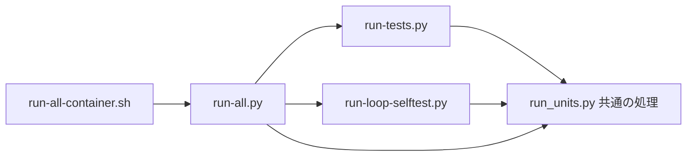

# テストの流し方(詳しい説明と時間の記録)

結論: 全回帰テスト(回帰テストをすべて流すこと)は `python3 -B scripts/run-all.py` の 1 つのコマンドで流す。
- 要点は [AGENTS.md](../AGENTS.md) の「検証」の節にある。この文書は、詳しい説明・決まり・時間の記録を持つ。
- 以前は、6 つのコマンドを別々に同時に始めていた。unittest は CPU の数の半分、loop-selftest は 4 分の 1 の枠(同時に動かすプロセスの数)を別々に持ち、先に終わった側の枠を、ほかが使えなかった。



## Rust の開発と検査(段階 0a)

Rust の検査は、既存の全回帰テストとは別に流す。段階 0a([Issue #442](https://github.com/Yuki-Maeda-valour/workflow/issues/442))で開発用の土台を作り、段階 0b([Issue #443](https://github.com/Yuki-Maeda-valour/workflow/issues/443))から入口と実行ファイル 3 本を同梱する。CI(変更を送るたびに自動で検査する仕組み)も、このソースの検査を続ける。
利用者向けの試し方と必要環境は [runtime-requirements.md](../plugins/dev-workflow/skills/do-task/references/runtime-requirements.md#rust-版を試す条件段階-1b) にある。
段階 1a([Issue #448](https://github.com/Yuki-Maeda-valour/workflow/issues/448))で検査した `resolve-task-dir` を、段階 1b([Issue #450](https://github.com/Yuki-Maeda-valour/workflow/issues/450))で配布する。共通入口・既存の呼び出し元・導入後の検査は、下の「段階 1b の配布と導入の検査」にある。

### Rust 1.99.1 の導入と外部の出力先

- `rustup`(Rust の版を入れて管理する道具)が無ければ、[Rust 公式の導入手順](https://rust-lang.org/tools/install/)で開発者が導入する。利用者への自動導入は加えない。
- [AGENTS.md の Rust の検査](../AGENTS.md#rust-の検査段階-0a)に、`rustup toolchain install 1.99.1` と、必要な `rustfmt`・`clippy` を入れるコマンドを置く。`native/rust-toolchain.toml` が使う版を選ぶため、全体の既定の版は変えなくてよい。
- Rust のビルドと依存の管理には Cargo を使う。依存の版を固定する `native/Cargo.lock` を共有し、ビルド・clippy(よくある誤りの検査)・テストに `--locked` を付ける。
- `CARGO_TARGET_DIR` は、リポジトリの外の空のフォルダにする。`mktemp -d` で作る例は `AGENTS.md` にある。`TMPDIR` を変えている場合も、作られる場所がリポジトリの外か確かめる。
- `native/target/` は無視する設定だが、通常の出力先には使わない。既存テストがコピーしたり走査したりする対象へ、ビルドの生成物を混ぜないため。
- `native/` の新しいソースは、Git の追跡対象に加えてからビルドする。入力の計算は Git の一覧を使う。Git が無い・一覧が取れない・空の場合はビルドを止める。
- `native/ci/build.py` は `CARGO_TARGET_DIR` を使い、未設定なら `RUNNER_TEMP/native-ci` を使う。どちらも指定が無ければ止める。リポジトリ内の出力先も拒否する。
- `RUSTFLAGS` などでビルド設定を上書きしない。最適化と絶対パスの置き換えは `native/Cargo.toml`・`native/.cargo/`、CI の設定は `native/ci/` に置く。

### 必須の検査と実行ファイルの指定

- コマンドの一覧は [AGENTS.md の Rust の検査](../AGENTS.md#rust-の検査段階-0a)にある。書式・clippy・Rust テスト、CI の定義と補助、配布物と比較の補助のテストをすべて流す。
- `native/ci/build.py test` は `native/ci/scripts/test_native_ci.py` を流す。Rust のビルドをせず、CI の補助を検査する。
- `scripts/test_native_distribution.py` と `scripts/test_support_native.py` は、既存の `scripts/run-all.py` にも自動で集められる。形式や比較の補助の検査にはテスト用の作り物を使う。
- 段階 0b では配布物を必須にし、`scripts/test_native_launch.py` で実際の配布物も起動する。これらの検査に Cargo は不要だが、配布物 3 本の欠落は失敗にする。
- 今回のソースから作った実行ファイルの検査は、`DEV_WORKFLOW_TEST_NATIVE_BINARY` にその実体を指定し、`native/ci/check_probe.py` と `native/ci/check_resolve_task_dir.py` で流す。配布した版の起動確認とは分ける。
  - 未設定・空文字・不在・実行不能は失敗にする。検査を飛ばさず、配布済みの実行ファイルへも切り替えない。
  - `check_probe.py` は `--version`・`--help`・`probe --json`・`probe --self-sha256` の出力と終了コードを確かめる。不正な引数の拒否、実行 CPU、自己の SHA256(内容の違いを確かめるための値)、作業フォルダの無変更も確かめる。
  - `check_resolve_task_dir.py` は、下の「タスク保存先の比較(段階 1a)」の条件で旧版と比べる。
  - `source_input_hash.py` で現在のソース入力を独立に計算し、`probe --json` の `source_input_sha256` と比べる。
- `run-all.py` は Cargo と `native/ci/` の検査を実行しない。`run-all-container.sh` も Cargo や外部ビルドの環境変数を渡さない。Mac で Linux 専用の全回帰テストを流さない。

### 共通の終了値と入出力の検査(C0a)

[Issue #453](https://github.com/Yuki-Maeda-valour/workflow/issues/453)の検査は、開発用ソースに追加した入出力の契約を確かめる。
配布物、C0bのファイル保護・上限、C0cの子プロセス監督の検査を完了したとは扱わない。

- `cargo test --locked` は、C0a時点で通常のRustテスト44件と、実プロセスを使う検査1件を実行する。4種類のCIでも同じコマンドを必須にする。
- `native/crates/core/src/output.rs` は、全256種類の終了値、無出力、非UTF-8とNUL、部分書込み、0バイト書込み、書込みと `flush` の失敗を検査する。
  - 途中の出力失敗を無視しても終了1になることを確かめる。後続出力の禁止と、診断の出力先・字面・回数も確認する。
  - 固定長バッファの範囲、短読、EOF、入力エラーを確認する。`Interrupted` も再試行せず返し、コマンドが専用の終了値を選べることを確かめる。
- `native/crates/cli/src/main.rs` は、登録表を通した引数と入出力の受け渡しを検査する。既存コマンドの引数・出力・終了値・無変更の検査も維持する。
- `native/crates/core/tests/command_io.rs` は、`harness = false` で登録した同じテスト実行物を子として起動する。外部サービスや孫プロセスは起動しない。
  - 子は標準出力・標準エラーを明示的な `BufWriter` で包む。改行のない途中出力を両方受け取るまで、親は入力を送らない。子が終了していないことも確認する。
  - 親は非UTF-8とNULを含む入力を送り、最終出力の生バイトと終了237を厳密に比較する。シグナル終了は合格にしない。
  - 途中出力の受信と子の終了待ちには、共通の20秒の期限を設ける。各出力の後半は最大128バイトまで読み、余分な出力を受理しない。
  - 失敗・時間切れでも直接の子へ `kill` と `wait` を行い、読取りスレッドを回収する。このテスト用の後片付けを製品の子プロセス監督とは扱わない。
- 今回作った実行ファイルで `check_probe.py` と `check_resolve_task_dir.py` を実行する。Linuxでの既存714件の比較と、下のMacで省略を許す条件を維持する。
  - `scripts/support_native.py` は変更しない。#448の承認済みの差を別コマンドへ広げず、通常の比較条件と比較補助のテストを維持する。
- PR前の全回帰テストは、管理担当が他の編集・検証を止めて単独で流す。最新mainを含む最終SHAと結果をPR本文へ記録する。
- その公開SHAに対するLinux・Macの必須CIの成功を確認してからマージする。手元のRust検査をPR用CIの成功と扱わない。
- C0aのMac実機と最低OSでの動作は未確認。MacのCI実行環境と、利用者の実機・最低OSでの実測は分けて記録する。

### 4 種類の CI と成果物

CI の定義は `.github/workflows/native.yml` にある。対象と同じ OS・CPU でビルドする。

| 機械 | `build.py --platform` の値 | Rust の対象名 | 最終ファイル |
|---|---|---|---|
| `ubuntu-24.04` | `linux-x86_64` | `x86_64-unknown-linux-musl` | `linux-x86_64/dev-workflow` |
| `ubuntu-24.04-arm` | `linux-arm64` | `aarch64-unknown-linux-musl` | `linux-arm64/dev-workflow` |
| `macos-15-intel` | `macos-x86_64` | `x86_64-apple-darwin` | `macos-universal/dev-workflow` に結合 |
| `macos-15` | `macos-arm64` | `aarch64-apple-darwin` | 同上 |

- 最初の `policy` は、CI の定義と補助のテストを流す。`build` は表の 4 種類すべてで書式・clippy・Rust テストを必須にする。
- `prepare --platform <表の値>` は Rust `1.99.1`・`rustfmt`・`clippy`・対象の標準ライブラリを入れる。`build --platform <表の値>` は必須検査、2 回のビルド、今回作った各実行ファイルの `check_probe.py` と `check_resolve_task_dir.py` による検査を行う。
- 旧版との比較を行う `build` と `verify-universal` の各工程は、checkout 直後の検査の後に `actions/setup-python` で Python 3.10.11 を用意する。製品の Python 3.10 以上という下限は変えない。
- 2 回のビルドは、同じソース・依存・道具・設定を使い、別々の空の出力先で行う。ビルドの形は `cargo build --release --locked --target <Rust の対象名>`。
- Linux は Rust に付属する musl(実行時に必要な C の処理を提供する部品)を使い、共有ライブラリを要しない実行ファイルを作る。`musl-gcc` や C の追加依存は導入しない。
  - 実行前に ELF(Linux の実行ファイル形式)の CPU、動的ローダー指定の不在、共有ライブラリ依存の不在を検査する。2 回のバイト列は `cmp` で比べる。
- Mac の両方で `MACOSX_DEPLOYMENT_TARGET=11.0` を指定する。`combine` が 2 回分をそれぞれ `lipo` で結合し、`codesign --sign -` で簡易署名を付ける。
  - 識別子は `org.dev-workflow.native`、署名の時刻は `--timestamp=none` に固定する。署名を検査してから SHA256 を取り、署名後の 2 本を `cmp` で比べる。
  - `verify-universal` は、同じ最終ファイルを Intel と Apple Silicon の両方へ渡し、`check_probe.py` と `check_resolve_task_dir.py` を実行する。署名し直さない。
- `distribution` は、Linux 2 本と署名後の Mac 1 本に `SHA256SUMS`・`build-info.json` を加えた 5 ファイルを作る。`make_dist.py` が成果物の形式検査に通してから、`native-dist.tar` にまとめる。
- 転送は tar(複数のファイルを 1 つにまとめる形式)を使い、実行してよい印を保つ。Mac の両方で最終ファイルの起動が通るまで、配布用 tar は作らない。
- `check_workflow.py` は `.github/workflows/` の全 `*.yml`・`*.yaml` を検査する。定義は JSON と共通の YAML の書き方に限る。通常の YAML のブロック表記や、重複するキーは拒否する。
  - イベントは `pull_request`・`push`・`workflow_dispatch`。権限は `contents: read` だけ。
  - 各処理はソース取得の直後にこの検査を流す。PR のソース SHA とリポジトリを明示し、`persist-credentials: false` を付ける。
  - 外部 Action は完全な commit SHA に固定する。キャッシュの Action・`pull_request_target`・秘密情報・書き込み権限は使わない。
  - ビルド設定は CI の定義に直接書かず、`native/ci/` のスクリプトに置く。採用した Action の確認記録は [native/ci/README.md](../native/ci/README.md#ワークフローの検査)にある。
- CI は成果物までを作り、PR 作成や push はしない。段階 0b 以降も、配布への取り込みは人が行う。

### ビルド入力の記録

- `native/crates/core/build.rs` がソース入力の SHA256 と Rust の版を埋め込む。実行時に Git や外部コマンドを起動して情報を求めない。
- 入力は `native/` の追跡ファイルだけ。相対パス・Git のモード・作業中の本文をパス順に計算する。生成物と `native/` の外の変更は含めない。計算するバイト列の形は [native/README.md の「ソース入力の SHA256」](../native/README.md#ソース入力の-sha256)にある。
- commit の SHA・時刻・CI の実行番号を実行ファイルへ埋め込まない。時刻の設定は `SOURCE_DATE_EPOCH=0`、Mac は `ZERO_AR_DATE=1` も使う。絶対パスは `native/.cargo/` の設定で固定名へ置き換える。
- `build-info.json` にソースの commit、入力と `Cargo.lock` の SHA256、Rust の版、対象ごとの道具と設定、CI の実行番号と URL、3 本の相対パスと SHA256 を残す。
  - `targets` には Cargo・リンカー(部品を実行ファイルにまとめる道具)・musl・Xcode・SDK(OS 用の開発道具一式)などの版を記録する。`signing` には Mac の署名設定と道具の情報を残す。
  - OS のラベルだけで道具が固定されたとは扱わない。ソース・依存・Rust の記録が違う成果物は組み合わせない。
- `validate.py` は配布物の内部の一致を検査し、現在の開発ソースとの一致は要求しない。配布へ取り込むときは `source_input_hash.py` を使い、取り込む 3 本とビルド元の入力を比べる。

### 旧版と Rust 版の差分テストの補助

`scripts/support_native.py` は標準ライブラリだけを使う。ほかの `support_*.py` を読み込まず、呼び出し側が必要な補助を組み合わせる。

| 関数 | 使い方と確かめる内容 |
|---|---|
| `require_native_binary()` | `DEV_WORKFLOW_TEST_NATIVE_BINARY` の実行可能な通常ファイルを求める。指定の不備は失敗にする |
| `run_command(argv, cwd=..., env=..., input=..., timeout=...)` | 引数の配列で起動する。終了コード・標準出力と標準エラーのバイト列・時間切れを返す |
| `snapshot_tree(path)` | 相対パスごとに種類・権限・内容の SHA256 を記録する。リンク先へは進まない |
| `compare_runs(legacy_argv, native_argv, initial_tree=..., work_dir=...)` | 同じ初期状態を 2 つのフォルダへコピーし、旧版と Rust 版の結果とファイルの変化を比べる |

- `compare_runs()` の `work_dir` は、まだ存在しない、`initial_tree` の外の場所を渡す。戻り値の `legacy_cwd`・`native_cwd` は検査のために残り、呼び出し側が片付ける。
- 比べるのは終了コード、出力のバイト列、ファイルの作成・変更・削除、実行権限を含む権限。`allow_differences` は、この比較だけで差を認める項目名と判定関数を指定する。
- 時刻や絶対パスを出力全体から一括で消さない。時間切れを許される差にしない。
- 時間切れでは、同じプロセスグループ(信号をまとめて送れるプロセスの集まり)へ終了信号を送り、直接の子を回収する。グループを抜けた子は停止の対象外。孫以降の回収は、その親か OS が受け持つ。
- Git の状態と、正常終了後の子プロセスの残存は、呼び出し側で `support_git.py`・`support_proc.py` を組み合わせて確かめる。補助は実行を隔離する仕組みではない。
- `probe` に旧版は無い。補助のテストと `check_probe.py` が通っても、旧版との同等性を確認したとは扱わない。

### タスク保存先の比較(段階 1a)

- `native/ci/check_resolve_task_dir.py` は Python 3.10 系で実行する。別の版では終了 1 になる。実際に使ったパッチ版を合格の行に出す。CI の比較用の版は 3.10.11 に固定する。
- `scripts/test_task_directory.py` の旧版の 29 件は維持する。専用の比較入口は引数、候補の順序、リンク、非 UTF-8 と制御文字、権限の境界を追加で確かめる。
- 通常の比較では、標準出力・標準エラーのバイト列と終了コードを比べる。旧版の `sys.argv[0]` の表示名だけを `dev-workflow resolve-task-dir` にそろえる。独立コピーの絶対ルート以外は出力から取り除かず、ヘルプの折返しも比較する。
- 実行後の 2 つのコピーが互いに同じだけでなく、初期状態とも同じことを確かめる。内容・種類・権限・リンクを含む。
- 権限の検査は root 以外の通常利用者で行う。root では終了 1 になり、合格にも skip にもしない。実行直後の種類と制限中の権限、元に戻した後の全体が変わらないことを確かめる。
- 一覧を読めても子の情報を取得できない権限条件では、[design.md の承認済みの差](design.md#タスク保存先の解決段階-1a)を専用ケースで確かめる。子を持つ管理ルートを `0400` にし、旧版の未処理の `PermissionError`・`errno.EACCES`・対象パスと、Rust の JSON のキー・文言・対象パスを検査する。両版とも終了 1 だが、旧版は標準エラー、Rust は標準出力へ出す。反対側の出力は空にする。
- 非 UTF-8 の出力も、同じ設計書に記した承認済みの差を専用ケースで確かめる。通常の比較の条件と `scripts/support_native.py` の `compare_runs` は変えない。
  - 両版の子プロセスへ、`PYTHONIOENCODING=utf-8:strict` と `PYTHONIOENCODING=utf-8:surrogateescape` をそれぞれ指定する。
  - 旧版の実際の `sys.stdout.encoding` と `sys.stdout.errors` を検査する。モジュールの読み込み・引数・作業フォルダ・環境・Python の起動オプションは、旧版の本実行と同じにする。
  - `strict` の旧版は、独立に組み立てた期待 JSON 文字列から `UnicodeEncodeError` を求める。`encoding`・対象文字・位置・`reason` を含む例外文と、`main` の JSON 出力箇所を含む呼び出し経路の全文を一致させる。候補複数の場合は、その前に出る既知の `ResolutionError` も含む。標準出力は空、終了値は 1 を必須とする。
  - Rust の標準出力は、解決処理を呼ばずに作る独立した期待バイト列と完全一致させる。元のバイトの保持・解決結果の終了値・空の標準エラーを検査する。
  - `surrogateescape` では、独立コピーの絶対ルートの差だけを除き、両版の出力バイト・標準エラー・終了値を完全一致させる。旧版の出力も独立した期待バイト列で確かめる。
  - 両モードで初期状態と各コピーの実行前後を比べ、内容・種類・権限・リンクが変わらないことを確かめる。
- 生バイトの明示値 `x\xff` は、すべての対象 OS で両モードの検査を必須にする。非 UTF-8 の実在ルートと候補名も両モードで検査する。
  - Mac の APFS が実在名の作成を `EILSEQ` で拒む場合だけ、その理由を出力して実在ルートと候補名の検査を省く。明示値の検査は省かない。名前の作成以外の失敗や、別の OS・エラーは省略理由にしない。
  - 引数解析の非 UTF-8 エラーは、通常の完全一致の比較を続ける。
- `native/ci/scripts/test_native_ci.py` は、専用判定が別の例外・発生箇所・出力先・終了値・期待バイトの変化を拒否することを確かめる。実際の出力設定の違いとファイルの変更も拒否する。通常の比較が同じ旧版の例外を許さないことも検査する。
- この比較は `run-all.py` に含めない。今回作った実行ファイルと、配布に採用する実行ファイルをそれぞれ指定し、Rust の検査として別に流す。

### 段階 1b の配布と導入の検査

配布元の検査と、公開する状態での検査を分ける。配布元の CI が成功していても、共通入口・呼び出し元・導入後の検査を省かない。

配布元は [Native CI run 42503942205](https://github.com/Yuki-Maeda-valour/workflow/actions/runs/42503942205) である。必須 9 件がすべて成功した同じ run の `native-dist.tar` から、次の 5 ファイルを同時に取り込む。古い失敗 run や、手元で再ビルドしたファイルを混ぜない。

| `plugins/dev-workflow/bin/dev-workflow/` 内のファイル | 権限 |
|---|---|
| `linux-x86_64/dev-workflow` | `0755` |
| `linux-arm64/dev-workflow` | `0755` |
| `macos-universal/dev-workflow` | `0755` |
| `SHA256SUMS` | `0644` |
| `build-info.json` | `0644` |

| 出所の記録 | 値 |
|---|---|
| ソースの commit | `3b9dfcc273f89898e13a2ccfb31f863c9a510fee` |
| `native/` のソース入力の SHA256 | `a91c5b6bfd19352949fafec455a19f0340d8816ff102e9883aa8ec028a12742c` |
| `native/Cargo.lock` の SHA256 | `56e9fddd70e2d0df59ce1a254a044c082c6f5ce9b4d2b2efd521b413628f598a` |
| `native-dist.tar` の SHA256 | `e46a68b8592962ffc667639e3f69df1807136ec505aa28f5fc37f5e982438b0b` |

- `build-info.json` のソース・道具・run・対象・各実行ファイルの SHA256 を、上の出所と照合する。アーカイブの名前・種類・権限も確かめる。`launch.sh` はこの 5 ファイルに含まれず、プラグイン側のコードとして検査する。
- 配布元の比較は、Linux の各 CPU で 2 回のビルドごとに 714 件が成功した。Mac は各 CPU の 2 回のビルドと、結合・署名後の各 CPU で 710 件が成功した。
  - Mac の APFS が非 UTF-8 の実在ルート・候補名を `EILSEQ` で拒んだ 4 件だけを省略した。生バイトの明示値は、両方の出力設定で検査した。Mac を 714 件成功とは記録しない。
- `DEV_WORKFLOW_ENGINE` が未設定・`legacy` の場合は、同梱の旧 Python を使う。`rust` の場合だけ Rust を使う。空文字・未知の値は終了 2 にし、Rust の失敗から旧版へ自動で戻さない。
- 共通入口の検査は、引数・作業場所・標準入出力・終了値の保持も含む。`0400` と非 UTF-8 出力の承認済みの差は上の比較条件を使い、通常の比較を緩めない。
- `scripts/test_native_launch.py` は、エンジンの選択、実行ファイルや道具の欠落、改変、リンクからの起動、引数などを検査する。`scripts/test_setup.py` はコピー・リンクの導入と、元の配置を取り除いたコピーからの起動も検査する。
- `scripts/check_dist_launch.py` は実際の配布入口を起動する。保存先の 5 条件を未設定・`legacy`・`rust` で試す 15 件と、従来の 4 コマンドを必須にする。独立に組み立てた期待 JSON のバイト列と、実行前後のファイルの内容・種類・権限を比べる。
  - Mac では署名と両 CPU 向けの形式も検査する。`.github/workflows/dist-check.yml` は Linux arm64・Mac Intel・Mac Apple Silicon の 3 件を実行する。Linux x86_64 は手元で同じ入口を流す。

リポジトリ直下から、配布入口と配布物の比較を流す。比較には Python 3.10 系を使い、root 以外の通常利用者で実行する。下の実行ファイルの指定は Linux x86_64 用である。

```bash
python3 -B scripts/check_dist_launch.py --root .
DEV_WORKFLOW_TEST_NATIVE_BINARY="$PWD/plugins/dev-workflow/bin/dev-workflow/linux-x86_64/dev-workflow" \
  python3 -B native/ci/check_resolve_task_dir.py
```

実際のプラグイン導入には `claude` CLI を使う。`scripts/check_plugin_install.py` が一時フォルダを作り、専用の `CLAUDE_CONFIG_DIR` を渡して marketplace 登録・user scope への導入・導入先の取得を行う。利用者の通常の設定先と `HOME` は変えない。

```bash
python3 -B scripts/check_plugin_install.py --root .
```

- 導入元は検査対象を commit したリポジトリにする。作業ブランチの commit 前に確かめる場合は、検査対象だけを専用の一時コピーへ移して検証用 commit を作り、作業ブランチに未レビューの commit を作らない。
- 一覧から得た導入先が専用の設定先の内側にあり、元のリポジトリとは別の場所であることを確かめる。リンク・特殊ファイルを拒否し、全項目の内容・権限・ハッシュを元のプラグインと照合してから起動する。
- 導入先でも保存先解決の 15 件と従来の 4 コマンドを実行する。起動後にも元と導入先の無変更を確かめる。一時の設定先は終了時に片付ける。
- 最終の版を付けた後にも実導入を流し直す。`scripts/test_check_plugin_install.py` の代用 CLI による検査だけでは、実導入の合格とは扱わない。

2026-11-09 時点の記録は次のとおりである。実装 commit は `b613108953be65dc02de2491a2dbe3f9b3d0df27`。公開する最終 commit の結果は、全回帰テストと最終 CI の完了後に PR 本文へ記録する。

| 検査 | 確認した結果と範囲 |
|---|---|
| Linux x86_64 の配布入口 | 保存先解決 15 件・従来の 4 コマンドが合格 |
| 通常利用者の Python 3.10.12 での比較 | 配布物と今回のソースから作った実行ファイルの両方で 714 件が合格 |
| Linux x86_64 の実プラグイン導入 | 検証用 commit `4e9cf1f9442534e33e70db3da68851e220a210e2` で、149 項目の内容・権限が一致した。導入先の保存先解決 15 件と従来の 4 コマンドが合格 |
| 導入先の Linux x86_64 の SHA256 | `9bcb0e3bc2bc6555d559255d7b7c7531456955d04372faef43136b77165e70d7`。配布の記録と一致 |
| 今回の Mac 実機への再導入 | 未確認。段階 0b の実機記録は [README.md](../README.md#e-rust-版を試す段階-1b) に分けて残す |
| Linux カーネル 5.6・macOS 11 の最低 OS | 実機では未確認。入口の版の判定と、現在の CI 環境での検査とは分ける |
| 公開する最終 commit の Native CI・Distribution launch・全回帰テスト | この時点では未実行。配布元 CI の成功を代わりに使わない |

### Git 設定の観測を移行へ引き継ぐテスト(#283)

[Issue #283](https://github.com/Yuki-Maeda-valour/workflow/issues/283)は、[Rust 移行計画 #400](https://github.com/Yuki-Maeda-valour/workflow/issues/400)の段階 2 に渡す入力と性質を固定する。
製品の `loop-state.py` は変えない。廃止済みの #246・#282 の分割計画は再開しない。
Rust 版の実装と比較は、この確認に含まない。

- `scripts/test_loop_state.py` の既存 `LoopStateTest` の 57 メソッドは維持する。
- 新しい `ConfigSnapshotContractTest` の 8 メソッドは、実物の Git とファイルを使う。
- 新規分は Git の初期化前から `HOME`・`XDG_CONFIG_HOME`・global 設定を一時フォルダへ向け、system 設定を無効にする。継承した `GIT_*` を外す。
- 環境、時計、包んだ関数は、例外が起きても元へ戻す。既存クラスの準備や期待値は変えない。

| 確かめる性質 | 既存の確認 | 追加する確認(`test_config_snapshot_` から始まるメソッド) |
|---|---|---|
| 保存済みの設定を通常 Git より前に拒否 | `test_held_global_config_link_is_checked_before_normal_git_discovery` と、保存済み候補・管理先・各作業場所の事前検査 | 同じ入力は増やさない |
| 根と有効な include を実効 Git より先に読む | 通常 include、条件付き include、同じ実体と別親の正常例 | `orders_reads_conditions_rechecks_and_candidates`。必要な前後関係と、全出典の再検査後に候補を調べる順序 |
| 後方の local remote で条件が有効になる | `test_hasconfig_uses_later_local_remote_and_boolean_without_value_is_normal` | `drains_nested_hasconfig_queue`。global → A → B と、処理中に増えた条件も末尾まで読むこと |
| 循環を実効 Git より前に拒否 | 同じ実体でも別の親なら循環としない正常例 | `rejects_normal_and_deferred_cycles_before_effective_git`。通常 include と、遅れて有効になる条件の循環 |
| 処理量の上限 | refs、Git 出力、フォルダ列挙、全体の項目・総量・1 ファイル上限 | `passes_same_budget_through_every_phase` と `keeps_callers_item_and_byte_consumption`。同じ `Budget` と事前消費の維持 |
| 時間の上限 | 制限値を渡す既存の実行 | `keeps_callers_deadline_at_late_phases`。実効 Git の直前・直後・候補の直前で、呼出し元の期限を超えれば拒否 |
| 読み取り後の変更 | 設定リンクの差替え、実行間の基準更新、読み取り中の変更 | `rejects_origin_change_after_effective_git`。実効 Git の直後に include を変えると拒否 |
| 返す値 | スナップショットの安定性と出典を含むこと | `returns_exact_values_and_ordered_candidates`。3 項目、実効設定の SHA256、出典のパス順、候補の種類・存在/不在・順序 |

追加した順序の確認は `config_snapshot` の中に限る。
保存済み状態を使うときは、その前に候補と出典を照らし合わせる。
`snapshot` 全体の最初の Git と、`config_snapshot` の根の取得を混同しない。

- SHA256 の期待値は、包んだ元の Git が返した生バイトから独立に計算する。製品の返却値から正解を作らない。
- 処理量の境界は同じ一時入力で実測する。固定した一時パスの長さや機械ごとのバイト数は期待にしない。
- 期限の検査は製品が参照する時計だけを差し替える。Git やテスト実行側の時計は変えず、長い待機もしない。
- 再検査の対象は候補の根に含まれない include とする。再検査を外した不具合を、最後の候補検査が偶然拒否しないようにする。
- 静的な循環を最初から置くと、Git 自身が `--no-includes` や `--file` の起動準備で先に拒否する。
  - Python 内部の循環判定には、既知の include を `safe_config_file` が読む間だけ実ファイルへ循環の辺を書く。
  - 元の関数が保持したファイル記述子(開いた実体への参照)から解析した直後に、`finally` で元の入力へ戻す。返る行や製品の辞書は加工しない。
  - 次の Git は非循環の実ファイルを読み、製品は実際に解析した辺から循環を検出する。循環を外した同じファイル構成は成功する。
  - 循環の検査を外すと、実効 Git の呼出しへ到達した時点でテストを失敗にする。後の再検査の不一致は、この検出の根拠にしない。

#### 独立コピーに不具合を入れる確認

```bash
python3 -B scripts/run-tests.py test_loop_state.py
python3 -B scripts/check_loop_state_mutations.py
```

`check_loop_state_mutations.py` は元の新規 8 件と無変更コピーの成功を確かめる。
続いて、元と書込みを共有しない新しいコピーを作り、次の 7 種類・10 件を 1 件ずつ検査する。

| 種類 | コピーへ入れる不具合 | 必須の失敗理由 |
|---|---|---|
| 順序 | 実効 Git を探索より前へ移す | `CONFIG_ORDER`。有効な出典の読取より先に実効 Git が始まった |
| 待ち行列 | 開始時の要素数だけで処理を終える | `CONFIG_QUEUE`。B が実効出典に現れたのに事前検査されなかった |
| 共有上限 | 途中で `Budget` を新しく作る | `CONFIG_BUDGET_ID`。呼出し元の入れ物ではなくなった |
| 期限 | 途中で期限を 60 秒延ばす | `CONFIG_DEADLINE`。期限超過なのに拒否されなかった |
| 循環 | 遅れて有効になった辺の循環検査を削る | `CONFIG_CYCLE`。実効 Git の呼出しへ到達した |
| 再検査 | 実効 Git 後の出典の再検査を削る | `CONFIG_RECHECK`。変更後なのに拒否されなかった |
| 返す値(4 件) | キー変更、SHA256 変更、出典の逆順、不在候補を存在へ変更 | `CONFIG_KEYS`・`CONFIG_DIGEST`・`CONFIG_ORIGINS_ORDER`・`CONFIG_CANDIDATES` の各検査失敗 |

- 差替え場所は 1 か所に限る。0 か所や複数なら止める。
- テスト名、検査失敗の印、実行件数、終了コードを確認する。構文エラー、読み込み失敗、検査の省略、時間切れは成功と数えない。
- 各行の JSON に、元とコピーの SHA256、テストの SHA256、失敗した検査、終了コード、所要時間を残す。
- 最後に元の製品の内容とモード、テストの内容が不変かを確かめる。一時コピーは処理を終えたら片付ける。
- この入口は開発者が明示して実行する。`run-all.py` による新規 8 件の通常実行とは分ける。

#### 段階 2 で使う範囲

- 同じ include 構成、条件、変更の時点と、成功値・拒否・外部から指定した処理量と時間の上限を引き継ぐ。
- Python の関数名、オブジェクトの同一性、工程別の消費数、循環を投入する内部の時点は、Python 内部だけの観察である。Rust へ同じ構成を要求しない。
- 独立コピーでは絶対パス、`dev`・`ino`・時刻が異なる。実効 Git の出力に出典パスを含むため、`effective_sha256` も単純一致できない。
- 比較時は同じ入力場所を使うか、値ごとに根拠がある対応を設計する。出力全体の一括正規化や広い差分許可で、安全の確認を消さない。
- 今回の成功だけで Rust 版との同等性を確認したとは扱わない。
- #448 側と全回帰テストを同時に流さない。公開前は管理担当が実行権を確認し、確認済みの commit を指定して全回帰テストを流す。

## 全回帰テストのコマンド(run-all.py)

使い方(リポジトリ直下で実行する):

```bash
python3 -B scripts/run-all.py                      # 全部を流す
python3 -B scripts/run-all.py -j 8                 # 同時に流す枠の数(既定は使える CPU の数。1 未満は引数の誤り)
python3 -B scripts/run-all.py --log-dir DIR        # 全部の単位の出力を DIR/<鍵の : と / を _ にした名前>.log に残す
python3 -B scripts/run-all.py --weights-file PATH  # 重みの記録の置き場
python3 -B scripts/run-all.py --plan               # 流さずに、始める順を出して終わる
python3 -B scripts/run-all.py --reuse              # 入力が前の合格と同じ単位を流さず、前の結果を使う(容器の中だけ。下の「結果の使い回し」)
python3 -B scripts/run-all.py --reuse-file PATH    # 使い回しの記録の置き場
```

- 終了コード: 合格なら 0。ほかは 1。引数の誤りは 2。止めたときは 128 + シグナル(プロセスに止めるなどを伝える合図)の番号(最後の `結果:` の行は出さない)。
- `--log-dir` のフォルダが無いときは、引数の誤り。止めた単位の出力も、出力が閉じた後に残す。
- `run-all.py` は、環境変数をそのまま各単位へ渡す(容器の入口の話は、下の「容器の入口」の節)。
  - loop-selftest の各プロセスには、環境に無いときだけ `LOOP_SELFTEST_TIMEOUT=6000`・`RUN_TIMEOUT=600` を足す。`LOOP_SELFTEST_ONLY` は節ごとに上書きする。
  - `LOOP_SELFTEST_PROGRESS` を妨げない。

### 単位と鍵

| 部 | 単位 | 鍵(重みの記録の鍵) | 表示名 |
|---|---|---|---|
| unittest | `run-tests.py` の全ファイルとシャード(1 つのテストのファイルを分けた、別々に流す単位) | `unittest:<ファイル>`(分けたときは `unittest:<ファイル>[<番号>/<数>]`。番号は 1 から) | `unittest <ファイル>`(分けたときは `unittest <ファイル> [<番号>/<数>]`) |
| loop-selftest | 全部の節と、節の外だけのプロセス | `loop:<節>`・`loop:(節の外だけ)` | `loop-selftest <節>`・`loop-selftest (節の外だけ)` |
| implement-guard-selftest | 下の「implement-guard の分け方」の単位 | `implement-guard:<単位>`(1 本のときは `implement-guard`) | `implement-guard-selftest.sh --only <単位>`(1 本のときは `implement-guard-selftest.sh`) |
| diff-snapshot-selftest | 1 本 | `diff-snapshot` | `diff-snapshot-selftest.sh` |
| review-agent-selftest・implement-agent-selftest | 枠の外で 1 本ずつ | `review-agent`・`implement-agent` | `review-agent-selftest.sh`・`implement-agent-selftest.sh` |

- 枠の外の 2 本は、待ちが主(CPU の時間 ÷ 壁時計が 0.08・0.04)なので、枠を使わせず、最初に始める。
- 部ごとの件数は、2 つのランナーの関数で照らし合わせる(unittest はシャードの総数と配った件数、loop は節の外の差し引きと節ごとに 1 件以上)。
  - implement-guard は、分けたとき単位ごとに 1 件以上。各 selftest は、結果の行があり、FAIL が 0 で、終了コードが 0。

### 重み

- 始める順は、重みの大きい順(同じなら与えた順)。重みは、重みの記録 → 表 → 既定の 200 秒の順に引く。
  - 表: unittest は `run-tests.py` の `WEIGHTS`(分けたファイルは「ファイルの重み ÷ 分ける数」)、loop の節は `run-loop-selftest.py` の `WEIGHTS`。implement-guard の単位・`implement-guard`(781 秒)・`diff-snapshot`(81 秒)・`loop:(節の外だけ)`(14 秒)は、`run-all.py` の定数。
  - 重みの記録にも表にも無い単位は、200 秒として早めに始める。軽い単位を早く始めても損は数秒。重い単位を最後に始めると、全体がその分延びる(`test_integrate_guard.py` が 2026-11-06 に起こした)。
- 重みの記録の置き場は `${XDG_CACHE_HOME:-~/.cache}/workflow-run-all/weights.json`(`--weights-file` で変える。フォルダが無ければ作る)。
  - `~/.cache/dev-workflow` と `~/.local/state/dev-workflow` の下には置かない(`pending-implementation.py scan` が走査する置き場のため)。
  - 形は `{"version": 1, "weights": {"<鍵>": <秒>}}`。
  - 成功した単位だけを書く。前の値があれば、前の値と今回の時間の平均にする(混み具合の揺れを均す)。止めた回は書かない。
  - 同じフォルダの一時ファイルに書いてから、置き換える。
  - 読めない・形が違うときは `注意: 重みの記録を読めない(…)` を出し、書けないときは `注意: 重みの記録を書けない(…)` を出して続ける。どちらも合否に効かせない。
- 回帰テスト(`scripts/test_run_all.py`)は、本物の HOME の記録に書かない(置き場を一時フォルダに向ける)。

### implement-guard の分け方

- `bash implement-guard-selftest.sh --list` が終了コード 0 で 1 行以上を返せば、その各行を単位にして、`--only <行>` で流す。
  - `--list` の単位は、群(A〜K・P)・M1〜M27・N1〜N14・わざと壊したコピーごとの L-a〜L-z。
  - 単位の和がケースをちょうど 1 回ずつ覆うことは、`--list` 自身が確かめる(覆わなければ終了コード 0 以外で終わる)。L-a〜L-z の分け方は selftest だけが知るので、`run-all.py` は書き直さない。
  - `run-all.py` は、行に空白・`,` が無いことと、同じ行が 2 つ無いことだけを確かめる。破っていれば、次の頭文字の一覧で流す。
- `--list` が終了コード 0 以外か、1 行も返さなければ、`ALL_CASES` の頭文字の一覧で流す。
  - `ALL_CASES` は `^ALL_CASES="([^"]*)"` で読み、空白で分けて ID の一覧にする(この道だけが読む)。
  - 流す前に、単位の一覧が `ALL_CASES` の全部の ID をちょうど 1 回ずつ覆うかを確かめる。規則は selftest の `want()` と同じ(`L` 以外の 1 文字は、その頭文字の全部。ほかは完全一致)。
  - 読めない・覆わないときは、1 本で流す。
- 頭文字の一覧か 1 本で流したときは、始めと最後に `警告: implement-guard-selftest.sh を <頭文字の一覧 | 1 本> で流した(<理由>)` を出す。
  - ただし、`--list` が無い版(終了コード 0 以外で、標準エラーが `ERROR: 不明な引数: --list` の 1 行だけ)で頭文字の一覧にしたときは出さない。
- どの形でも、件数を足し合わせて照らす。
- 毎回覆いを確かめる理由: `--list` や `ALL_CASES` の読み取りがケースを落としても、件数の照合(単位ごとに 1 件以上)では気づけないため。
- 各単位は、別のプロセスで、自分の一時フォルダと保護領域(`selftest-guard-XXXXXX`)を作る。置き場を先に作れば、取り合う物は無い。
- `implement-guard-selftest.sh` 自身の使い方(2026-11-07 の #386)。
  - `--list`: `--only` に渡せる単位を 1 行に 1 つ出す(79 行。群 12・M のケース 27・N のケース 14・L の変異 26)。何も作らない。ほかの引数と一緒には渡せない(終了コード 1)。
  - `--only <単位>`: その単位だけを流す。変異は 1 つずつ流せる(`--only L-<記号>`)。
  - `--check-units <単位,単位,...>`: 渡した単位が、全ケースをちょうど 1 回ずつ覆うかを見る(0 か 1 で終わる)。何も作らない。
  - 単位を足すときは、`MUT_IDS`(変異の記号)と `ALL_CASES`(ケース ID)を直す。`--list` が覆いを確かめ、崩れていれば終了コード 1 になる。

### 始める前の確かめ

- `~/.local/state/dev-workflow` が無ければ作り、`置き場を作った: <パス>` を出す(`--plan` では作らない)。終わっても消さない。
  - `test_pending_implementation.py` と implement-agent・implement-guard の selftest は、この置き場を「無ければ作り、空なら消す」。
  - 置き場が無いまま同時に流すと、一方が消した直後に、他方が中に作れず落ちることがある(既知の取り合い。implement-guard の selftest は、置き場を作り直して 3 回まで試すようにした。implement-agent の selftest と `test_pending_implementation.py` は直していない)。
  - 同時に動くほかの流しが中に作ろうとする所で消すと、取り合いが戻る。そのため、最後に消さない。
- `git --version` を読み、`git: <出力>` を出す。
  - 2.42 より古ければ `警告:` の行を出す(最後の結果の行の前にも、もう一度出す。`--plan` では、最後の単位の行の後)。
  - 2.42 以上 2.45 未満なら `注意:` の行を出す(reftable の確かめ 3 件が skip になる)。
  - 版を読めなければ `警告: git の版を読めない(…)` を出す。
- 流している Python の版を読み、`git:` の行の後に `python: <sys.version の 1 行目>` を出す(版に加えて、ビルドの日付とコンパイラも見える)。
  - 3.10 より古ければ `警告:` の行を出す(git と同じく、最後の結果の行の前にも、もう一度出す。`--plan` では、最後の単位の行の後)。
  - 3.10 でなければ(3.11 以降)、`注意:` の行を出す(下限の版で動くかを確かめたことにならない)。
  - 版では止めない。終了コードと最後の結果の行は変わらない。
- `--plan` の出力は、1 行目が `計画: …`。その後に `git:`・`python:` と警告・注意の行、枠の外の単位(`枠の外  <表示名>`)、枠の単位を始める順に `<順番> <重み> 秒 <記録|表|既定> <表示名>` が続く。

### git の版の警告の根拠

| 版 | 起きること | 根拠 |
|---|---|---|
| 2.36 より古い | loop 系の回帰テストが、変更と関係なく落ちる | `loop.sh` が `git worktree list --porcelain -z` を使う。回帰テストは `loop.sh` を起動する |
| 2.42 より古い | 製品の `loop.sh` が `git var GIT_CONFIG_SYSTEM` を使えない | 2.39.5 は使い方の誤り(終了コード 129)、2.43.0 は `/etc/gitconfig` を返す(容器で確かめた)。回帰テストはこの処理を通らない(`loop-selftest.sh` が `GIT_CONFIG_SYSTEM` を export し、`test_loop_startup.py` が `GIT_CONFIG_NOSYSTEM=1` を付ける) |
| 2.45 より古い | reftable の確かめ 3 件が skip になる | `test_diagnostic_formats.py`・`test_diagnostic_view_edges.py` |

- 全部が通ると確かめたのは 2.56.0(容器のイメージ `workflow-test:jammy-gitppa-md`)。2.36〜2.55 で全部通るかは未確認。
- 作業機の git 2.34.1 では、loop 系のテストが変更と関係なく落ちる。

### Python の版の決まりの根拠

結論: 製品の下限とテストの容器の Python は、どちらも 3.10。3.11 以降は、測ると遅くなったので採らない([Issue #433](https://github.com/Yuki-Maeda-valour/workflow/issues/433))。

- 版は 3.10。製品の下限([runtime-requirements.md](../plugins/dev-workflow/skills/do-task/references/runtime-requirements.md) の「実行環境」)と、テストの容器(`workflow-test:run-all-*`)の Python 3.10.12 が同じ版になる。
  - 3.10 は Ubuntu 22.04 の標準の python3。
- 3.11 以降は遅くなった(2026-11-07 に測った)。
  - 条件: 容器(Ubuntu 22.04・git 2.56.0)、CPU 0-11、ほかの容器は 0 個。Python の版だけを替えた。各 2〜3 回の中央値(秒)。どの回も合格。
  - 3.10.12 は Ubuntu の配るもの、3.11.18・3.12.16・3.13.18・3.14.10 は deadsnakes の PPA(Ubuntu 向けに新しい Python を配る、公式でない置き場)のもの。作り方(最適化の指定など)の違いがどれだけ効いたかは未確認。

| 単位 | 3.10.12 | 3.11.18 | 3.12.16 | 3.13.18 | 3.14.10 |
|---|---|---|---|---|---|
| loop-selftest の host 節 | 78.7 | 82.4(+5%) | 88.0(+12%) | 79.2(+6%。別の日の回の比) | 104.5(+33%) |
| `test_loop_startup.py` の 1/12 | 23.1 | 24.0(+4%) | 26.1(+13%) | +8%(別の回の比) | 29.2(+26%) |
| implement-guard の M24 | 19.0 | 19.8 | 20.1 | 19.2 | 19.8 |

- この条件では、新しい版ほど遅かった。全回帰テストは python3 を約 6.8 万回起動し、CPU 時間の 69% を使う。新しい版は 1 回の起動が重いと推測される(作り方の違いの分は未確認)。
- 3.10 以外の版で流すと、3.11 以降にしか無い構文や API(`except*`・`tomllib`・`typing.Self`・`datetime.UTC` など)を使っても落ちず、見逃す。だから `run-all.py` は `注意:` を出す。PR の前は Python 3.10 の容器(`bash scripts/run-all-container.sh`)で流す。
- 3.10 より古い版で `run-all.py` 自体が起動できるかは、確かめていない。起動できない版では、警告の行より前に止まりうる。
- 新しい版(3.11〜3.14)で無くなった標準ライブラリは、使っていなかった(2026-11-07 に 1 回だけ点検した。対象は commit d14a734 の `plugins/`・`scripts/`・`setup.sh` で、シェルと文書に埋め込んだ Python も含む)。探したのは、無くなったモジュールの import(`distutils`・`imp`・`asyncore` など 25 個)・無くなった API(`assertEquals`・`SafeConfigParser`・`ast.Num` など)・非推奨のもの(`datetime.utcnow`・`pkg_resources` など)で、どれも 0 件だった。
- 新しい版で動かすこと(テスト)は、確かめていない。この点検を繰り返す検査(テスト・`validate.py` の検査)は足していない。

### 結果の使い回し(`--reuse`)

結論: 作業の途中に全回帰テストを流し直すときは、`bash scripts/run-all-container.sh --worktree -- --reuse` で、入力が前の合格と同じ単位を流さず、前の結果を使える。PR の前と merge の前には使わない。

- 目的: 変えた所に関係する単位だけを流し、作業の途中の待ち時間を減らす。
- 使う場面: 作業の途中の流し直し。容器の入口に `-- --reuse` を付ける。
- 使わない場面: PR の前と merge の前(AGENTS.md の「検証」「PR の前の手順」)。いつも `--reuse` を付けずに、全部を新しく流す。
  - 使い回した回の最後の行は `結果: 合格(<数> 個の単位は使い回した)/ <秒> 秒` になる。合格の条件(`結果: 合格 / <秒> 秒`)と字面が違うので、合格の条件に当たらない。
- 既定(`--reuse` なし)は、今までと同じく全部を新しく流す。出力の行も終了コードも変わらない。

容器の中だけで働く理由:

- 使い回しと記録は、容器の入口(`run-all-container.sh`)の中だけで働く。`run-all.py` は、環境変数 `RUN_ALL_IMAGE` が `<名前>@sha256:<64 桁の小文字の 16 進>` の形のときだけ、容器の中と見なす。
- テストは、環境変数・PATH のコマンド・git の設定・umask(新しく作るファイルから除く権限)などで、skip や合否を変える。
  - ホストでは、これらが利用者やセッションごとに違う。変わったかを鍵で拾いきれない(例: 環境変数が指すスクリプトの、同じフォルダのファイル)。
  - 容器の中では、イメージの ID が道具・設定・PATH のコマンドを決める。環境変数は入口が決める(ホストから渡すのは、秒数の 3 つだけ)。リポジトリの中身は、入口が毎回作り直す。
- ホストで `--reuse` を付けると、`注意: 使い回せない(ホストで流しているので、使い回さない)。全部の単位を新しく流す` を出して、全部を新しく流す。ホストの回は、既定の回も記録しない。
- `RUN_ALL_IMAGE` の形が違う(`不明` を含む)ときは、`注意: 使い回せない(容器のイメージの ID が分からない)。全部の単位を新しく流す` を出す。
- 入口は、イメージの ID を読めないときと、`--image` を渡したときに、`RUN_ALL_IMAGE=不明` を渡す。
  - そのため、`--image` を渡した回は、容器の中でも使い回さない。
  - 入口が作らないイメージは、環境変数などの中身を入口が決めないため(例: イメージの環境変数が、取り付けた記録のフォルダの中のファイルを指しうる)。

鍵(使い回してよいかを決める値):

- 鍵は、次の 4 つから作る。1 文字でも変われば鍵が変わり、その単位を流す。
  - 単位の範囲のファイルとディレクトリ: 中身の sha256(中身から計算する 64 桁の値。中身が 1 文字でも違えば変わる)・権限・持ち主(uid・gid)・種類。
  - 道具の版: `RUN_ALL_IMAGE` の値(容器のイメージの ID)・`git --version`・Python の版と実行ファイル・`bash --version` の 1 行目・umask・利用者とグループの番号。
  - 環境変数: 全部から、`HOSTNAME`(容器の ID。毎回変わる)・`PWD`・`OLDPWD`・`SHLVL`・`_`・`RUN_ALL_IMAGE`(道具の版の側に入れる)を除いたもの。
  - 単位の鍵の名前(`unittest:test_x.py` など)と、記録の形の版。
- 入力の一覧は、リポジトリ直下からたどった全部のディレクトリとファイル。1 回の計算で 1 回だけ取る。git は使わない(一覧に git の版や設定が効かない)。
  - `.gitignore` で無視されたファイルと、空のディレクトリも入れる。リポジトリ全体をコピーするテストがあるため。
  - 名前が `.git` のものだけは、どの深さでも除く(容器の入口は、流すたびに `git init` と commit をする)。
  - 特別なファイル(FIFO〈名前付きのパイプ〉・ソケット〈プロセスどうしの通信の口〉・デバイス)は、種類だけを入れる(中身を読まない)。
  - 一覧を読めないディレクトリ・読めないファイルがあれば、鍵を作らない。
- シンボリックリンク(別のパスを指すファイル)は、リンクの文字列とリンク先で分ける。
  - リンク先が、同じ範囲の部品の中の通常のファイル: リンクの文字列とリンク先のパスを入れる(中身は部品の側で入る)。
  - リンク先が無い: 「壊れている」と入れる。
  - リンク先がディレクトリ・部品の外(リポジトリの中でも外でも): その部品の範囲は決まらない。コピーすると中身をたどり、部品の外の変化は部品のハッシュ値に入らないため。
- 流す前に `__pycache__` という名前のディレクトリがあれば、鍵を作らない。`.pyc` の中身と、元のファイルの更新時刻で、読まれ方が変わるため。容器の入口が渡す中身には `__pycache__` が無い。

範囲(単位ごとの入力の範囲。粗く、広く取る):

| 部 | 範囲 | 理由 |
|---|---|---|
| loop・implement-guard・diff-snapshot・review-agent・implement-agent | `runner` + `top` + `plugins` | bash の selftest が読む本物のファイルは `plugins/dev-workflow/` の下だけ。`.claude-plugin/` も足す。ランナーと、作業場所から Python が読みうるモジュールも足す |
| unittest | `all`(リポジトリの全部。無視されたファイルも) | `docs/`・`AGENTS.md` を読むテストや、無視されたファイルも含めてリポジトリ全体をコピーするテストがある。テストのファイルごとに読む範囲を確かめる仕組みが無い |
| 上に無い部 | 無し(使い回さない) | 範囲が決まらない単位は流す |

- 範囲の部品(どれも入力の一覧の一部。部品ごとにハッシュ値を 1 回だけ作る):
  - `runner`: `scripts/` の下の全部から、`scripts/` の直下の `test_*.py` を除いたもの(ランナー・`scripts/container/`・補助のファイル)と、`requirements-dev.txt`。ランナーは `scripts/` を読み込みの起点にするので、`scripts/json.py` のような名前のファイルでも動きが変わる。テストのファイルは読み込まない。
  - `top`: リポジトリ直下の、Python のモジュールになりうるファイル(例: `json.py`)と、直下の Python のパッケージ(`__init__` のファイルを持つディレクトリ。例: `json/`)の下の全部。単位はリポジトリ直下を作業場所にして起動し、`loop-selftest.sh` は作業場所で `python3 -c` を流すため。
    - 直下のリンクのうち、ディレクトリかリポジトリの外を指すもの(例: 外のパッケージのディレクトリを指す `json`)も入れる。中を確かめられないので、`top` の範囲は決まらない(bash の selftest は使い回さない)。
  - `plugins`: `plugins/` と `.claude-plugin/` の下。
  - `all`: 入力の一覧の全部。
- 単位が起動するファイル(`entry`)が、範囲の中の通常のファイルでないときも、範囲は決まらない。
- 例: `docs/` だけを変えたら、unittest は流し、bash の selftest は使い回す。`plugins/` の下を変えたら、全部を流す。
- 範囲を決めるときの決まり:
  - 単位の動きを変える引数を `run-all.py` に足すときは、その引数を鍵に入れる(#398 が足す引数など)。
  - 容器の入口が渡す環境変数を足すときは、環境変数はすでに鍵に入る。
  - 新しい部を足すときは、`run-all.py` の `SCOPES` と、上の範囲の表を直す。範囲の表に無い部は使い回さない。
  - bash の selftest が `plugins/` の外を読むようにしたら、範囲の表を直す。

使い回すとき・記録するとき:

- 使い回すのは合格だけ。記録の中で、同じ鍵のいちばん新しい結果が合格のときだけ使う。
  - 失敗も記録する。同じ鍵で後から落ちたら、前の合格は使わない(混んだ機械では、同じ中身でも時間切れで落ちることがある)。
  - 範囲が決まらない単位は、いつも流す。
- 新しく流す理由は、単位ごとに 1 つ: `範囲が決まらない`・`前の回が失敗`・`記録が無い`・`道具の版が違う`・`環境変数が違う`・`入力のファイルが違う`。
- 部ごとの件数は、使い回した単位の結果も含めて照らし合わせる(`結果(` の 6 行と `異常:` の決まりは同じ)。
- 流し終えた後に、入力の一覧をもう一度取る。範囲の部品のハッシュ値が流す前と同じ単位だけを、流す前の鍵で記録する。
  - 流している間に入力が変わった単位は、どちらの中身を確かめたかが分からないので、記録しない。
  - 流している間に Python が書く `__pycache__` の下は、比べるときに除く。
- 容器の中の既定の回(`--reuse` なし)も、新しく流した単位の結果を記録する(次の `--reuse` の回が使う)。止めた回は書かない。
- 重みの記録には、新しく流して合格した単位の時間だけを書く。`--log-dir` は、新しく流した単位のログだけを書く。

記録:

- 置き場は `${XDG_CACHE_HOME:-~/.cache}/workflow-run-all/results.json`(`--reuse-file` で変える)。
  - 重みの記録と同じフォルダ。作業ツリーの外なので、作業ツリーを汚さない。
  - 容器の入口は、このフォルダを容器へ取り付けている。容器の中でも、回をまたいで使える。
  - 作業ツリーの中に置くと、容器の入口が渡す中身に入らない。容器の中で書いても、容器と一緒に消える。
- 形は `{"version": 1, "units": {"<単位の鍵>": [<記録>, …]}}`。
  - 記録は `input`・`tools`・`env`・`files`(どれも 64 桁の 16 進)・`ok`(真偽)・`seconds`・`at`(終わった時刻。UTC の ISO 8601)・`code`・`extra`(件数)・`output`(出力を zlib〈データを縮める仕組み〉で縮めて、base64〈データを英数字と一部の記号(`+`・`/`・`=`)だけの文字列にする形〉にしたもの。失敗の記録では空)。
  - 出力も記録するのは、loop の部の集計が、各節の出力の `PASS` の名前を照らすため。
  - 同じ単位の鍵・同じ `input` の記録は、終わった時刻のいちばん新しい 1 つだけを残す(書く順ではない)。1 つの単位の鍵あたり、新しい順に 8 個までを残す。
- 錠: 同じフォルダの `results.json.lock` を `flock`(ファイルに錠をかけ、ほかのプロセスの読み書きと重ならないようにする仕組み)で取る。読むときは共有の錠、書くときは排他の錠。取れるまで待つ。
  - 複数の作業が、同じフォルダを容器へ取り付けて同時に流すため。錠が無いと、後に書いた回が、先に書いた回の新しい失敗を消し、古い合格が戻りうる。
  - 書く回は、排他の錠を取ってから読み直し、今回の記録を足し、一時ファイルに書いて置き換えてから、錠を外す。錠を持たずに、記録のファイルを書く・消す・置き換えることはしない。
  - 錠を持つのは読み書きの間だけ。持ったプロセスが終われば、錠は外れる。
- 無効の印: 同じフォルダの `results.json.void`(中身は空。更新時刻だけを使う)。
  - 記録を書けない回に、新しく流して落ちた単位があれば、印を作るか、更新時刻を今にする。
  - 印があれば、読むときも書くときも、印の更新時刻から 1 秒後までに終わった記録を捨てる。印は消さない。
  - 1 秒の余裕は、ファイルの更新時刻が時計より少し前に丸められることがあるため(印の直前に終わった記録を、確実に捨てる)。
  - 理由: 書けないまま同じ鍵の古い合格が残ると、次の `--reuse` の回が使いうる。記録のファイルを消しても、後から書くほかの回が、古い合格を書き戻しうる。
- 読めない・形が違うときは `注意: 使い回しの記録を読めない(<パス>: <理由>)。全部の単位を新しく流す` を出し、流した後に正しい形で書き直す。1 つの記録の形が違うときは、その記録だけを捨てる。
- 書けないときは `注意: 使い回しの記録を書けない(<パス>: <理由>)。今回の結果は記録しない` を出して続ける(合否に効かせない)。印も作れなければ、`注意: 使い回しの記録を無効にできない(<パス>: <理由>)。次の --reuse の回の前に、記録のファイルを消す` を出す。
- 記録は、同じ利用者なら書き換えられる。重みの記録と同じく、利用者自身の物として信じる(PR の前と merge の前の回は、記録を読まない)。

報告の行(`--reuse` の回。鍵を作れないときは、注意の行だけを出す):

- 始めの注意の後に `使い回し: 入力が前の合格と同じ <n> 個の単位は流さない(新しく流すのは <m> 個)`(`n` が 0 でも出す)。
- `m` が 1 以上なら `新しく流す理由: <理由> <数> 個・…`(0 個の理由は出さない)。
- 使い回した単位ごとに、元の順で `使い回し <秒> 秒  <表示名>  <件数>`(秒は記録の値)。
- `<m> 個の単位を、同時に <j> 個まで流す(枠の外: <名前の並び | なし>)` は、新しく流す単位だけを数える。
- `結果(` の 6 行の前に `使い回した単位: <n> 個 / 新しく流した単位: <m> 個`。
- 最後の行は、`n` が 1 以上で合格なら `結果: 合格(<n> 個の単位は使い回した)/ <秒> 秒`。`n` が 0 なら `結果: 合格 / <秒> 秒`。不合格の行は同じ。
- `--plan --reuse` は、`計画:` の行の後に、使い回しと理由の行と、使い回す単位ごとの `使い回し  <表示名>` を出す。始める順の一覧には、新しく流す単位だけを並べる。単位のプロセスを始めず、記録も書かない。
- `--reuse` の無い回の出力は変わらない(使い回しの行・注意の行を出さない。記録を書けないときの `注意:` だけは、重みと同じく出す)。

限界(鍵に入らないもの):

- 流している間にファイルを変え、終わる前に元に戻したこと。
- ファイルの更新時刻と、拡張属性(ACL など)。
- 日付や時刻、混み具合で結果が変わるテスト。前の回の合格を使うので、今流せば落ちるかは分からない。PR の前と merge の前は全部を新しく流すので、そこで分かる。
- 記録のフォルダに書けないあいだに落ちた単位。書けるようになった後の回が、それより前の合格を使いうる。書けないときは、毎回注意の行を出す。
- 容器の入口を通さずに `RUN_ALL_IMAGE` を手で設定したときの、ホストの状態(`--image` を渡した回は、入口が `不明` を渡して使い回さない)。
- ホストの利用者の uid が 1000(容器の `tester`)でないと、容器から記録を書けない(重みの記録と同じ。下の「容器の入口」)。

## 容器の入口(run-all-container.sh)

```bash
bash scripts/run-all-container.sh [--commit <rev> | --worktree] [--image <名前>] [--cpuset-cpus <一覧>] [--name <名前>] [--timeout <秒>] [--log-dir <ホストのフォルダ>] [-- <run-all.py の引数>…]
```

- 既定は `--commit HEAD`。`git archive <rev>` で取り出した中身を、標準入力で容器へ渡す。commit していない変更は混ぜない。
- `--worktree`: 追跡しているファイルと、無視されていない未追跡のファイル(実在するものだけ)を渡す。無視されたファイル(`.env` など)は渡さない。
- 容器の中で、中身を `~/w` に展開し、`git init` と 1 回の commit をする(`review-guard.py` の検証用のコピーと同じ形)。次の行を出してから、`timeout <秒> python3 -B scripts/run-all.py <引数>` を流す。
  - `git --version` と `python3 --version` の出力。
  - `容器の /tmp: <findmnt -no FSTYPE,OPTIONS /tmp の出力>`。tmpfs が exec で取り付けられていると、`noexec` が出ない。
  - `容器の /tmp での実行: できる`(`/tmp` に置いた小さなスクリプトを実行できたとき。できなければ `できない` を出して、終了コード 1 で止まる)。
- `--timeout` の既定は 3600 秒(`0` なら timeout を付けない)。時間切れの終了コードは 124。
- イメージは、`scripts/container/Dockerfile` と `requirements-dev.txt` の中身の sha256 の先頭 12 桁を名前に入れる(`workflow-test:run-all-<12 桁>`)。無ければ作る。どちらかを変えれば、次の回に作り直す。
  - 作るときは、一時フォルダに 2 つのファイルだけを置いて `docker build` する(リポジトリ全体を送らない)。
  - `--image` を渡せば、そのイメージを使う(作らない)。
  - git は PPA(`ppa:git-core/ppa`)の最新で、版を固定できない。流した版は、PR の本文の「流した環境」の行に残す。
  - `PyYAML`・`markdown-it-py`・`mdurl` は、root でシステムの置き場に入れる。利用者別の依存を読む順序を確かめるテストがあるため、利用者別の置き場には入れない。
- イメージの ID(`docker image inspect --format '{{.Id}}'`)を読む。読めれば、容器は名前でなく ID で起動する(`--image` を渡したときも)。
  - 名前が途中で別のイメージを指しても、鍵に入れた ID のイメージで流すため。
  - `--image` を渡さずに ID を読めたときは、`イメージの ID: <ID>` を出し、容器の `run-all.py` へ `RUN_ALL_IMAGE=<名前>@<ID>` を渡す(結果の使い回しの鍵に入る。上の「結果の使い回し」)。
  - ID を読めないときは、`注意: イメージの ID を読めない。容器の中では結果を使い回さない` を出し、名前で起動して `RUN_ALL_IMAGE=不明` を渡す。
  - `--image` を渡したときは、ID を読めても `RUN_ALL_IMAGE=不明` を渡し、`注意: --image を渡したので、容器の中では結果を使い回さない` を出す(容器の中では使い回さない)。起動は、ID を読めれば ID で行う。
  - `RUN_ALL_IMAGE` は、入口が自分で決めて渡す値で、ホストの環境変数ではない。`渡す環境変数:` の行には数えない。
- 作業の途中に結果を使い回すときは、`bash scripts/run-all-container.sh --worktree -- --reuse` と書く(PR の前と merge の前には使わない)。
- `docker run --rm -i --init --tmpfs /tmp:rw,exec,nosuid,nodev,size=16g`
  - `/tmp` を tmpfs にするのは、速く、終われば消えるため。既定の noexec では、テストが `/tmp` に置くスタブを実行できないので、exec にする。
  - `--init` は、容器の最初のプロセスがシグナルを子プロセスへ渡し、終わった子プロセスを回収するため。
  - `--cpuset-cpus`・`--name` は、渡されたときだけ付ける。
- 重みの記録と使い回しの記録は、ホストの `${XDG_CACHE_HOME:-~/.cache}/workflow-run-all` を作り、容器の `/home/tester/.cache/workflow-run-all` に取り付けて、回をまたいで使う。
  - 作れなければ `注意: 重みの記録のフォルダを作れない(<パス>)。容器の中だけで記録する` を出し、取り付けずに続ける。
  - 限界: ホストの利用者の uid が 1000(容器の `tester`)でないと、容器から書けない。そのときは `run-all.py` が `注意: 重みの記録を書けない(…)` と `注意: 使い回しの記録を書けない(…)` を出し、流す結果には効かない。
  - 取り付け先の親の `/home/tester/.cache` は、イメージの中で `tester` の持ち物として作っておく(無いと、docker が root の持ち物で作り、`tester` は `~/.cache` に書けなくなる)。
- `--log-dir <ホストのフォルダ>`: 容器の `/home/tester/run-all-logs` に取り付け、`run-all.py` に `--log-dir /home/tester/run-all-logs` を渡す。フォルダが無ければ引数の誤り。
- docker の既定の context が違う機械では、`DOCKER_CONTEXT=<名前> bash scripts/run-all-container.sh …` で流す。
- 容器へ渡すホストの環境変数は、`LOOP_SELFTEST_TIMEOUT`・`RUN_TIMEOUT`・`LOOP_STARTUP_CASE_TIMEOUT` の 3 つだけ。
  - ホストで設定されているものだけを、`docker run -e <名前>` で渡す(値はコマンド行に出さない)。ほかの環境変数は渡さない。
  - 渡した名前を、容器の外で `渡す環境変数: <名前の並び>`(無ければ `渡す環境変数: なし`)の 1 行に出す。
- 終了コードは、容器の中のコマンドの終了コード(時間切れは 124)。引数の誤りは 2。

## 2 つのランナー(部分だけ流すとき)

作業の途中に一部だけ流す入口として、2 つのランナーは使い方・出力の行・終了コード・`-j` の既定を変えずに残している。子プロセスの起動と止め方・並べ方・失敗の出力は、`scripts/run_units.py` が持つ。

### run-tests.py(unittest)

回帰テスト(`scripts/test_*.py`)は `scripts/run-tests.py` で流す。

- 作業の途中は、変えたファイルに関係するテストのファイルだけを流す。例: `python3 -B scripts/run-tests.py test_validate.py test_writing_rules.py`
  - 関係するテストのファイルは、`grep -l '<変えたファイルの名前>' scripts/test_*.py` で探す。
- merge の前は、`run-all.py` で全部を流す(AGENTS.md の「検証」の節)。

- テストのファイルごとに別のプロセスを起動する。同時に流すのは、使える CPU の数の半分まで。数は `-j <数>` で変える。
  - 数を増やしすぎるか、機械が混むと、`test_loop_startup.py` のテストが時間切れで落ちることがある。たいていは、失敗の文の先頭に `時間切れ:` が出る(出ないと分かっている 1 つは下に書いた。ほかに無いかは確かめていない)。
    - `時間切れ: <秒> 秒の上限に当たった` は、1 通りの確かめ(`run_case` の 1 回)の上限に当たった。上限は既定で 300 秒。`LOOP_STARTUP_CASE_TIMEOUT=<秒>` を付けて延ばすか、数を減らして流し直す。
      - 1 回の `loop.sh` の上限(`RUN_TIMEOUT`)は、1 通りの上限より短ければ、1 通りの上限と同じにする。先に 1 通りの上限に当たり、この文が出る。
      - 止めた後に、別のプロセスグループの `loop.sh` が、渡した `RUN_TIMEOUT` の秒数より短い間、残ることがある。この秒数は、ふつうは 1 通りの上限と同じ。環境の `RUN_TIMEOUT` が上限より大きいとき(例: 600 を export している)は、その秒数になる。
    - `時間切れ: 起動の印 <名前> が 100 秒待っても現れない` は、背景で起動した `loop.sh` が、100 秒たっても CLI のスタブ(テストで CLI の代わりに起動するスクリプト)を起動せず、まだ動いていた。
      - この 100 秒は延ばせない。`loop-selftest.sh` が背景の `loop.sh` を 150 秒で止めるため、それより短くしている。
      - ほかの重い処理が止まるのを待ってから流し直す。
    - `背景の loop.sh が起動の印 <名前> の前に終わった(終了コード <数>)` は、時間切れではない。背景の `loop.sh` が、CLI のスタブを起動する前に終わった。流し直さずに、続く出力で理由を調べる。
    - `時間切れ:` が出ない時間切れ: 背景の `loop.sh` が、CLI のスタブを起動した後に `loop-selftest.sh` の 150 秒(`start_bg`)で止められた。
      - `test_term_during_next_child_does_not_reuse_a_prior_verified_state` の終了コード 92 になる(背景の `loop.sh` の終了コードが 143 でなく 137)。
    - ほかにも短い上限がある。当たるかは未確認(出力が残っている回〈下の表の 7 回目の 13 件と、#224 の作業の全回帰テストの 5 件〉では当たっていない): `loop-selftest.sh` の `COMMON_ARGS` が `loop.sh` に渡す `--net-timeout 10` と、`test_loop_startup.py` の `wait_dead "$CHILD" 5`(`test_stop_file_with_inflight_requires_confirmation_then_stops_normally` の終了コード 79 と、`test_term_during_next_child_does_not_reuse_a_prior_verified_state` の終了コード 93)。
- 重いファイルは、その中のテストを複数のプロセスに分けて流す。分ける数は `run-tests.py` の `SHARDS` にある。
- 失敗したプロセスの出力は、最後にまとめて出る。
- 限界: 入れ子の実行で、内側の別のグループの子孫が合図を無視すると、外側の SIGKILL の後に残ることがある。そのときは、残ったプロセスを pid を指定して止める。
- 件数と結果は、1 つのプロセスで順に流す `python3 -m unittest discover -s scripts -p 'test_*.py'` と同じ。
- テストのファイルを足すときは、ほかのテストと同じパスの一時フォルダ・ポートを使わない。`HOME` の下に作るときは、一意な名前のフォルダにする。同時に流すと取り合うため。
- テストの共通の処理は、`scripts/` の `support_*.py`(共通の補助)を使う(#388)。名前を `test_` で始めないので、discover は拾わない。
  - `support_git.py`: テストが git を流す関数。git の自動の保守(`maintenance`・`gc`)を止めて流す。
  - `support_load.py`: 製品のスクリプトの読み込み(`__pycache__` を書かない)と、`__pycache__` を除いたコピー。
  - `support_cli.py`: CLI(コマンドとして起動する入口)の実行・確かめが外れたときの文・同じプロセスでの `main` の呼び出し。
  - `support_proc.py`: プロセスの不在の確かめと片付け。
  - `support_native.py`: 旧版と Rust 版の出力・終了コード・ファイルの比較。使い方は上の「旧版と Rust 版の差分テストの補助」にある。
  - 診断のテストの準備は `diagnostic_test_support.py`(共通の補助とは別のファイル)。
  - dotted の形(`python3 -m unittest scripts.<名前>`)では、`import support_*` が失敗する。`diagnostic_test_support.py` も同じく読み込めない。
  - dotted の形で流す手順がある `test_check_process.py`・`test_review_guard.py` だけ、失敗したときに `from scripts import support_*` で読み込み直す。

### run-loop-selftest.py(loop-selftest)

`loop-selftest.sh` は `scripts/run-loop-selftest.py` で、節ごとに分けて並べて流す。

- 節は、`loop-selftest.sh` の最上位(ほかの `if` や関数の中でない所)に、行頭の 1 行で書いた `if want <節>; then` で始まるまとまり(2026-11-07 で 52 個。重かった 6 節を 28 節に分けた)。1 つの節を 1 つのプロセスで流す(`LOOP_SELFTEST_ONLY=<節>`)。
- 作業の途中は、変えた所に関係する節だけを流してよい。例: `python3 -B scripts/run-loop-selftest.py perm d22`
  - 節の名前は `grep '^if want' plugins/dev-workflow/skills/ship-task/scripts/loop-selftest.sh` で見る。
- 同時に流すのは、使える CPU の数の 4 分の 1 まで。数は `-j <数>` で変える。
  - 既定を小さくしているのは、`run-tests.py`(CPU の数の半分)と同時に流すため。足しても CPU の数を超えない。
  - 全回帰テストで `-j 6` にすると、全体は 143 秒短くなったが、2 つ落ちた(2026-11-05 の容器。16 CPU・load の平均 17.7)。
    - judge の節: 17 個のタスクを 1 回で回す `loop.sh` の起動が、そのときの値の `RUN_TIMEOUT=300` に当たった(`期待 0・実際 124`)。
    - `test_loop_startup.py` の 1 件: 片付けの途中で、git が裏で動かす保守の処理とファイルを取り合った。
  - judge の節(judge・judge-fail・judge-hang)で `期待 0・実際 124` か `期待 0・実際 137` が出たら、`-j` を減らすか、`RUN_TIMEOUT` を延ばして流し直す。
- 節の外の確かめ 2 件(最初のスタブの証明 1 件と、最後の後片付けの 1 件)は、どのプロセスでも流れる。
  - そのため、どの節も選ばないプロセスを 1 つ足して、その件数を測る。合計では 1 回分だけ数える。
  - 差し引くのは、節の外の確かめが、どのプロセスでも同じ名前で PASS したときだけ。
- 件数と結果は、1 本で流す `bash plugins/dev-workflow/skills/ship-task/scripts/loop-selftest.sh` と同じ。
  - 2026-11-05 に容器で確かめた。PASS の件数は次のとおり。
    - 1 本で流す: 3547〜3548 件。
    - 節を 1 つずつ順に流す: 3547 件。
    - 分けて並べて流す(下の表で loop-selftest が合格した 1・3・4・6・8 回目): 3546〜3547 件。
  - 確かめの名前の一覧を 1 本で流したときと比べたのは、節を 1 つずつ順に流した回と、下の表の 1・6・8 回目。3・4 回目は件数だけを比べた(節ごとの出力を残していない)。
  - 比べた回では、名前の一覧は同じだった。違うのは「人の確認後にテスト用に起動したプロセスを片付けた」の数だけだった。
    - この確かめは、その時に生きている、テスト用に起動したプロセスの数だけ出るので、1 本で流しても揺れる(1 本で 63〜64 件・分けて 62〜63 件。`-j 6` で流した参考の回は 64 件)。
  - 重かった 6 節を 28 節に分けた後(2026-11-07、容器)に、分ける前の 6 節と比べた。
    - 28 節を 1 つずつ順に流した PASS は 976 件(節の外の 3 件は 1 回分)。分ける前の 6 節を同じ容器で流した PASS は 961 件。
    - 確かめの名前の一覧を比べた(`pid <数字>` と、候補の名前の 12 桁の値は置き換えた)。差は、足した 14 件と、揺れる 1 件(上の「人の確認後にテスト用に起動したプロセスを片付けた」)だけ。
    - 足した 14 件は、judge の 17 個のタスクを 4 回の起動に分けたため。
      - 4 件の確かめ(判定・人のチェックアウトの 2 件・報告に許した項目の一覧を出さない)が、増えた 3 回の起動の分で 12 件。
      - 時間切れのイテレーションの後も次のイテレーションへ進むことを見るために足した、新しいタスク `fail-late-j` の判定の 2 件。
    - 28 節を `LOOP_SELFTEST_ONLY` で選んで 1 本で流した(2026-11-07)。PASS 976 件 / FAIL 0 件。名前の一覧は、節ごとに流した和と同じだった。
    - 分ける前の 6 節を 1 本で流した回(PASS 962 件)との差は、足した 14 件だけだった(この回は「人の確認後にテスト用に起動したプロセスを片付けた」の数も同じ)。
- 次のときは「異常:」を出し、終了コード 1 で終わる。
  - 節の形を読めない。流す前に止まる。形は、bash 自身にファイルを読ませて確かめる(先に `bash -n` で読めることを確かめ、それから定義だけして、実行はしない)。
    - bash で読めない(構文の誤り・余分な `}` など)。
    - want を、最上位の `if want <節>; then` の外で呼んでいる(`elif want`・入れ子の `if want`・`want <節> && …`・`X=1 want …`・`time -p want …`・複数行の `$( … )` やバッククォートの中・`coproc want …`・`trap 'want …' …` など)。
    - 最上位の `if want <節>; then` に `else` か `elif` がある。その側は、ほかの全部のプロセスで流れ、1 本で流すと流れないため。
    - 最上位の `if want` が、行頭の 1 行の `if want <節>; then` の形でない(名前を引用符で囲む・変数で渡す・`then` を次の行に書く)。
    - どれかの所が、2 つのプロセスで流れるか、どのプロセスでも流れない形になっている(単独の節を 2 つ見る `if want <節> || want <節>` など)。
  - 結果の行(`結果: PASS <数> 件 / FAIL <数> 件`)が無い。時間切れ(終了コード 124)などのとき。
  - 節の確かめが 1 件も流れていない。
  - 節の外の確かめが、どれかのプロセスで落ちた。差し引きをやめ、最後の行は `結果: 件数は不明(上の「異常:」を見る)/ <秒> 秒` になる。
- 失敗したプロセスの出力は、最後にまとめて出る。全部のプロセスの出力を残すときは `--log-dir <フォルダ>` を付ける。
- 節を足すときは、次の決まりを守る。
  - 行頭に `if want <節>; then` と 1 行で書き、対の `fi` も行頭に置く。名前は引用符で囲まない。
  - 最上位の `if want <節>; then` の行のほかでは、want を呼ばない。その `if` に `else`・`elif` を付けない。
  - 節の中では、ほかの節が作った変数・関数・ファイルを使わない。分けて流すと、ほかの節は流れないため。
  - `run-loop-selftest.py` が流す前に止めるのは、正規表現が見つける形(上の「節の形を読めない」に挙げた形など)。
    - 正規表現で見るので、見つけられない書き方もありうる(例: 変数に入れた名前で呼ぶ `f=want; $f <節>`・実行中に組み立てた文字列を `eval` する)。
    - 止まらなくても、決まりを破れば件数が合わなくなる。決まりを守れば、どれも書かずに済む。
    - 呼び出しでない文字列でも止まることがある(例: コードの行の `echo "(want delta)"`、ヒアドキュメントの中の `we (want to) go`・`| want x |`・Python の `if want != got:`・`while want != 0:`)。そのときは、言い回しか変数の名前を変える(Python の変数名は want 以外にする)。
- 限界: 止めたときに、`loop-selftest.sh` が別のプロセスグループで起動した子プロセス(`loop.sh` など)が、`RUN_TIMEOUT` の秒数まで残ることがある。そのときは、残ったプロセスを pid を指定して止める。
  - `loop-selftest.sh` の一時フォルダ(`mktemp -d` で作る。既定は `/tmp/tmp.*`)も、後片付けが走らずに残ることがある。
  - 残った一時フォルダは、中断の行の後に `残った一時フォルダ(<節>。確かめてから消す): <パス>` と出る。中を確かめてから消す。
  - この表示の前に、止めた全部のプロセスの出力が閉じるのを、時間で切らずに待つ。別のプロセスグループの子プロセスが標準出力を開いたまま残ると、その子プロセスが終わるまで待つ。

## 全回帰テストの手順の経緯(run-all.py の前)

`run-all.py` の前は、次の手順で流していた。

1. `mkdir -p ~/.local/state/dev-workflow` で置き場を作る(今は `run-all.py` が作る)。
   - `test_pending_implementation.py` と implement-agent・implement-guard の selftest は、この置き場を「無ければ作り、空なら消す」。
   - 置き場が無いまま同時に流すと、一方が消した直後に、他方が中に作れず落ちることがある(既知の取り合い。implement-guard の selftest は、置き場を作り直して 3 回まで試すようにした。implement-agent の selftest と `test_pending_implementation.py` は直していない)。
2. 次の 6 つを同時に始める。
   - `LOOP_SELFTEST_TIMEOUT=6000 RUN_TIMEOUT=600 python3 -B scripts/run-loop-selftest.py`
   - `python3 -B scripts/run-tests.py`
   - review-agent・implement-agent・diff-snapshot・implement-guard の selftest(`bash plugins/dev-workflow/skills/do-task/scripts/<名前>-selftest.sh` の 4 つ)
3. 6 つすべての終了コードが 0 なら合格。

- `run-loop-selftest.py` を単独で流すときは、`LOOP_SELFTEST_TIMEOUT=6000 RUN_TIMEOUT=600` を自分で付ける(`run-all.py` は、環境に無いときだけ足す)。
  - `LOOP_SELFTEST_TIMEOUT` は、1 つのプロセス(節 1 つ)の全体の上限の秒数。既定は 1500 秒。
  - `RUN_TIMEOUT` は、止まった `loop.sh` を打ち切るまでの秒数(`loop.sh` の 1 回の起動ごと)。既定は 150 秒。
    - `loop-selftest.sh` で `RUN_TIMEOUT` を使うのは、`timeout -k 5 "${RUN_TIMEOUT:-150}"` の 1 か所だけ。延ばしても、確かめる中身は変わらない。
  - 600 にするのは、並べて流すと 1 つの節が遅くなるため。分ける前の judge の節(17 個のタスクを 1 回の `loop.sh` で回す)は、300 秒を超えることがあった。分けた後は、1 回の `loop.sh` の起動が 4 回に分かれ、1 回が短くなった(judge は 7 個・judge-fail は 6 個・judge-hang は 2 回で 2 個と 3 個。新しいタスクを 1 個足したので計 18 個)。
    - 2026-11-05 の容器で、`RUN_TIMEOUT=300` では judge の節が FAIL 19 件になった(`期待 0・実際 137`。300 秒の後の SIGKILL で止められた。下の表の 2 回目)。
    - `RUN_TIMEOUT=600` では 6 つとも合格した(下の表の 3・4・8 回目)。ただし、混んだ機械では 600 でも落ちることがある(5・7 回目と、表の下を見る)。
  - 1 本で流す `bash plugins/dev-workflow/skills/ship-task/scripts/loop-selftest.sh` には、前から `LOOP_SELFTEST_TIMEOUT=6000 RUN_TIMEOUT=300` を付けてきた(下の表の「変える前」は、この値で測った)。
  - 既定の上限のままだと、混んだ機械では変更前の main でも、時間切れ(rc 124)や「判定」の群の FAIL 15 件になった(2026-11-05、別の作業で 1 本で流したときの実測)。

## 時間の記録

### 2026-11-05(6 つを別々に同時に流していた時代)


- 2026-11-05 の容器での時間。変えた後の回は、流した順に番号を付けた。「ほかのコンテナ」は、同じ機械で動いていた、ほかのセッションのコンテナの数で、いつ見た数かも書いた:

| 流し方 | `RUN_TIMEOUT` | ほかのコンテナ | 全体 | unittest | loop-selftest | 結果 |
|---|---|---|---|---|---|---|
| 変える前: `run-tests.py` と、`bash loop-selftest.sh` を含む 5 本を同時に流す | 300 | 流している間に 30 秒ごとに見て 0〜2 個(3980 秒の回は未記録) | 3847〜3980 秒 | 513〜525 秒 | 3847〜3980 秒 | すべて合格 |
| 変えた後の 1 回目: 上の 6 つを同時に流す | 300 | 流している間に 30 秒ごとに見て 0〜1 個 | 1335 秒 | 534 秒 | 1335 秒 | すべて合格(loop-selftest は PASS 3546 件) |
| 変えた後の 2 回目: 同上 | 300 | 未記録 | 1481 秒 | 685 秒 | 1481 秒(judge の節は 634 秒) | judge の節が FAIL 19 件。ほかの 5 つは合格 |
| 変えた後の 3 回目: 同上 | 600 | 未記録 | 1410 秒 | 595 秒 | 1409 秒 | すべて合格(loop-selftest は PASS 3546 件) |
| 変えた後の 4 回目: 同上 | 600 | 未記録 | 1314 秒 | 588 秒 | 1312 秒 | すべて合格(loop-selftest は PASS 3547 件) |
| 変えた後の 5 回目: 同上 | 600 | ほかのセッションの全回帰テストのコンテナが動いていた(数は未記録。load の平均 17) | 2060 秒 | 1074 秒 | 2059 秒 | 落ちた(表の下) |
| 変えた後の 6 回目: 同上 | 600 | 始めた時 0 個 | 1511 秒 | 731 秒 | 1509 秒 | unittest の 1 件が落ちた(表の下)。loop-selftest は合格(PASS 3547 件) |
| 変えた後の 7 回目: 同上 | 600 | 途中から 2 個(load の平均は最大 31) | 2832 秒 | 1065 秒 | 2830 秒 | 落ちた(表の下) |
| 変えた後の 8 回目: 同上 | 600 | 始めた時 0 個 | 1475 秒 | 569 秒 | 1474 秒 | すべて合格(loop-selftest は PASS 3547 件) |

- 混んだ機械では、`RUN_TIMEOUT=600` でも時間切れで落ちる。落ちたら、ほかの重い処理が止まるのを待ってから流し直す。
  - 5 回目: judge でない humanconfig の節が FAIL 3 件。`test_loop_startup.py` が 19 件失敗し、`test_shell_requirements.py` が 1 件エラーになった。ほかの 4 本は合格。
  - 7 回目: judge の節が FAIL 9 件(`期待 0・実際 124`。1 回の起動が `RUN_TIMEOUT=600` に当たった)。`test_loop_startup.py` が 13 件落ちた(12 件は中の時間切れ 100 秒の後の SIGKILL〈`-9`〉、1 件は終了コード 91)。
  - `test_loop_startup.py` の落ち方を、出力が残っている回について Issue #352 で調べた。7 回目の 13 件と、#224 の作業の全回帰テストの 5 件は、どれも時間切れだった。5・6 回目は出力が残っておらず、理由は未確認。
    - `-9` と終了コード 124 は、1 通りの確かめの上限(当時 100 秒)に当たった。#352 で既定を 300 秒に延ばし、`LOOP_STARTUP_CASE_TIMEOUT` で変えられるようにした。
    - 終了コード 91 は、起動の印を待つ上限(当時 35 秒)に当たった。#352 で 100 秒に延ばした。
- 6 回目は、loop-selftest は合格し、`test_loop_startup.py` の 1 件(HUP の場合)だけが落ちた。始めた時のほかのコンテナは 0 個、load の平均は 4.19。落ちた理由(時間切れかどうか)は未記録(unittest の出力を残していない)。

- implement-guard-selftest(ほかの 4 本で最長)は、変える前に 811 秒、変えた後の 1 回目に 880 秒だった。
- 変えた後も、全体の時間は loop-selftest で決まる。
  - 節を 1 つずつ順に流した時間の和は 4065 秒(30 節の 4054 秒と、節の外だけのプロセスの 11 秒)。
  - 4 つずつ並べると、各節が遅くなる。1 回目は、31 プロセスの時間の和が 5289 秒(1.3 倍)になり、全体は 1335 秒だった。
  - 分ける前は、最も重い節は discover(順に流して 639 秒・並べて 904 秒)。次は breakers(437 秒)・judge(393 秒)・humanconfig(327 秒)。
  - 分けた後(2026-11-07 に順に流して)は、最も重い節が discover-stop(150 秒)。28 節の和は約 2100〜2200 秒。同じ機械でほかのセッションも動いていたので、値は回ごとに揺れる(`run-loop-selftest.py` の `WEIGHTS` のコメントを見る)。
  - `bash loop-selftest.sh` を 1 本で、ほかのテストと同時でなく流すと 3718 秒。

### 2026-11-06 の実測と模擬(run-all.py を作る前の調べ)

- 6 つとも合格した(容器・16 CPU)。全体は 1092 秒で、loop-selftest の節の和 4330 秒 ÷ 4 枠で決まった。

| 部 | 時間 |
|---|---|
| loop-selftest | 1092 秒 |
| unittest | 560 秒 |
| implement-guard-selftest | 781 秒 |
| implement-agent-selftest | 293 秒 |
| review-agent-selftest | 188 秒 |
| diff-snapshot-selftest | 81 秒 |

- unittest の全体の終わり(560 秒)を決めたのは、`test_integrate_guard.py`(447 秒に始まり 560 秒に終わった)。重みの表に無く、最後に始まったため。
- 件数: unittest 1780 件・loop-selftest 3546〜3548 件・review-agent 343 件・implement-agent 344 件・diff-snapshot 983 件・implement-guard 1731 件。
- 全部の単位を 1 つの共通の枠(16 枠でも 12 枠でも)に入れ、重い順に始めると、実測の時間で模擬して 781 秒になる(implement-guard-selftest を 1 本で流すとき。その後は、最も重い単位で止まる)。
  - 模擬に使った単位の時間は、6 本を同時に流したとき(CPU の時間 ÷ 壁時計の合計が約 11.3、load の平均 12.6)に測った値。1 つの枠に詰めると合計が上がり、単位の時間は延びうる。
  - 時間切れまでの余裕: `test_loop_startup.py` の最長のテスト 159 秒に対して 1 通りの上限 300 秒。judge の節の最長の 1 回 254 秒に対して `RUN_TIMEOUT` 600 秒。
- 全回帰テストの番では、load の平均と最大、`test_loop_startup.py` の各シャードと judge の節の時間を記録する。時間切れで落ちたら、`-j` を減らして流し直し、既定を下げる案を報告に書く。

