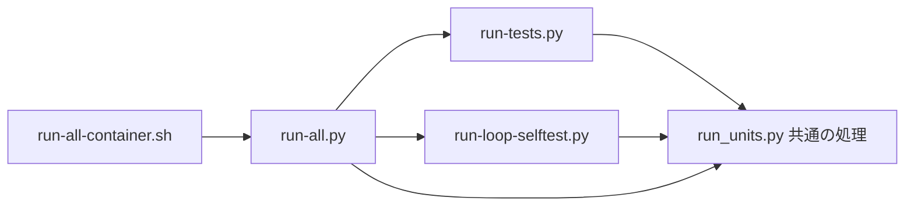

# テストの流し方(詳しい説明と時間の記録)

結論: 全回帰テスト(回帰テストをすべて流すこと)は `python3 -B scripts/run-all.py` の 1 つのコマンドで流す。
- 要点は [AGENTS.md](../AGENTS.md) の「検証」の節にある。この文書は、詳しい説明・決まり・時間の記録を持つ。
- 以前は、6 つのコマンドを別々に同時に始めていた。unittest は CPU の数の半分、loop-selftest は 4 分の 1 の枠(同時に動かすプロセスの数)を別々に持ち、先に終わった側の枠を、ほかが使えなかった。



## 全回帰テストのコマンド(run-all.py)

使い方(リポジトリ直下で実行する):

```bash
python3 -B scripts/run-all.py                      # 全部を流す
python3 -B scripts/run-all.py -j 8                 # 同時に流す枠の数(既定は使える CPU の数。1 未満は引数の誤り)
python3 -B scripts/run-all.py --log-dir DIR        # 全部の単位の出力を DIR/<鍵の : と / を _ にした名前>.log に残す
python3 -B scripts/run-all.py --weights-file PATH  # 重みの記録の置き場
python3 -B scripts/run-all.py --plan               # 流さずに、始める順を出して終わる
```

- 終了コード: 合格なら 0。ほかは 1。引数の誤りは 2。止めたときは 128 + シグナルの番号(最後の `結果:` の行は出さない)。
- `--log-dir` のフォルダが無いときは、引数の誤り。止めた単位の出力も、出力が閉じた後に残す。
- 環境変数は、そのまま各単位へ渡す。
  - loop-selftest の各プロセスには、環境に無いときだけ `LOOP_SELFTEST_TIMEOUT=6000`・`RUN_TIMEOUT=600` を足す。`LOOP_SELFTEST_ONLY` は節ごとに上書きする。
  - `LOOP_SELFTEST_PROGRESS` を妨げない。

### 単位と鍵

| 部 | 単位 | 鍵(重みの記録の鍵) | 表示名 |
|---|---|---|---|
| unittest | `run-tests.py` の全ファイルとシャード | `unittest:<ファイル>`(分けたときは `unittest:<ファイル>[<番号>/<数>]`。番号は 1 から) | `unittest <ファイル>`(分けたときは `unittest <ファイル> [<番号>/<数>]`) |
| loop-selftest | 全部の節と、節の外だけのプロセス | `loop:<節>`・`loop:(節の外だけ)` | `loop-selftest <節>`・`loop-selftest (節の外だけ)` |
| implement-guard-selftest | 下の「implement-guard の分け方」の単位 | `implement-guard:<単位>`(1 本のときは `implement-guard`) | `implement-guard-selftest.sh --only <単位>`(1 本のときは `implement-guard-selftest.sh`) |
| diff-snapshot-selftest | 1 本 | `diff-snapshot` | `diff-snapshot-selftest.sh` |
| review-agent-selftest・implement-agent-selftest | 枠の外で 1 本ずつ | `review-agent`・`implement-agent` | `review-agent-selftest.sh`・`implement-agent-selftest.sh` |

- 枠の外の 2 本は、待ちが主(CPU の時間 ÷ 壁時計が 0.08・0.04)なので、枠を使わせず、最初に始める。
- 部ごとの件数は、2 つのランナーの関数で照らし合わせる(unittest はシャードの総数と配った件数、loop は節の外の差し引きと節ごとに 1 件以上)。
  - implement-guard は、分けたとき単位ごとに 1 件以上。各 selftest は、結果の行があり、FAIL が 0 で、終了コードが 0。

### 重み

- 始める順は、重みの大きい順(同じなら与えた順)。重みは、重みの記録 → 表 → 既定の 200 秒の順に引く。
  - 表: unittest は `run-tests.py` の `WEIGHTS`(分けたファイルは「ファイルの重み ÷ 分ける数」)、loop の節は `run-loop-selftest.py` の `WEIGHTS`。implement-guard の単位・`implement-guard`(781 秒)・`diff-snapshot`(81 秒)・`loop:(節の外だけ)`(14 秒)は、`run-all.py` の定数。
  - 重みの記録にも表にも無い単位は、200 秒として早めに始める。軽い単位を早く始めても損は数秒。重い単位を最後に始めると、全体がその分延びる(`test_integrate_guard.py` が 2026-11-06 に起こした)。
- 重みの記録の置き場は `${XDG_CACHE_HOME:-~/.cache}/workflow-run-all/weights.json`(`--weights-file` で変える。フォルダが無ければ作る)。
  - `~/.cache/dev-workflow` と `~/.local/state/dev-workflow` の下には置かない(`pending-implementation.py scan` が走査する置き場のため)。
  - 形は `{"version": 1, "weights": {"<鍵>": <秒>}}`。
  - 成功した単位だけを書く。前の値があれば、前の値と今回の時間の平均にする(混み具合の揺れを均す)。止めた回は書かない。
  - 同じフォルダの一時ファイルに書いてから、置き換える。
  - 読めない・形が違うときは `注意: 重みの記録を読めない(…)` を出し、書けないときは `注意: 重みの記録を書けない(…)` を出して続ける。どちらも合否に効かせない。
- 回帰テスト(`scripts/test_run_all.py`)は、本物の HOME の記録に書かない(置き場を一時フォルダに向ける)。

### implement-guard の分け方

- `bash implement-guard-selftest.sh --list` が終了コード 0 で 1 行以上を返せば、その各行を単位にして、`--only <行>` で流す。
  - `--list` の単位は、群(A〜K・P)・M1〜M27・N1〜N13・わざと壊したコピーごとの L-a〜L-z。
  - 単位の和がケースをちょうど 1 回ずつ覆うことは、`--list` 自身が確かめる(覆わなければ終了コード 0 以外で終わる)。L-a〜L-z の分け方は selftest だけが知るので、`run-all.py` は書き直さない。
  - `run-all.py` は、行に空白・`,` が無いことと、同じ行が 2 つ無いことだけを確かめる。破っていれば、次の頭文字の一覧で流す。
- `--list` が終了コード 0 以外か、1 行も返さなければ、`ALL_CASES` の頭文字の一覧で流す。
  - `ALL_CASES` は `^ALL_CASES="([^"]*)"` で読み、空白で分けて ID の一覧にする(この道だけが読む)。
  - 流す前に、単位の一覧が `ALL_CASES` の全部の ID をちょうど 1 回ずつ覆うかを確かめる。規則は selftest の `want()` と同じ(`L` 以外の 1 文字は、その頭文字の全部。ほかは完全一致)。
  - 読めない・覆わないときは、1 本で流す。
- 頭文字の一覧か 1 本で流したときは、始めと最後に `警告: implement-guard-selftest.sh を <頭文字の一覧 | 1 本> で流した(<理由>)` を出す。
  - ただし、`--list` が無い版(終了コード 0 以外で、標準エラーが `ERROR: 不明な引数: --list` の 1 行だけ)で頭文字の一覧にしたときは出さない。
- どの形でも、件数を足し合わせて照らす。
- 毎回覆いを確かめる理由: `--list` や `ALL_CASES` の読み取りがケースを落としても、件数の照合(単位ごとに 1 件以上)では気づけないため。
- 各単位は、別のプロセスで、自分の一時フォルダと保護領域(`selftest-guard-XXXXXX`)を作る。置き場を先に作れば、取り合う物は無い。

### 始める前の確かめ

- `~/.local/state/dev-workflow` が無ければ作り、`置き場を作った: <パス>` を出す(`--plan` では作らない)。終わっても消さない。
  - `test_pending_implementation.py` と implement-agent・implement-guard の selftest は、この置き場を「無ければ作り、空なら消す」。
  - 置き場が無いまま同時に流すと、一方が消した直後に、他方が中に作れず落ちることがある(既知の取り合い。selftest の側は直していない)。
  - 同時に動くほかの流しが中に作ろうとする所で消すと、取り合いが戻る。そのため、最後に消さない。
- `git --version` を読み、`git: <出力>` を出す。
  - 2.42 より古ければ `警告:` の行を出す(最後の結果の行の前にも、もう一度出す。`--plan` では、最後の単位の行の後)。
  - 2.42 以上 2.45 未満なら `注意:` の行を出す(reftable の確かめ 3 件が skip になる)。
  - 版を読めなければ `警告: git の版を読めない(…)` を出す。
- `--plan` の出力は、1 行目が `計画: …`。その後に `git:` と警告の行、枠の外の単位(`枠の外  <表示名>`)、枠の単位を始める順に `<順番> <重み> 秒 <記録|表|既定> <表示名>` が続く。

### git の版の警告の根拠

| 版 | 起きること | 根拠 |
|---|---|---|
| 2.36 より古い | loop 系の回帰テストが、変更と関係なく落ちる | `loop.sh` が `git worktree list --porcelain -z` を使う。回帰テストは `loop.sh` を起動する |
| 2.42 より古い | 製品の `loop.sh` が `git var GIT_CONFIG_SYSTEM` を使えない | 2.39.5 は使い方の誤り(終了コード 129)、2.43.0 は `/etc/gitconfig` を返す(容器で確かめた)。回帰テストはこの処理を通らない(`loop-selftest.sh` が `GIT_CONFIG_SYSTEM` を export し、`test_loop_startup.py` が `GIT_CONFIG_NOSYSTEM=1` を付ける) |
| 2.45 より古い | reftable の確かめ 3 件が skip になる | `test_diagnostic_formats.py`・`test_diagnostic_view_edges.py` |

- 全部が通ると確かめたのは 2.56.0(容器のイメージ `workflow-test:jammy-gitppa-md`)。2.36〜2.55 で全部通るかは未確認。
- 作業機の git 2.34.1 では、loop 系のテストが変更と関係なく落ちる。

## 容器の入口(run-all-container.sh)

```bash
bash scripts/run-all-container.sh [--commit <rev> | --worktree] [--image <名前>] [--cpuset-cpus <一覧>] [--name <名前>] [--timeout <秒>] [--log-dir <ホストのフォルダ>] [-- <run-all.py の引数>…]
```

- 既定は `--commit HEAD`。`git archive <rev>` で取り出した中身を、標準入力で容器へ渡す。commit していない変更は混ぜない。
- `--worktree`: 追跡しているファイルと、無視されていない未追跡のファイル(実在するものだけ)を渡す。無視されたファイル(`.env` など)は渡さない。
- 容器の中で、中身を `~/w` に展開し、`git init` と 1 回の commit をする(`review-guard.py` の検証用のコピーと同じ形)。次の行を出してから、`timeout <秒> python3 -B scripts/run-all.py <引数>` を流す。
  - `git --version` と `python3 --version` の出力。
  - `容器の /tmp: <findmnt -no FSTYPE,OPTIONS /tmp の出力>`。tmpfs が exec で取り付けられていると、`noexec` が出ない。
  - `容器の /tmp での実行: できる`(`/tmp` に置いた小さなスクリプトを実行できたとき。できなければ `できない` を出して、終了コード 1 で止まる)。
- `--timeout` の既定は 3600 秒(`0` なら timeout を付けない)。時間切れの終了コードは 124。
- イメージは、`scripts/container/Dockerfile` と `requirements-dev.txt` の中身の sha256 の先頭 12 桁を名前に入れる(`workflow-test:run-all-<12 桁>`)。無ければ作る。どちらかを変えれば、次の回に作り直す。
  - 作るときは、一時フォルダに 2 つのファイルだけを置いて `docker build` する(リポジトリ全体を送らない)。
  - `--image` を渡せば、そのイメージを使う(作らない)。
  - git は PPA(`ppa:git-core/ppa`)の最新で、版を固定できない。流した版は、PR の本文の「流した環境」の行に残す。
  - `PyYAML`・`markdown-it-py`・`mdurl` は、root でシステムの置き場に入れる。利用者別の依存を読む順序を確かめるテストがあるため、利用者別の置き場には入れない。
- `docker run --rm -i --init --tmpfs /tmp:rw,exec,nosuid,nodev,size=16g`
  - `/tmp` を tmpfs にするのは、速く、終われば消えるため。既定の noexec では、テストが `/tmp` に置くスタブを実行できないので、exec にする。
  - `--init` は、容器の最初のプロセスがシグナルを子へ渡し、終わった子を回収するため。
  - `--cpuset-cpus`・`--name` は、渡されたときだけ付ける。
- 重みの記録は、ホストの `${XDG_CACHE_HOME:-~/.cache}/workflow-run-all` を作り、容器の `/home/tester/.cache/workflow-run-all` に取り付けて、回をまたいで使う。
  - 作れなければ `注意: 重みの記録のフォルダを作れない(<パス>)。容器の中だけで記録する` を出し、取り付けずに続ける。
  - 限界: ホストの利用者の uid が 1000(容器の `tester`)でないと、容器から書けない。そのときは `run-all.py` が `注意: 重みの記録を書けない(…)` を出し、流す結果には効かない。
  - 取り付け先の親の `/home/tester/.cache` は、イメージの中で `tester` の持ち物として作っておく(無いと、docker が root の持ち物で作り、`tester` は `~/.cache` に書けなくなる)。
- `--log-dir <ホストのフォルダ>`: 容器の `/home/tester/run-all-logs` に取り付け、`run-all.py` に `--log-dir /home/tester/run-all-logs` を渡す。フォルダが無ければ引数の誤り。
- docker の既定の context が違う機械では、`DOCKER_CONTEXT=<名前> bash scripts/run-all-container.sh …` で流す。
- 終了コードは、容器の中のコマンドの終了コード(時間切れは 124)。引数の誤りは 2。

## 2 つのランナー(部分だけ流すとき)

作業の途中に一部だけ流す入口として、2 つのランナーは使い方・出力の行・終了コード・`-j` の既定を変えずに残している。子の起動と止め方・並べ方・失敗の出力は、`scripts/run_units.py` が持つ。

### run-tests.py(unittest)

回帰テスト(`scripts/test_*.py`)は `scripts/run-tests.py` で流す。

- 作業の途中は、変えたファイルに関係するテストのファイルだけを流す。例: `python3 -B scripts/run-tests.py test_validate.py test_writing_rules.py`
  - 関係するテストのファイルは、`grep -l '<変えたファイルの名前>' scripts/test_*.py` で探す。
- merge の前は、`run-all.py` で全部を流す(AGENTS.md の「検証」の節)。

- テストのファイルごとに別のプロセスを起動する。同時に流すのは、使える CPU の数の半分まで。数は `-j <数>` で変える。
  - 数を増やしすぎるか、機械が混むと、`test_loop_startup.py` のテストが時間切れで落ちることがある。たいていは、失敗の文の先頭に `時間切れ:` が出る(出ないと分かっている 1 つは下に書いた。ほかに無いかは確かめていない)。
    - `時間切れ: <秒> 秒の上限に当たった` は、1 通りの確かめ(`run_case` の 1 回)の上限に当たった。上限は既定で 300 秒。`LOOP_STARTUP_CASE_TIMEOUT=<秒>` を付けて延ばすか、数を減らして流し直す。
      - 1 回の `loop.sh` の上限(`RUN_TIMEOUT`)は、1 通りの上限より短ければ、1 通りの上限と同じにする。先に 1 通りの上限に当たり、この文が出る。
      - 止めた後に、別のプロセスグループの `loop.sh` が、渡した `RUN_TIMEOUT` の秒数より短い間、残ることがある。この秒数は、ふつうは 1 通りの上限と同じ。環境の `RUN_TIMEOUT` が上限より大きいとき(例: 600 を export している)は、その秒数になる。
    - `時間切れ: 起動の印 <名前> が 100 秒待っても現れない` は、背景で起動した `loop.sh` が、100 秒たっても子を起動せず、まだ動いていた。
      - この 100 秒は延ばせない。`loop-selftest.sh` が背景の `loop.sh` を 150 秒で止めるため、それより短くしている。
      - ほかの重い処理が止まるのを待ってから流し直す。
    - `背景の loop.sh が起動の印 <名前> の前に終わった(終了コード <数>)` は、時間切れではない。背景の `loop.sh` が、子を起動する前に終わった。流し直さずに、続く出力で理由を調べる。
    - `時間切れ:` が出ない時間切れ: 背景の `loop.sh` が、子を起動した後に `loop-selftest.sh` の 150 秒(`start_bg`)で止められた。
      - `test_term_during_next_child_does_not_reuse_a_prior_verified_state` の終了コード 92 になる(背景の `loop.sh` の終了コードが 143 でなく 137)。
    - ほかにも短い上限がある。当たるかは未確認(出力が残っている回〈下の表の 7 回目の 13 件と、#224 の作業の全回帰テストの 5 件〉では当たっていない): `loop-selftest.sh` の `COMMON_ARGS` が `loop.sh` に渡す `--net-timeout 10` と、`test_loop_startup.py` の `wait_dead "$CHILD" 5`(`test_stop_file_with_inflight_requires_confirmation_then_stops_normally` の終了コード 79 と、`test_term_during_next_child_does_not_reuse_a_prior_verified_state` の終了コード 93)。
- 重いファイルは、その中のテストを複数のプロセスに分けて流す。分ける数は `run-tests.py` の `SHARDS` にある。
- 失敗したプロセスの出力は、最後にまとめて出る。
- 限界: 入れ子の実行で、内側の別のグループの子孫が合図を無視すると、外側の SIGKILL の後に残ることがある。そのときは、残ったプロセスを pid を指定して止める。
- 件数と結果は、1 つのプロセスで順に流す `python3 -m unittest discover -s scripts -p 'test_*.py'` と同じ。
- テストのファイルを足すときは、ほかのテストと同じパスの一時フォルダ・ポートを使わない。`HOME` の下に作るときは、一意な名前のフォルダにする。同時に流すと取り合うため。

### run-loop-selftest.py(loop-selftest)

`loop-selftest.sh` は `scripts/run-loop-selftest.py` で、節ごとに分けて並べて流す。

- 節は、`loop-selftest.sh` の最上位(ほかの `if` や関数の中でない所)に、行頭の 1 行で書いた `if want <節>; then` で始まるまとまり(2026-11-05 で 30 個)。1 つの節を 1 つのプロセスで流す(`LOOP_SELFTEST_ONLY=<節>`)。
- 作業の途中は、変えた所に関係する節だけを流してよい。例: `python3 -B scripts/run-loop-selftest.py perm d22`
  - 節の名前は `grep '^if want' plugins/dev-workflow/skills/ship-task/scripts/loop-selftest.sh` で見る。
- 同時に流すのは、使える CPU の数の 4 分の 1 まで。数は `-j <数>` で変える。
  - 既定を小さくしているのは、`run-tests.py`(CPU の数の半分)と同時に流すため。足しても CPU の数を超えない。
  - 全回帰テストで `-j 6` にすると、全体は 143 秒短くなったが、2 つ落ちた(2026-11-05 の容器。16 CPU・load の平均 17.7)。
    - judge の節: 17 個のタスクを 1 回で回す `loop.sh` の起動が、そのときの値の `RUN_TIMEOUT=300` に当たった(`期待 0・実際 124`)。
    - `test_loop_startup.py` の 1 件: 片付けの途中で、git が裏で動かす保守の処理とファイルを取り合った。
  - judge の節で `期待 0・実際 124` か `期待 0・実際 137` が出たら、`-j` を減らすか、`RUN_TIMEOUT` を延ばして流し直す。
- 節の外の確かめ 3 件(最初のスタブの証明 2 件と、最後の後片付けの 1 件)は、どのプロセスでも流れる。
  - そのため、どの節も選ばないプロセスを 1 つ足して、その件数を測る。合計では 1 回分だけ数える。
  - 差し引くのは、節の外の確かめが、どのプロセスでも同じ名前で PASS したときだけ。
- 件数と結果は、1 本で流す `bash plugins/dev-workflow/skills/ship-task/scripts/loop-selftest.sh` と同じ。
  - 2026-11-05 に容器で確かめた。PASS の件数は次のとおり。
    - 1 本で流す: 3547〜3548 件。
    - 節を 1 つずつ順に流す: 3547 件。
    - 分けて並べて流す(下の表で loop-selftest が合格した 1・3・4・6・8 回目): 3546〜3547 件。
  - 確かめの名前の一覧を 1 本で流したときと比べたのは、節を 1 つずつ順に流した回と、下の表の 1・6・8 回目。3・4 回目は件数だけを比べた(節ごとの出力を残していない)。
  - 比べた回では、名前の一覧は同じだった。違うのは「人の確認後に試験用の子を片付けた」の数だけだった。
    - この確かめは、その時に生きている、テスト用に起動した子の数だけ出るので、1 本で流しても揺れる(1 本で 63〜64 件・分けて 62〜63 件。`-j 6` で流した参考の回は 64 件)。
- 次のときは「異常:」を出し、終了コード 1 で終わる。
  - 節の形を読めない。流す前に止まる。形は、bash 自身にファイルを読ませて確かめる(先に `bash -n` で読めることを確かめ、それから定義だけして、実行はしない)。
    - bash で読めない(構文の誤り・余分な `}` など)。
    - want を、最上位の `if want <節>; then` の外で呼んでいる(`elif want`・入れ子の `if want`・`want <節> && …`・`X=1 want …`・`time -p want …`・複数行の `$( … )` やバッククォートの中・`coproc want …`・`trap 'want …' …` など)。
    - 最上位の `if want <節>; then` に `else` か `elif` がある。その側は、ほかの全部のプロセスで流れ、1 本で流すと流れないため。
    - 最上位の `if want` が、行頭の 1 行の `if want <節>; then` の形でない(名前を引用符で囲む・変数で渡す・`then` を次の行に書く)。
    - どれかの所が、2 つのプロセスで流れるか、どのプロセスでも流れない形になっている(単独の節を 2 つ見る `if want <節> || want <節>` など)。
  - 結果の行(`結果: PASS <数> 件 / FAIL <数> 件`)が無い。時間切れ(終了コード 124)などのとき。
  - 節の確かめが 1 件も流れていない。
  - 節の外の確かめが、どれかのプロセスで落ちた。差し引きをやめ、最後の行は `結果: 件数は不明(上の「異常:」を見る)/ <秒> 秒` になる。
- 失敗したプロセスの出力は、最後にまとめて出る。全部のプロセスの出力を残すときは `--log-dir <フォルダ>` を付ける。
- 節を足すときは、次の決まりを守る。
  - 行頭に `if want <節>; then` と 1 行で書き、対の `fi` も行頭に置く。名前は引用符で囲まない。
  - 最上位の `if want <節>; then` の行のほかでは、want を呼ばない。その `if` に `else`・`elif` を付けない。
  - 節の中では、ほかの節が作った変数・関数・ファイルを使わない。分けて流すと、ほかの節は流れないため。
  - `run-loop-selftest.py` が流す前に止めるのは、正規表現が見つける形(上の「節の形を読めない」に挙げた形など)。
    - 正規表現で見るので、見つけられない書き方もありうる(例: 変数に入れた名前で呼ぶ `f=want; $f <節>`・実行中に組み立てた文字列を `eval` する)。
    - 止まらなくても、決まりを破れば件数が合わなくなる。決まりを守れば、どれも書かずに済む。
    - 呼び出しでない文字列でも止まることがある(例: コードの行の `echo "(want delta)"`、ヒアドキュメントの中の `we (want to) go`・`| want x |`・Python の `if want != got:`・`while want != 0:`)。そのときは、言い回しか変数の名前を変える(Python の変数名は want 以外にする)。
- 限界: 止めたときに、`loop-selftest.sh` が別のプロセスグループで起動した子(`loop.sh` など)が、`RUN_TIMEOUT` の秒数まで残ることがある。そのときは、残ったプロセスを pid を指定して止める。
  - `loop-selftest.sh` の一時フォルダ(`mktemp -d` で作る。既定は `/tmp/tmp.*`)も、後片付けが走らずに残ることがある。
  - 残った一時フォルダは、中断の行の後に `残った一時フォルダ(<節>。確かめてから消す): <パス>` と出る。中を確かめてから消す。
  - この表示の前に、止めた全部のプロセスの出力が閉じるのを、時間で切らずに待つ。別のプロセスグループの子が標準出力を開いたまま残ると、その子が終わるまで待つ。

## 全回帰テストの手順の経緯(run-all.py の前)

`run-all.py` の前は、次の手順で流していた。

1. `mkdir -p ~/.local/state/dev-workflow` で置き場を作る(今は `run-all.py` が作る)。
   - `test_pending_implementation.py` と implement-agent・implement-guard の selftest は、この置き場を「無ければ作り、空なら消す」。
   - 置き場が無いまま同時に流すと、一方が消した直後に、他方が中に作れず落ちることがある(既知の取り合い。selftest の側は直していない)。
2. 次の 6 つを同時に始める。
   - `LOOP_SELFTEST_TIMEOUT=6000 RUN_TIMEOUT=600 python3 -B scripts/run-loop-selftest.py`
   - `python3 -B scripts/run-tests.py`
   - review-agent・implement-agent・diff-snapshot・implement-guard の selftest(`bash plugins/dev-workflow/skills/do-task/scripts/<名前>-selftest.sh` の 4 つ)
3. 6 つすべての終了コードが 0 なら合格。

- `run-loop-selftest.py` を単独で流すときは、`LOOP_SELFTEST_TIMEOUT=6000 RUN_TIMEOUT=600` を自分で付ける(`run-all.py` は、環境に無いときだけ足す)。
  - `LOOP_SELFTEST_TIMEOUT` は、1 つのプロセス(節 1 つ)の全体の上限の秒数。既定は 1500 秒。
  - `RUN_TIMEOUT` は、止まった `loop.sh` を打ち切るまでの秒数(`loop.sh` の 1 回の起動ごと)。既定は 150 秒。
    - `loop-selftest.sh` で `RUN_TIMEOUT` を使うのは、`timeout -k 5 "${RUN_TIMEOUT:-150}"` の 1 か所だけ。延ばしても、確かめる中身は変わらない。
  - 600 にするのは、並べて流すと 1 つの節が遅くなるため。judge の節(17 個のタスクを 1 回の `loop.sh` で回す)は、300 秒を超えることがある。
    - 2026-11-05 の容器で、`RUN_TIMEOUT=300` では judge の節が FAIL 19 件になった(`期待 0・実際 137`。300 秒の後の SIGKILL で止められた。下の表の 2 回目)。
    - `RUN_TIMEOUT=600` では 6 つとも合格した(下の表の 3・4・8 回目)。ただし、混んだ機械では 600 でも落ちることがある(5・7 回目と、表の下を見る)。
  - 1 本で流す `bash plugins/dev-workflow/skills/ship-task/scripts/loop-selftest.sh` には、前から `LOOP_SELFTEST_TIMEOUT=6000 RUN_TIMEOUT=300` を付けてきた(下の表の「変える前」は、この値で測った)。
  - 既定の上限のままだと、混んだ機械では変更前の main でも、時間切れ(rc 124)や「判定」の群の FAIL 15 件になった(2026-11-05、別の作業で 1 本で流したときの実測)。

## 時間の記録

### 2026-11-05(6 つを別々に同時に流していた時代)


- 2026-11-05 の容器での時間。変えた後の回は、流した順に番号を付けた。「ほかのコンテナ」は、同じ機械で動いていた、ほかのセッションのコンテナの数で、いつ見た数かも書いた:

| 流し方 | `RUN_TIMEOUT` | ほかのコンテナ | 全体 | unittest | loop-selftest | 結果 |
|---|---|---|---|---|---|---|
| 変える前: `run-tests.py` と、`bash loop-selftest.sh` を含む 5 本を同時に流す | 300 | 流している間に 30 秒ごとに見て 0〜2 個(3980 秒の回は未記録) | 3847〜3980 秒 | 513〜525 秒 | 3847〜3980 秒 | すべて合格 |
| 変えた後の 1 回目: 上の 6 つを同時に流す | 300 | 流している間に 30 秒ごとに見て 0〜1 個 | 1335 秒 | 534 秒 | 1335 秒 | すべて合格(loop-selftest は PASS 3546 件) |
| 変えた後の 2 回目: 同上 | 300 | 未記録 | 1481 秒 | 685 秒 | 1481 秒(judge の節は 634 秒) | judge の節が FAIL 19 件。ほかの 5 つは合格 |
| 変えた後の 3 回目: 同上 | 600 | 未記録 | 1410 秒 | 595 秒 | 1409 秒 | すべて合格(loop-selftest は PASS 3546 件) |
| 変えた後の 4 回目: 同上 | 600 | 未記録 | 1314 秒 | 588 秒 | 1312 秒 | すべて合格(loop-selftest は PASS 3547 件) |
| 変えた後の 5 回目: 同上 | 600 | ほかのセッションの全回帰テストのコンテナが動いていた(数は未記録。load の平均 17) | 2060 秒 | 1074 秒 | 2059 秒 | 落ちた(表の下) |
| 変えた後の 6 回目: 同上 | 600 | 始めた時 0 個 | 1511 秒 | 731 秒 | 1509 秒 | unittest の 1 件が落ちた(表の下)。loop-selftest は合格(PASS 3547 件) |
| 変えた後の 7 回目: 同上 | 600 | 途中から 2 個(load の平均は最大 31) | 2832 秒 | 1065 秒 | 2830 秒 | 落ちた(表の下) |
| 変えた後の 8 回目: 同上 | 600 | 始めた時 0 個 | 1475 秒 | 569 秒 | 1474 秒 | すべて合格(loop-selftest は PASS 3547 件) |

- 混んだ機械では、`RUN_TIMEOUT=600` でも時間切れで落ちる。落ちたら、ほかの重い処理が止まるのを待ってから流し直す。
  - 5 回目: judge でない humanconfig の節が FAIL 3 件。`test_loop_startup.py` が 19 件失敗し、`test_shell_requirements.py` が 1 件エラーになった。ほかの 4 本は合格。
  - 7 回目: judge の節が FAIL 9 件(`期待 0・実際 124`。1 回の起動が `RUN_TIMEOUT=600` に当たった)。`test_loop_startup.py` が 13 件落ちた(12 件は中の時間切れ 100 秒の後の SIGKILL〈`-9`〉、1 件は終了コード 91)。
  - `test_loop_startup.py` の落ち方を、出力が残っている回について Issue #352 で調べた。7 回目の 13 件と、#224 の作業の全回帰テストの 5 件は、どれも時間切れだった。5・6 回目は出力が残っておらず、理由は未確認。
    - `-9` と終了コード 124 は、1 通りの確かめの上限(当時 100 秒)に当たった。#352 で既定を 300 秒に延ばし、`LOOP_STARTUP_CASE_TIMEOUT` で変えられるようにした。
    - 終了コード 91 は、起動の印を待つ上限(当時 35 秒)に当たった。#352 で 100 秒に延ばした。
- 6 回目は、loop-selftest は合格し、`test_loop_startup.py` の 1 件(HUP の場合)だけが落ちた。始めた時のほかのコンテナは 0 個、load の平均は 4.19。落ちた理由(時間切れかどうか)は未記録(unittest の出力を残していない)。

- implement-guard-selftest(ほかの 4 本で最長)は、変える前に 811 秒、変えた後の 1 回目に 880 秒だった。
- 変えた後も、全体の時間は loop-selftest で決まる。
  - 節を 1 つずつ順に流した時間の和は 4065 秒(30 節の 4054 秒と、節の外だけのプロセスの 11 秒)。
  - 4 つずつ並べると、各節が遅くなる。1 回目は、31 プロセスの時間の和が 5289 秒(1.3 倍)になり、全体は 1335 秒だった。
  - 最も重い節は discover(順に流して 639 秒・並べて 904 秒)。次は breakers(437 秒)・judge(393 秒)・humanconfig(327 秒)。
  - `bash loop-selftest.sh` を 1 本で、ほかのテストと同時でなく流すと 3718 秒。

### 2026-11-06 の実測と模擬(run-all.py を作る前の調べ)

- 6 つとも合格した(容器・16 CPU)。全体は 1092 秒で、loop-selftest の節の和 4330 秒 ÷ 4 枠で決まった。

| 部 | 時間 |
|---|---|
| loop-selftest | 1092 秒 |
| unittest | 560 秒 |
| implement-guard-selftest | 781 秒 |
| implement-agent-selftest | 293 秒 |
| review-agent-selftest | 188 秒 |
| diff-snapshot-selftest | 81 秒 |

- unittest の全体の終わり(560 秒)を決めたのは、`test_integrate_guard.py`(447 秒に始まり 560 秒に終わった)。重みの表に無く、最後に始まったため。
- 件数: unittest 1780 件・loop-selftest 3546〜3548 件・review-agent 343 件・implement-agent 344 件・diff-snapshot 983 件・implement-guard 1731 件。
- 全部の単位を 1 つの共通の枠(16 枠でも 12 枠でも)に入れ、重い順に始めると、実測の時間で模擬して 781 秒になる(implement-guard-selftest を 1 本で流すとき。その後は、最も重い単位で止まる)。
  - 模擬に使った単位の時間は、6 本を同時に流したとき(CPU の時間 ÷ 壁時計の合計が約 11.3、load の平均 12.6)に測った値。1 つの枠に詰めると合計が上がり、単位の時間は延びうる。
  - 時間切れまでの余裕: `test_loop_startup.py` の最長のテスト 159 秒に対して 1 通りの上限 300 秒。judge の節の最長の 1 回 254 秒に対して `RUN_TIMEOUT` 600 秒。
- 全回帰テストの番では、load の平均と最大、`test_loop_startup.py` の各シャードと judge の節の時間を記録する。時間切れで落ちたら、`-j` を減らして流し直し、既定を下げる案を報告に書く。

